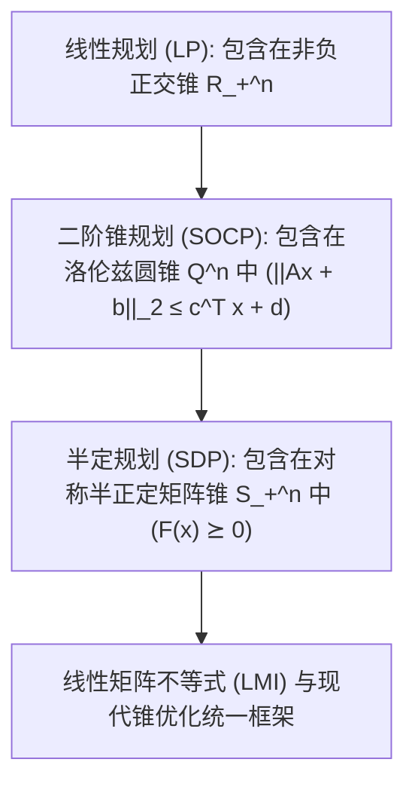

# Lec 13 凸优化基础、二阶锥规划 (SOCP) 与半定规划 (SDP) (Convex Optimization Foundations: SOCP and Semidefinite Programming)

> MIT 15.C57 优化方法 · 讲义 13

## TL;DR

- 凸优化确立了“局部最优即全局最优”的数学基石，将优化问题划分为凸与非凸两大世界。
- 二阶锥规划（SOCP / Lorentz Cone）将范数锥约束纳入多项式内点法高效求解体系。
- 半定规划（SDP）在对称半正定锥上优化线性矩阵不等式（LMI），成为控制论与组合松弛的核心支柱。
## 凸优化的分水岭哲学

最优化宗师洛克菲勒（R. T. Rockafellar）在 1993 年著名的 SIAM Review 综述中留下一句奠定现代运筹学基调的至理名言：
> **“最优化问题的伟大分水岭，并非线性与非线性之间的对立，而是凸性（Convexity）与非凸性（Nonconvexity）之间的分水岭。”**

考虑凸优化问题（Convex Optimization Problem）：
$$
\min_{x} f(x) \quad \text{s.t.} \quad g_i(x) \le 0, \; i=1,\dots,m; \quad A x = b
$$
其中目标函数 $f(x)$ 与所有不等式约束函数 $g_i(x)$ 均为凸函数，等式约束必须为仿射变换。

凸规划拥有三项在工程上具有决定性意义的公理化性质：
1. **任意局部极小值点必然是全局极小值点**；
2. **所有最优解的集合是一个连通凸集**；
3. **基于自和谐阻碍函数（Self-Concordant Barriers）的内点法保证在多项式时间内求解至任意预设精度**。

在现代凸分析中，这三类规划被统一统摄在**锥规划（Conic Programming）**的宏大版图之下：
$$
\min_{x} c^\top x \quad \text{s.t.} \quad A x - b \in \mathcal{K}
$$
其中 $\mathcal{K}$ 为真锥（Proper Cone）。当 $\mathcal{K}$ 分别为非负正交锥、二阶圆锥或半正定锥时，自然对应 LP、SOCP 与 SDP。

## 二阶锥规划 (SOCP) 与几何范数优化

二阶锥（Second-Order Cone, SOC），又称**洛伦兹锥（Lorentz Cone）**或冰淇淋锥，定义在 $\mathbb{R}^{n+1}$ 中：
$$
\mathcal{Q}^{n+1} = \left\{ (x, t) \in \mathbb{R}^n \times \mathbb{R} : \|x\|_2 \le t \right\}
$$

一个标准的**二阶锥规划（SOCP）**模型由若干组圆锥不等式构成：
$$
\begin{aligned}
\min_{x} \quad & f^\top x \\
\text{s.t.} \quad & \|A_i x + b_i\|_2 \le c_i^\top x + d_i, \quad i = 1, \dots, m
\end{aligned}
$$

SOCP 具有惊人的表达能力，能够无缝吸纳如下复杂非凸/非线性几何约束：
1. **凸二次规划（QP / QCQP）**：
   约束 $x^\top P x + q^\top x + r \le 0$（其中 $P \succeq 0$）。
   通过 Cholesky 分解 $P = R^\top R$，并利用双曲代数恒等式 $4 u v = (u + v)^2 - (u - v)^2$，可严格重塑为二阶锥：
   $$
   \left\| \begin{pmatrix} 2 R x \\ 1 + q^\top x + r \end{pmatrix} \right\|_2 \le 1 - q^\top x - r
   $$
2. **高斯信道鲁棒天线波束赋形**与投资组合方差极小化。

## 半定规划 (SDP) 与线性矩阵不等式 (LMI)

当锥结构从有限维向量拓展至矩阵空间时，我们进入了现代凸优化的最高峰——**半定规划（Semidefinite Programming, SDP）**。
设 $\mathcal{S}^n$ 为 $n \times n$ 实对称矩阵空间。定义半正定锥（Positive Semidefinite Cone）：
$$
\mathcal{S}_+^n = \left\{ X \in \mathcal{S}^n : v^\top X v \ge 0, \; \forall v \in \mathbb{R}^n \right\} = \{ X \succeq 0 \}
$$

SDP 的标准原始形式为：
$$
\begin{aligned}
\min_{X \in \mathcal{S}^n} \quad & \langle C, X \rangle = \text{Tr}(C X) \\
\text{s.t.} \quad & \langle A_i, X \rangle = \text{Tr}(A_i X) = b_i, \quad i = 1, \dots, m \\
& X \succeq 0
\end{aligned}
$$
其对应的对偶形式表现为著名的**线性矩阵不等式（Linear Matrix Inequality, LMI）**：
$$
\max_{y \in \mathbb{R}^m} \quad b^\top y \quad \text{s.t.} \quad C - \sum_{i=1}^m y_i A_i \succeq 0
$$

::: theorem [锥对偶与 Nesterov-Nemirovski 多项式内点法]
1994 年 Yurii Nesterov 与 Arkadi Nemirovski 建立了著名的自和谐对偶理论，证明了对称锥（Symmetric Cones）上的通用内点法：
对于维度为 $n$、包含 $m$ 个约束的 SDP，原对偶路径跟踪内点法（Primal-Dual Path-Following IPM）所需的迭代步数严格满足：
$$
N_{\text{iter}} = O\left( \sqrt{n} \ln\left( \frac{1}{\epsilon} \right) \right)
$$
单步仅涉及 Cholesky 分解与线性代数求解，从根本上确立了 SDP 在理论多项式时间内的绝对可解性。
:::

::: insight [从组合 NP-hard 到量子信息的 SDP 桥梁]
半定规划在现代科学中扮演着横跨数个学科的超强引擎角色：
在理论计算机科学中，它是破解 NP-hard 极值难题最强大的凸松弛工具（如 Goemans-Williamson MAXCUT 算法）；
在现代控制工程中，李雅普诺夫动态系统渐进稳定性判据可完全等价写为一组 LMI 求解；
在量子信息理论中，密度矩阵的纠缠见证（Entanglement Witnesses）与量子信道保真度直接构成了天然的半正定规划。掌握锥优化，即掌握了现代应用数学最前沿的计算语言。
:::
