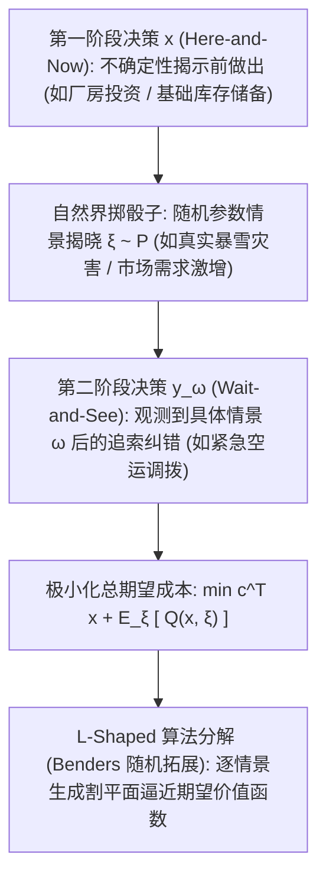

# Lec 14 随机规划：两阶段追索模型与机会约束 (Stochastic Programming: Recourse Models and Chance Constraints)

> MIT 15.C57 优化方法 · 讲义 14

## TL;DR

- 随机规划将未来不确定性刻画为已知概率分布下的显式场景树与期望效用极小化。
- 两阶段追索模型（Two-Stage Stochastic Program with Recourse）区分先行不可悔决策与后行补偿纠错。
- 深入拆解大数样本均值近似（SAA）、L-Shaped 算法求解及高风险机会约束（Chance Constraints）。
## 不确定性下的决策挑战

在此前讨论的经典数学规划中，我们默认模型的所有参数（客户需求 $d$、设备故障率、原材料现货价格、风力光伏发电功率）均为完美已知的确定性实数。
然而，真实世界本质上充斥着随机波动与物理不确定性。
若直接将随机变量简单粗暴地替换为其数学期望（Expected Value），常常会遭遇运筹学中著名的**“平均值谬误”（Flaw of Averages）**：
$$
\mathbb{E}[f(x, \xi)] \neq f(x, \mathbb{E}[\xi])
$$
根据 Jensen 不等式，对于凸成本函数，根据平均值规划出的生产方案，在真实随机扰动冲击下的实际运营成本期望，必然显著恶化甚至全面导致生产线崩溃断供！

1955 年乔治·丹齐格（George Dantzig）创立了**随机规划（Stochastic Programming）**，系统构建了在已知随机变量联合概率分布 $\mathbb{P}(\xi)$ 的前提下，寻找数学期望性能最优的稳健决策理论。

## 两阶段追索模型 (Two-Stage Recourse Models)

两阶段随机规划将系统的决策时间轴清晰划分为两个离散窗口：
1. **第一阶段“此时此刻”决策（Here-and-Now Decision $x$）**：
   在任何随机事件揭晓之前必须立即做出的先决承诺决策（如基建容量、航线规划）；
2. **第二阶段“走着瞧”追索决策（Wait-and-See Recourse Decision $y_\omega$）**：
   当随机事件的具体情景 $\omega$ 发生后，决策者依据实际现实所采取的自适应弥补与纠偏行动（如弃风限电、外包代工）。

标准的具有固定补偿的两阶段随机规划模型表述为：
$$
\begin{aligned}
\min_{x \in X} \quad & c^\top x + \mathcal{Q}(x) \\
\text{s.t.} \quad & A x = b
\end{aligned}
$$
其中期望追索价值函数 $\mathcal{Q}(x)$ 定义为在随机测度下的数学积分：
$$
\mathcal{Q}(x) = \mathbb{E}_{\xi} [ Q(x, \xi) ] = \int_\Omega Q(x, \xi(\omega)) \, d\mathbb{P}(\omega)
$$
情景 $\omega$ 下的第二阶段从问题为：
$$
Q(x, \xi) = \min_{y \ge 0} \left\{ q(\xi)^\top y : W y = h(\xi) - T(\xi) x \right\}
$$
其中 $W$ 为补偿矩阵（Recourse Matrix），$T$ 为技术传递矩阵。

::: theorem [两阶段随机凸性定理]
若第二阶段问题对所有可能的情景均可行（相对完备追索 / Relatively Complete Recourse），则期望价值函数 $\mathcal{Q}(x)$ 是关于第一阶段决策变量 $x$ 的**严格凸函数**。
因此，两阶段随机线性规划本质上是一个良态的连续凸规划！
:::

## 样本均值近似 (SAA) 与 L-Shaped 算法

当随机变量连续分布或包含成千上万种场景组合时，计算高维积分 $\mathbb{E}[Q(x, \xi)]$ 属于数值不可行。两大主流计算求解方案包括：

### 1. 样本均值近似 (Sample Average Approximation, SAA)
利用蒙特卡洛采样独立抽取 $N$ 个独立同分布场景 $\{\xi^1, \dots, \xi^N\}$，将连续概率测度离散化为经验平均：
$$
\min_{x} \left\{ c^\top x + \frac{1}{N} \sum_{s=1}^N Q(x, \xi^s) \right\}
$$
大数定律与大偏差理论保证：只需抽取多项式规模的样本数 $N = O\left( \frac{n}{\epsilon^2} \ln\left( \frac{1}{\delta} \right) \right)$，SAA 解的真实期望误差即以至少 $1 - \delta$ 的概率被控制在 $\epsilon$ 以内。

### 2. L-Shaped 算法 (Slyke-Wets 分解)
L-Shaped 算法是 Benders 分解在随机场景下的绝妙泛化。
主问题维护 $x$ 与期望成本下界标量 $\theta$。算法并行求解所有 $N$ 个场景的对偶从问题，计算各情景对偶乘子 $\pi^s$ 的加权平均值 $\bar{\pi} = \sum p_s \pi^s$，向主问题回传一条聚合的**多场景平均最优割（Optimality Cut）**：
$$
\theta \ge \sum_{s=1}^N p_s (\pi^s)^\top \left( h^s - T^s x \right)
$$
实现了对海量分布式并发情景的极速解耦。

## 机会约束规划 (Chance Constraints)

在某些严苛工程系统中（如核反应堆冷却水位控制或心脏起搏器电池余量），由于物理损坏成本无穷大，决策者不满足于“平均期望成本合格”，而是要求**系统违背约束的安全事故概率被严格锁死在极小置信水平 $\alpha$ 之内**：
$$
\mathbb{P}\left( A(\xi) x \ge b(\xi) \right) \ge 1 - \alpha
$$
其中 $\alpha \in (0, 0.05]$ 为预设的风险容忍上限（如 99% 的可靠度）。

::: pitfall [机会约束的非凸性陷阱]
机会约束的连续形式极其险恶：**即便原始约束 $A x \ge b$ 严格是线性的，满足概率大于 $1-\alpha$ 的可行域集合通常也是极度非凸、甚至严重断裂碎片化的！**
直接求解机会约束往往是 NP-hard 的。现代工程通常利用马尔可夫不等式、切诺夫界或条件在险价值（CVaR）将其保守近似松弛为一个可计算的凸二阶锥（SOCP）模型。
:::

::: insight [信息价值的数学量化：EVPI 与 VSS]
随机规划为现代管理学贡献了两个极具穿透力的量化指标：
1. **完全信息期望价值（Expected Value of Perfect Information, EVPI）**：量化了企业为了在事前预知未来的确切天气或市场状态，所愿意向咨询公司支付的最高咨询费上限；
2. **随机解的价值（Value of Stochastic Solution, VSS）**：量化了企业采用现代随机优化模型相比采用粗糙的“平均值模型”所能直接节省的真实真金白银运营成本。运筹优化将不确定性风险的对冲价值精确量化为了资产负债表上的显式数字。
:::
