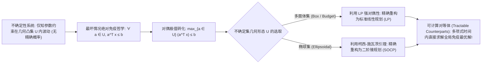

# Lec 15 鲁棒优化：多面体与椭球不确定集及其对等体 (Robust Optimization: Polyhedral, Ellipsoidal Uncertainty Sets and Tractable Counterparts)

> MIT 15.C57 优化方法 · 讲义 15

## TL;DR

- 鲁棒优化（Robust Optimization）摆脱对精确概率分布的脆弱依赖，追求最坏情况免疫保障。
- 多面体不确定集（Box / Polyhedral）利用线性规划强对偶性转化为标准等价 LP。
- 椭球不确定集（Ellipsoidal Sets）通过柯西-施瓦茨不等式精确重塑为二阶锥规划（SOCP）。
## 分布脆弱性与鲁棒优化的范式飞跃

上一讲讨论的随机规划建立在一个极其沉重的先验前提之上：**假设决策者能够百分之百精确获知未来随机扰动的真实概率分布 $\mathbb{P}(\xi)$**。
然而，在真实工程与金融实践中，这几乎是一个不可能达成的奢望：
- 历史数据往往极其匮乏（如百年一遇的新型传染病流行或全球地缘政治突发冲突）；
- 估计概率分布参数（如高斯分布的均值与协方差）必然伴随不可避免的统计估计误差；
- 统计物理中的“分布偏移”（Distribution Shift）使得过去十年的历史经验在未来瞬间失效。

Ben-Tal 与 Nemirovski（2000）在一篇震动业界的论文中指出：
在传统的确定性线性规划中，如果某些敏感约束的技术系数仅仅发生 **$0.1\%$ 的微小随机扰动**，求出的“名义最优解”在实际落地时违背物理约束的概率竟然高达 **$99.9\%$**！
为了摆脱对脆弱概率分布的依赖，Aharon Ben-Tal、Arkadi Nemirovski 以及 Dimitris Bertsimas 体系化开创了**现代鲁棒优化（Robust Optimization, RO）**。

鲁棒优化的核心哲学是：**不再为不确定参数假设具体的概率密度函数，而是假定参数在一个预设的确定性几何不确定集（Uncertainty Set $\mathcal{U}$）内任意游弋；要求决策必须对 $\mathcal{U}$ 内的所有可能参数实现绝对可行与最坏情况（Worst-Case）免疫**！

## 鲁棒对等体 (Robust Counterparts) 的数学推导

考虑单条包含不确定参数系数 $a$ 的线性约束：
$$
a^\top x \le b, \quad \forall a \in \mathcal{U}
$$
其在逻辑上等价于要求在该不确定集内的**上确界（最坏恶劣情况）必须满足上界限制**：
$$
\max_{a \in \mathcal{U}} \left( a^\top x \right) \le b
$$
鲁棒优化的全部魔力在于：通过凸对偶理论，将左侧嵌套的内层极大化优化问题（Inner Maximization），**在代数上精确转化为外层的一组确定性凸约束，即所谓的“可计算对等体”（Tractable Counterpart）**！

### 1. 箱式多面体不确定集 (Box Uncertainty)
设系数在名义值 $\bar{a}$ 附近以区间对称游弋：$\mathcal{U}_{\infty} = \{a \in \mathbb{R}^n : |a_j - \bar{a}_j| \le \hat{a}_j, \; \forall j\}$。
内层极大值为各分量独立绝对值之和：
$$
\max_{a \in \mathcal{U}_{\infty}} a^\top x = \bar{a}^\top x + \sum_{j=1}^n \hat{a}_j |x_j|
$$
引入辅助非负变量 $z_j \ge |x_j|$，原鲁棒约束等价转化为极其平凡的标准线性规划（LP）：
$$
\begin{aligned}
\bar{a}^\top x + \sum_{j=1}^n \hat{a}_j z_j &\le b \\
-z_j \le x_j &\le z_j, \quad \forall j
\end{aligned}
$$

### 2. 椭球不确定集 (Ellipsoidal Uncertainty)
为了刻画参数之间的相关波动并避免箱式集合在角落过度悲观的缺陷，Ben-Tal 与 Nemirovski 引入了椭球不确定集：
$$
\mathcal{U}_{2} = \left\{ a = \bar{a} + P u : \|u\|_2 \le \Omega \right\}
$$
其中 $P$ 为协方差相关变形矩阵，$\Omega$ 为马氏不确定性半径。
根据柯西-施瓦茨不等式，内层最坏情况极值为：
$$
\max_{\|u\|_2 \le \Omega} (\bar{a} + P u)^\top x = \bar{a}^\top x + \Omega \|P^\top x\|_2
$$
约束 $\bar{a}^\top x + \Omega \|P^\top x\|_2 \le b$ **严格对应一个标准的二阶锥规划（SOCP）约束**！
可在毫秒内通过通用内点法精确求解，无需任何抽样近似。

## Bertsimas-Sim 预算不确定集 (Budget of Uncertainty)

箱式不确定集过于悲观（现实中不可能所有数千个参数同时跌至历史最坏极端），而椭球不确定集引入了非线性二阶锥。
2004 年 Dimitris Bertsimas 与 Melvyn Sim 提出了工业运筹中最具代表性的**预算不确定集（Budget Uncertainty Set $\mathcal{U}_{\Gamma}$）**：
$$
\mathcal{U}_{\Gamma} = \left\{ a : a_j = \bar{a}_j + z_j \hat{a}_j, \; |z_j| \le 1, \; \sum_{j=1}^n |z_j| \le \Gamma \right\}
$$
其中参数 $\Gamma \in [0, n]$ 被称为**不确定性预算（Budget of Uncertainty）**：
- 当 $\Gamma = 0$ 时退化为完全确定性的名义模型；
- 当 $\Gamma = n$ 时退化为全参数同时劣化的最保守箱式模型；
- 决策者通过连续调节 $\Gamma$，可以在“稳健保守度”与“方案经济效益”之间建立平滑单调的黄金折衷！

::: theorem [Bertsimas-Sim 线性对等体强对偶定理]
在预算不确定集 $\mathcal{U}_{\Gamma}$ 下，最坏情况极小化内层问题是一个线性规划。
通过对内层 LP 应用强对偶定理，引入对偶乘子标量 $z_0$ 与向量 $p$，原鲁棒约束**严格等价于如下纯线性确定性约束系统（保持为纯 LP）**：
$$
\begin{aligned}
\bar{a}^\top x + z_0 \Gamma + \sum_{j=1}^n p_j &\le b \\
z_0 + p_j &\ge \hat{a}_j |x_j|, \quad \forall j=1,\dots,n \\
z_0 \ge 0, \quad p &\ge 0
\end{aligned}
$$
若原问题是整数规划（MILP），该鲁棒对等体完全保持 MILP 线性结构不变，不会引入任何非线性计算惩罚！
:::

::: insight [确定性最优化的鲁棒终局]
鲁棒优化展示了现代最优化思想的最高辩证法：
我们无需畏惧现实世界的不可预测与数据缺失；
通过对高维不确定凸几何施加精妙的对偶旋转，最坏情况下的无序风暴被驯服为代数确定性约束的坚固护城河。
从火箭弹道控制、跨国电网调度到金融投资组合对冲，鲁棒优化将“在最坏的逆境中寻求最优生存”构筑为了可计算的永恒公理。
:::
