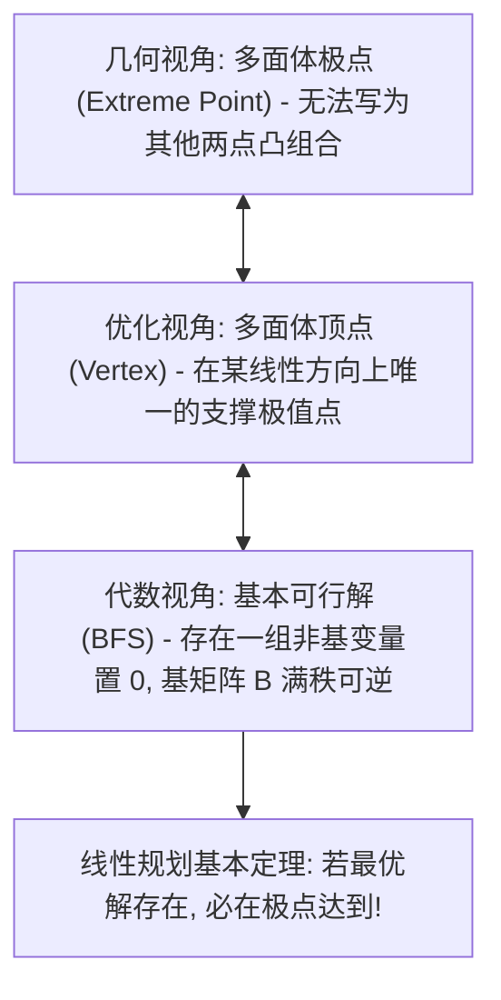

# Lec 2 多面体几何、极点与基本可行解 (Polyhedral Geometry, Extreme Points, and Basic Feasible Solutions)

> MIT 15.C57 优化方法 · 讲义 2

## TL;DR

- 凸多面体（Polyhedron）是有限半空间不等式系统的交集，其外围几何由面、棱与极点构成。
- 极点（Extreme Point）在纯代数上等价于由非奇异满秩子矩阵确定的基本可行解（BFS）。
- 线性规划基本定理证明：若有界 LP 存在最优解，则必然至少存在一个最优解落在极点之上。
## 多面体几何与半空间交集

线性规划（Linear Programming, LP）的可行域在几何上是一个凸多面体。
形式化地，一个**多面体（Polyhedron）**定义为有限个闭半空间的交集：
$$
P = \{x \in \mathbb{R}^n : A x \ge b\}
$$
若多面体是有界的（即存在 $M < \infty$ 使得 $\|x\| \le M$ 对所有 $x \in P$ 均成立），则称为**多胞形（Polytope）**。

在几何空间中，我们关心多面体的“尖角”或“拐点”。这些点无法通过集合内其他任何两个不同点的凸组合得到：

::: definition [极点 (Extreme Point) 与顶点 (Vertex)]
设 $P$ 为凸集。点 $x \in P$ 称为 $P$ 的一个**极点**，若不存在两个不同点 $y, z \in P$（$y \neq x, z \neq x$）以及标量 $\lambda \in (0, 1)$ 使得：
$$
x = \lambda y + (1 - \lambda) z
$$
点 $x \in P$ 称为 $P$ 的一个**顶点**，若存在非零向量 $c \in \mathbb{R}^n$ 使得 $x$ 是在 $P$ 上严格极大化线性泛函 $c^\top y$ 的唯一最优解：
$$
c^\top x > c^\top y, \quad \forall y \in P \setminus \{x\}
$$
:::

在任意多面体上，极点的几何概念与顶点的代数极值概念是完全等价的。

## 标准型与基本可行解 (BFS)

为了建立计算代数理论，通常通过引入非负松弛变量（Slack Variables），将多面体变换为标准形式（Standard Form）：
$$
P = \{x \in \mathbb{R}^n : A x = b, \; x \ge 0\}
$$
其中 $A$ 为 $m \times n$ 实矩阵，无失一般性假定 $A$ 具有行满秩 $\text{rank}(A) = m \le n$。

我们将决策变量的下标划分为两组：
- **基变量集合（Basic Variables）**：大小为 $m$ 的指标集 $\mathcal{B} \subset \{1, 2, \dots, n\}$，对应的列子矩阵 $B = A_{\mathcal{B}}$ 是 $m \times m$ 满秩可逆矩阵；
- **非基变量集合（Nonbasic Variables）**：大小为 $n - m$ 的指标集 $\mathcal{N} = \{1, \dots, n\} \setminus \mathcal{B}$，对应的子矩阵为 $N = A_{\mathcal{N}}$。

::: definition [基本可行解 (Basic Feasible Solution, BFS)]
对于给定的基矩阵 $B$：
1. 令所有非基变量全取为零：$x_{\mathcal{N}} = 0$；
2. 由约束方程组 $B x_{\mathcal{B}} + N x_{\mathcal{N}} = b$ 唯一确定基变量的解：
$$
x_{\mathcal{B}} = B^{-1} b
$$
所得向量 $x = (x_{\mathcal{B}}, 0)$ 称为一个**基本解（Basic Solution）**。
若进一步满足非负性约束 $x_{\mathcal{B}} \ge 0$，则称 $x$ 为一个**基本可行解（BFS）**。
:::

若 $x_{\mathcal{B}} > 0$（严格大于零），该 BFS 称为**非退化的（Non-degenerate）**；若存在某些基变量 $x_i = 0$，则称为**退化的（Degenerate）**。

## 线性规划代数基本定理

几何与代数的终极桥梁由 Dimitris Bertsimas 在《Introduction to Linear Optimization》中证明为如下基石定理：

::: theorem [极点与 BFS 的代数等价定理]
设 $P = \{x \in \mathbb{R}^n : A x = b, \; x \ge 0\}$ 为标准型多面体。
向量 $x \in P$ 是 $P$ 的一个极点，**当且仅当** $x$ 是 $P$ 的一个基本可行解（BFS）。
:::

::: theorem [线性规划基本定理 (Fundamental Theorem of LP)]
考虑标准型线性规划 $\min c^\top x \text{ s.t. } x \in P$。
1. 若多面体 $P$ 非空且包含至少一个极点，并且最优目标函数值在 $P$ 上有下界，则**必然存在一个极点是最优解**；
2. 若该 LP 存在最优解，则至少存在一个基本可行解是最优解。
:::

该定理的证明依靠多面体的 Minkowski-Weyl 紧分解定理：任何有界多胞形均可唯一表征为其有限个极点的凸包（Convex Hull）。
由于线性函数在凸包上的极值必然在凸包的极点边界上达到，这意味着优化算法**无需在连续无限的空间内部漫无目的地搜索，而只需在有限个（至多 $\binom{n}{m}$ 个）离散的 BFS 之间进行智能遍历**！这就是单纯形法的起源。

::: pitfall [退化现象与伪循环陷阱]
当且仅当一个极点对应多个不同的基指标集 $\mathcal{B}$ 时，系统处于退化（Degeneracy）状态。
在几何上，这意味着有超过 $n$ 个超平面交汇在同一个顶点上（例如三维空间中的四棱锥尖端）。
在退化状态下，单纯形法可能在同一个几何极点上反复更换不同的代数基矩阵，目标函数值原地踏步，从而陷入死循环（Cycling）。必须通过 Bland 最小下标法则或扰动法打破死循环。
:::

::: insight [从连续无限到离散有限的降维奇迹]
极点与基本可行解（BFS）的代数等价定理，是整个运筹最优化历史上最震撼人心的数学奇迹之一。
在面对连续决策空间 $\mathbb{R}^n$ 时，可行域内部包含着不可数无限多的点；
然而，线性函数的凹凸性与超平面的刚性几何交织在一起，宣告了一个绝对真理：**最优解绝不会隐藏在多面体腹地的任何平庸位置，它必然被物理推挤至最外围的离散尖角之上**。
这一代数定理瞬间将一个在连续测度空间中“大海捞针”的不可能计算任务，骤降为一个有限图上离散顶点遍历的组合搜索问题，为后续一切可计算性理论奠定了唯一的公理基石。
:::
