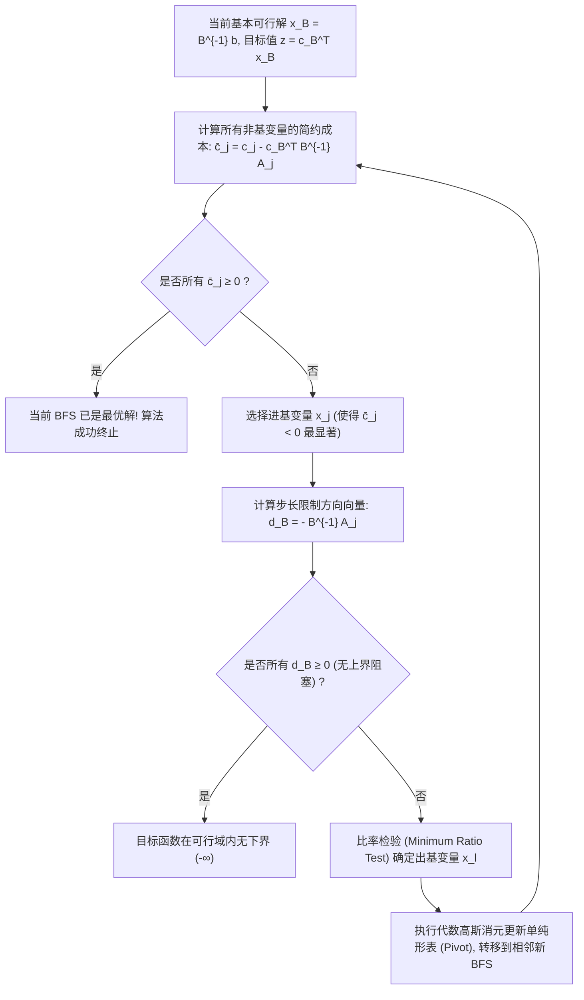

# Lec 3 单纯形算法、代数演进与检验数 (The Simplex Algorithm, Tableau Operations, and Reduced Costs)

> MIT 15.C57 优化方法 · 讲义 3

## TL;DR

- 单纯形法在多面体的一维棱图（1-Skeleton）上从一个 BFS 沿边缘滑动到相邻更优 BFS。
- 简约成本（Reduced Cost）向量 $\bar{c}_j = c_j - c_B^\top B^{-1} A_j$ 严格判定当前极点的最优性。
- 比率检验（Ratio Test）确定出基变量，确保在保持非负可行性的前提下步长达到最大。
## 单纯形法的棱边缘几何演进

上一讲确立了 LP 的最优解必然在极点（BFS）上达到。
一个暴力的算法是列举全部 $\binom{n}{m}$ 种可能的基子矩阵 $B$ 并求解 $B^{-1} b$。
然而，当 $n = 100, m = 50$ 时，$\binom{100}{50} \approx 10^{29}$，甚至超越了超级计算机的运算极限。

1947 年乔治·丹齐格（George Dantzig）提出了**单纯形法（Simplex Method）**：
从某个初始基本可行解 $x^{(0)}$ 出发，算法并不在全图随机游走，而是沿着多面体表面的一维边缘（Edges / 1-Skeleton），**贪婪地滑动到具有更优目标函数值的相邻基本可行解（Adjacent BFS）**。
所谓相邻 BFS，是指它们所对应的基指标集 $\mathcal{B}$ 仅相差一个元素——即通过一个**进基变量（Entering Variable）**替换一个**出基变量（Leaving Variable）**的枢轴旋转（Pivot Operation）实现转移。

## 简约成本与代数最优性条件

考虑标准型 LP：$\min c^\top x \text{ s.t. } A x = b, x \ge 0$。
设当前基矩阵为 $B$，非基矩阵为 $N$。
我们将目标函数展开为基变量与非基变量的显式表达式：
由于 $x_{\mathcal{B}} = B^{-1} b - B^{-1} N x_{\mathcal{N}}$，代入目标函数可得：
$$
z = c^\top x = c_{\mathcal{B}}^\top x_{\mathcal{B}} + c_{\mathcal{N}}^\top x_{\mathcal{N}} = c_{\mathcal{B}}^\top B^{-1} b + \sum_{j \in \mathcal{N}} \left( c_j - c_{\mathcal{B}}^\top B^{-1} A_j \right) x_j
$$

::: definition [简约成本 (Reduced Cost)]
对于任意非基变量 $x_j$（$j \in \mathcal{N}$），定义其**简约成本（Reduced Cost）**为：
$$
\bar{c}_j = c_j - c_{\mathcal{B}}^\top B^{-1} A_j = c_j - p^\top A_j
$$
其中 $p^\top = c_{\mathcal{B}}^\top B^{-1}$ 称为单纯形乘子（Simplex Multiplier）或影子价格向量。
:::

简约成本 $\bar{c}_j$ 具有鲜明的物理意义：**当我们将非基变量 $x_j$ 从 0 微小增加 1 个单位时，为了保持等式约束 $A x = b$ 成立，目标函数值 $z$ 所发生的净边际变化率**！

::: theorem [单纯形最优性充要条件]
考虑非退化的标准型 LP 及基本可行解 $x$：
1. 若所有非基变量的简约成本均非负：
   $$
   \bar{c}_j \ge 0, \quad \forall j \in \mathcal{N}
   $$
   则当前 BFS $x$ 是全局唯一最优解；
2. 若存在某个非基变量使得 $\bar{c}_j < 0$，且对应的方向向量 $d = -B^{-1} A_j$ 满足 $d \ge 0$，则该 LP 目标函数值在可行域内无界（即最优值为 $-\infty$）。
:::

## 最小比率检验与枢轴旋转

若存在 $\bar{c}_j < 0$，我们选定 $x_j$ 作为**进基变量**（Dantzig 法则选取 $\bar{c}_j$ 最负者）。
此时让 $x_j$ 从 0 逐步增加一个正步长 $\theta > 0$。基变量相应演进为：
$$
x_{\mathcal{B}}(\theta) = x_{\mathcal{B}} - \theta \cdot \left( B^{-1} A_j \right) = x_{\mathcal{B}} - \theta \cdot u
$$
其中 $u = B^{-1} A_j$。
为了保持非负性 $x_{\mathcal{B}}(\theta) \ge 0$，步长 $\theta$ 不能无限扩张。对于所有 $u_i > 0$ 的行，必须满足 $x_{\mathcal{B}(i)} - \theta u_i \ge 0$，即 $\theta \le \frac{x_{\mathcal{B}(i)}}{u_i}$。

::: definition [最小比率检验 (Minimum Ratio Test)]
步长极限由最小比率唯一锁定：
$$
\theta^* = \min_{i \in \{1, \dots, m\} : u_i > 0} \left\{ \frac{x_{\mathcal{B}(i)}}{u_i} \right\}
$$
使该比率取得最小值的行指标 $l$，其对应的当前基变量 $x_{\mathcal{B}(l)}$ 恰好在 $\theta = \theta^*$ 时被压降至绝对 0，被选为**出基变量**！
:::

在代数实现上，通过对完整的**单纯形表（Simplex Tableau）**进行以主元元素（Pivot Element $u_l$）为中心的高斯-若尔当消元（Gauss-Jordan Elimination），立即刷新出新的基逆矩阵与简约成本，平滑进入下一轮迭代。

::: insight [单纯形表背后的稀疏 LU 矩阵更新]
在现代商用求解器（如 Gurobi）中，从来不直接存储全量单纯形表，因为对于百万行规模的矩阵，稠密消元会引发内存灾难。
求解器采用**修正单纯形法（Revised Simplex Method）**，仅维护基矩阵 $B$ 的稀疏 LU 分解，并利用 Forrest-Tomlin 算法对枢轴变换后的秩一（Rank-1）扰动进行极速递推更新，使得单步迭代复杂度从 $O(m^2 n)$ 骤降至 $O(m \cdot \text{nnz})$。
:::
