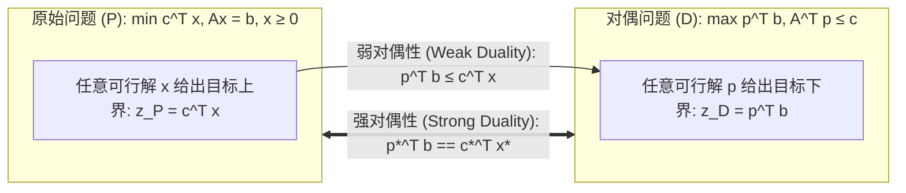

# Lec 4 对偶理论、Farkas 引理与互补松弛性 (Duality Theory, Farkas' Lemma, and Complementary Slackness)

> MIT 15.C57 优化方法 · 讲义 4

## TL;DR

- 每个线性规划（原始问题）天然伴随着一个由其约束乘子构成的对偶线性规划（对偶问题）。
- 弱对偶性确立了目标界的全局包络；强对偶性证明在最优解处原始与对偶目标值严格恒等。
- 互补松弛条件（Complementary Slackness）架起了原始紧约束与对偶严格正乘子之间的结构对应。
## 对偶理论的诞生与数学对称美

对偶理论（Duality Theory）是整个应用数学中最深刻、最具哲学意味的构造之一。
1947 年约翰·冯·诺伊曼（John von Neumann）在与乔治·丹齐格会面时，敏锐地指出线性规划的底层结构与二人零和博弈的极小极大定理（Minimax Theorem）完全同构，从而孕育了线性规划对偶理论。

考虑如下非对称形式的标准原始线性规划（Primal Problem, P）：
$$
\begin{aligned}
(P) \quad \min_{x \in \mathbb{R}^n} \quad & c^\top x \\
\text{s.t.} \quad & A x = b \\
& x \ge 0
\end{aligned}
$$
我们希望寻找该最小化问题的一个理论**确定性下界**。
如果我们将等式约束 $A x = b$ 的每一行乘以一个实数乘子 $p_i \in \mathbb{R}$，并将它们线性组合相加，得到：
$$
p^\top A x = p^\top b
$$
如果我们精心选取乘子向量 $p = (p_1, \dots, p_m)^\top$，使得其对每个变量的合成系数均不超过原始成本向量，即：
$$
p^\top A \le c^\top \iff A^\top p \le c
$$
那么由于 $x \ge 0$，两边点乘 $x$ 必然保持不等号方向：
$$
p^\top b = p^\top A x \le c^\top x
$$
这意味着：**对于任意满足 $A^\top p \le c$ 的乘子向量 $p$，$p^\top b$ 恒为原始问题目标值 $c^\top x$ 的一个严格合法下界**！
为了让这个下界尽可能紧致（尽可能大），我们自然地提出了**对偶问题（Dual Problem, D）**：
$$
\begin{aligned}
(D) \quad \max_{p \in \mathbb{R}^m} \quad & p^\top b \\
\text{s.t.} \quad & A^\top p \le c
\end{aligned}
$$

## 弱对偶性与强对偶性定理

对偶理论由两大里程碑定理严格确立：

::: theorem [弱对偶性定理 (Weak Duality)]
设 $x$ 为原始问题 $(P)$ 的任意可行解，$p$ 为对偶问题 $(D)$ 的任意可行解。则恒有：
$$
p^\top b \le c^\top x
$$
推论：
1. 若原始问题无下界（目标值 $-\infty$），则对偶问题必然不可行；
2. 若对偶问题无上界（目标值 $+\infty$），则原始问题必然不可行；
3. 若存在可行解对 $(\bar{x}, \bar{p})$ 满足 $c^\top \bar{x} = \bar{p}^\top b$，则 $\bar{x}$ 必然是原始最优解，$\bar{p}$ 必然是对偶最优解。
:::

弱对偶性的代数证明仅需一行：$p^\top b = p^\top (A x) = (A^\top p)^\top x \le c^\top x$。

::: theorem [强对偶性定理 (Strong Duality)]
若原始问题 $(P)$ 存在有限最优解 $x^*$，则对偶问题 $(D)$ 也必然存在有限最优解 $p^*$，并且两者的最优目标函数值**严格相等**：
$$
c^\top x^* = (p^*)^\top b
$$
:::

证明在代数上直接来自单纯形法的终止状态：当单纯形法终止时，所有简约成本非负：
$$
\bar{c} = c^\top - c_{\mathcal{B}}^\top B^{-1} A \ge 0 \implies A^\top (B^{-1})^\top c_{\mathcal{B}} \le c
$$
令对偶解 $p^* = (B^{-1})^\top c_{\mathcal{B}}$，其不仅满足对偶可行性，且其对偶目标值为 $(p^*)^\top b = c_{\mathcal{B}}^\top B^{-1} b = c^\top x^*$，直接闭合了对偶间隙（Zero Duality Gap）！

## Farkas 引理与凸分离几何

在凸分析中，强对偶性的根本几何支柱是凸集分离超平面定理（Separating Hyperplane Theorem）。其在离散线性代数中的体现即为著名的 **Farkas 引理（Farkas' Lemma）**。

::: theorem [Farkas 引理 (Farkas' Lemma)]
设 $A$ 为 $m \times n$ 矩阵，$b \in \mathbb{R}^m$ 为列向量。
以下两个命题中有且仅有一个成立：
1. 存在向量 $x \ge 0$ 使得 $A x = b$（即向量 $b$ 位于由 $A$ 的各列所张成的凸锥 $\text{Cone}(A)$ 内部）；
2. 存在向量 $p \in \mathbb{R}^m$ 使得 $A^\top p \ge 0$ 且 $p^\top b < 0$（即存在一个超平面 $p$，将点 $b$ 与凸锥 $\text{Cone}(A)$ 严格分离）。
:::

Farkas 引理是凸几何中证明不可行性证明（Certificates of Infeasibility）的标准工具：求解器若判定问题不可行，必须输出向量 $p$ 作为不可辩驳的代数凭据。

## 互补松弛性条件

原始最优解与对偶最优解之间的微观互补机制由互补松弛条件完美刻画：

::: theorem [互补松弛条件 (Complementary Slackness)]
设 $x$ 与 $p$ 分别为原始与对偶问题的可行解。
$x$ 与 $p$ 同时为各自最优解的**充分必要条件**是：
$$
x_j \cdot \left( c_j - A_j^\top p \right) = 0, \quad \forall j = 1, \dots, n
$$
即：
- 若原始决策变量严格为正（$x_j > 0$），则对应的对偶约束必须取严格等号紧绷（$A_j^\top p = c_j$）；
- 若对偶约束存在正松弛（$A_j^\top p < c_j$），则对应的原始变量必须被强制压缩至绝对零（$x_j = 0$）。
:::

::: insight [对偶乘子的信息认证价值]
强对偶性不仅是一个数学恒等式，它更是现代分布式计算中不可篡改的“加密凭证”。
在云端求解一个包含十亿变量的超大型能源管网 LP 时，租户无需信任云端运行了数千核的复杂求解器细节；
云端只需返回一对维度极小的向量 $(x^*, p^*)$。验证方只需在毫秒内验证：$A x^* = b$、$x^* \ge 0$、$A^\top p^* \le c$ 以及 $c^\top x^* = (p^*)^\top b$。一旦等式成立，由强对偶定理，解的绝对全局最优性便得到了无懈可击的数学公理认证！
:::
