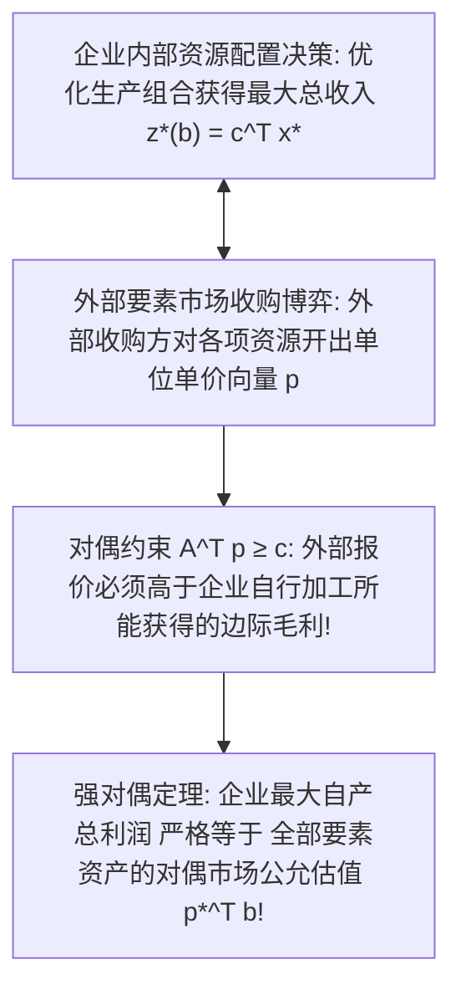

# Lec 5 经济学边际解释、影子价格与灵敏度分析 (Economic Interpretations, Shadow Prices, and Sensitivity Analysis)

> MIT 15.C57 优化方法 · 讲义 5

## TL;DR

- 对偶最优解向量 $p^*$ 在微观经济学中被精准定义为资源的影子价格（Shadow Prices）。
- 影子价格量化了在资源约束右端项 $b_i$ 发生微小边际增益时，最优目标函数的导数变化率。
- 灵敏度分析（Sensitivity Analysis）推导了保持最优基不变的成本与资源容许摄动区间。
## 对偶变量的经济学本质：影子价格

在运筹学的企业管理与公共决策应用中，线性规划不仅用于指导“现在该生产什么”，更用于回答战略层面的决策：“为了扩张生产，企业应该出资多少去收购外部的额外原材料或增加厂房工时？”

考虑标准资源分配问题：
$$
\begin{aligned}
\max_{x} \quad & c^\top x \\
\text{s.t.} \quad & A x \le b \\
& x \ge 0
\end{aligned}
$$
其中 $c_j$ 是生产第 $j$ 种产品的净单位利润，$b_i$ 是企业拥有的第 $i$ 种有限生产要素（如工时、电力、钢材）的总配额容量。
其对称对偶问题为：
$$
\begin{aligned}
\min_{p} \quad & p^\top b \\
\text{s.t.} \quad & A^\top p \ge c \\
& p \ge 0
\end{aligned}
$$

::: definition [影子价格 (Shadow Price)]
设 $z^*(b) = \max \{c^\top x : A x \le b, x \ge 0\}$ 为关于可用资源量向量 $b$ 的最优价值函数。
在最优解非退化的假设下，最优对偶向量 $p^*$ 的第 $i$ 个分量恰好是企业最优利润关于第 $i$ 种资源边际增量的梯度导数：
$$
p_i^* = \frac{\partial z^*(b)}{\partial b_i}
$$
$p_i^*$ 被严格定义为第 $i$ 种资源的**影子价格（Shadow Price）**或沉没边际价值。
:::

根据互补松弛定理，这一经济学解释得到了绝妙呼应：
- 若某种资源在最优生产方案中**尚未被耗尽**（即存在正松弛 $s_i = b_i - \sum A_{ij} x_j^* > 0$），则其影子价格**严格为 0**（$p_i^* = 0$）。在经济学上这极其符合常理：既然仓库里现存的电力已经用不完了，额外再购买一度电对企业总利润的增加贡献为零！
- 只有当某种关键资源被**完全占满吃尽**（约束紧绷 $s_i = 0$）时，其影子价格才可能严格大于零（$p_i^* > 0$）。

## 最优基下的微扰分析与灵敏度范围

在真实商业环境中，原材料成本 $c$、市场需求与资源供给 $b$ 处于持续的宏观动态波动之中。
如果参数发生微小漂移，企业是否需要立即废弃当前产线、重新运行耗费数小时的求解器？
**灵敏度分析（Sensitivity Analysis）**通过利用最终最优基逆矩阵 $B^{-1}$，可以在微秒内解析出保持当前最优基结构不变的容许变化区间。

### 1. 目标函数系数 $c$ 的波动
设产品 $k$ 的单位利润发生变动：$c_k \to c_k + \Delta c_k$。
- 若 $k$ 是非基变量（$k \in \mathcal{N}$），其最优解仍为 0。该基保持最优当且仅当新的简约成本依然非负：
  $$
  \bar{c}_k' = (c_k + \Delta c_k) - p^\top A_k \ge 0 \iff \Delta c_k \ge -\bar{c}_k
  $$
- 若 $k$ 是基变量（$k \in \mathcal{B}$），其变动会引发整个影子价格向量的全局联动：$p' = (c_{\mathcal{B}} + \Delta c_k e_i)^\top B^{-1}$。
  保持全网所有非基变量 $\bar{c}_j' \ge 0$ 的充要条件构成了对 $\Delta c_k$ 的一个闭区间约束：
  $$
  \Delta c_k \in [\underline{\Delta c_k}, \bar{\Delta c_k}]
  $$

### 2. 右端资源量 $b$ 的波动
设第 $k$ 种资源的库存发生变动：$b \to b + \Delta b \cdot e_k$。
只要新的基变量取值依然保持非负可行性：
$$
x_{\mathcal{B}}' = B^{-1} (b + \Delta b \cdot e_k) \ge 0
$$
当前的基指标集合 $\mathcal{B}$ 就依然是最优基！在此容许区间内，企业无需改变生产产品种类，且最优总利润严格呈现完美的线性增长：
$$
\Delta z^* = p_k^* \cdot \Delta b_k
$$

::: pitfall [影子价格在退化情形下的次微分断裂]
上述偏导数公式成立的前提是该极点为非退化基本可行解。
若系统存在退化，则最优价值函数 $z^*(b)$ 在该点通常不可微，而是呈现为一个凸凹非平滑分段折线。
此时左导数（边际削减）与右导数（边际追加）往往不相等，对应的影子价格是一个集合——即凸分析中的**次微分（Subdifferential $\partial z^*(b)$）**。商业软件返回的影子价格只是该凸集的一个极端次梯度，直接用于大范围外推会导致严重投资误判。
:::

::: insight [对偶灵敏度在电力实时现货市场 (LMP) 中的核心地位]
现代跨国电网的实时节点边际电价（Locational Marginal Pricing, LMP）体系完全是基于对偶灵敏度建立的。
在交流潮流线性化（DC-OPF）优化模型中，每个变电站节点的千瓦时电价，正是该节点功率平衡等式约束所对应的**对偶影子价格**！
它不仅精确反映了发电机的微观燃料边际成本，还实时、透明地内嵌了跨区域高压输电走廊线路阻塞引发的热稳定影子惩罚，每天驱动着全球数千亿美元电力现货的清算结算。
:::
