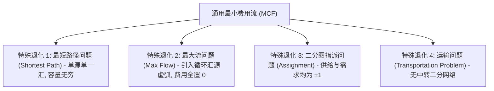

# Lec 6 网络流模型、全单模性与网络单纯形法 (Network Flow Models, Total Unimodularity, and the Network Simplex Method)

> MIT 15.C57 优化方法 · 讲义 6

## TL;DR

- 最小费用网络流（MCF）统一涵盖了最短路、最大流、二分匹配与转运问题。
- 有向图节点-弧关联矩阵的全单模性（Total Unimodularity）保证了整数约束的天然凸松弛。
- 网络单纯形法（Network Simplex）将基矩阵求逆转化为生成树（Spanning Tree）上的极速图论遍历。
## 最小费用网络流与图模型统一性

在交通规划、电信路由调度、自来水管网与供应链物流中，决策问题表现为流体或离散实体跨越有向图网络的流动。
设网络由有向连通图 $G = (V, E)$ 描述，其中 $|V| = n, |E| = m$。
每个节点 $i \in V$ 具有外部供给/需求量 $b_i$（满足流守恒总平衡 $\sum_{i \in V} b_i = 0$）：
- $b_i > 0$ 表示该节点为供给源（Source）；
- $b_i < 0$ 表示该节点为需求汇（Sink）；
- $b_i = 0$ 表示该节点为纯中转站（Transshipment Node）。

每条有向弧 $(i, j) \in E$ 具有单位运费 $c_{ij}$、流量下界 $l_{ij} \ge 0$ 以及容量上限 $u_{ij}$。
**最小费用流问题（Minimum Cost Flow, MCF）**的数学规划形式为：
$$
\begin{aligned}
\min_{x} \quad & \sum_{(i, j) \in E} c_{ij} x_{ij} \\
\text{s.t.} \quad & \sum_{k: (i, k) \in E} x_{ik} - \sum_{k: (k, i) \in E} x_{ki} = b_i, \quad \forall i \in V \\
& 0 \le x_{ij} \le u_{ij}, \quad \forall (i, j) \in E
\end{aligned}
$$

## 全单模性与整数解天然天成定理

在很多组合优化问题中，变量代表不可分割的离散实体（如卡车台数、包裹件数、人员安排），本应要求 $x_{ij} \in \mathbb{Z}$。
然而整数规划通常是 NP-hard 的。
为什么网络流问题即便**完全忽略整数约束、直接当作连续线性规划求解**，求解器得出的结果却**必然百分之百是绝对纯整数**？
其数学奥秘根植于约束矩阵的**全单模性（Total Unimodularity）**。

::: definition [全单模矩阵 (Totally Unimodular Matrix, TUM)]
一个整矩阵 $A$ 称为**全单模矩阵（TUM）**，若 $A$ 的任意阶方阵子式（Square Submatrix）的行列式取值只能是如下三者之一：
$$
\det(A') \in \{0, +1, -1\}
$$
特别地，矩阵本身的每个元素必须在 $\{0, +1, -1\}$ 中。
:::

::: theorem [Poincaré 有向图关联矩阵全单模定理]
有向图 $G = (V, E)$ 的节点-弧关联矩阵 $A \in \mathbb{R}^{n \times m}$（每一列对应一条弧 $(i, j)$，在行 $i$ 处为 $+1$，在行 $j$ 处为 $-1$，其余全为 0）**是一个全单模矩阵**。
:::

证明基于对子式规模的数学归纳法：在任意方阵子式中，若存在全零列则行列式为 0；若存在只有一个非零元的列，按该列拉普拉斯展开；若每列均有两个非零元，则必然是一正一负，所有行向量相加恒等于零向量，行列式为 0。

::: theorem [Hoffman-Kruskal 整数多胞形定理]
设矩阵 $A$ 是全单模的，向量 $b$ 是纯整数向量。
则由约束系统构成的多面体 $P = \{x : A x = b, x \ge 0\}$ 的**每一个极点（BFS）的坐标分量均为纯整数**！
:::

证明极其优美：由克莱姆法则（Cramer's Rule），基本解分量为 $x_{\mathcal{B}(i)} = \frac{\det(B_i)}{\det(B)}$。
由于 $B$ 是 $A$ 的满秩方阵子式，其行列式 $\det(B) = \pm 1$。整数除以 $\pm 1$ 必然是整数！
这一理论建立了运筹学中最著名的桥梁：**网络流问题不需要分支定界，连续单纯形法直接产出最优整数解**。

## 网络单纯形法与生成树拓扑

虽然通用单纯形法能求解网络流，但维护 $m \times m$ 矩阵逆开销巨大。
1960 年代，运筹学家发现：**网络流中的基矩阵 $B$，与网络中的一棵生成树（Spanning Tree $T$）在拓扑上一一对应**！
这催生了比通用单纯形快上百倍的**网络单纯形法（Network Simplex）**：

1. **基树（Basis Tree $T$）**：由 $n-1$ 条树弧构成的无环连通子图；
2. **非基弧**：分为处于流量下限的非基弧 $L$（$x_{e} = 0$）与处于容量上限的非基弧 $U$（$x_{e} = u_e$）；
3. **节点电位（Node Potentials $\pi_i$）**：
   在树上任意选取一个根节点置 $\pi_{\text{root}} = 0$。对于所有树弧 $(i, j) \in T$，其简约成本恒等于零：
   $$
   \bar{c}_{ij} = c_{ij} - (\pi_i - \pi_j) = 0 \implies \pi_i - \pi_j = c_{ij}
   $$
   通过自顶向下的深度优先遍历（DFS），可以在 $O(n)$ 时间内线性求出所有节点的电位 $\pi$；
4. **进基弧与基本环路（Fundamental Cycle）**：
   扫描非基弧中违反最优性条件的弧 $(u, v)$（如 $\bar{c}_{uv} < 0$ 且处于下限）。
   将弧 $(u, v)$ 加入生成树，**必然在树上闭合出一个唯一的基本环路 $C$**；
5. **环路增广与出基**：
   沿着环路 $C$ 推动最大容许循环流 $\delta > 0$，环路上首先达到容量边界瓶颈的弧成为出基弧，基树拓扑完成一次树分支剪接更新。

::: insight [纯图论算法对代数矩阵消元的降维替代]
网络单纯形法是运筹学中“算法工程化”的巅峰之作。
整个算法运行过程中，**不需要执行任何浮点矩阵求逆、不需要高斯消元、不需要存储单纯形表**，全部操作被抽象为在静态数组上对指针树（父节点指针、子节点深度列表、环路遍历）的纯离散图论遍历。
这种以树拓扑替代矩阵代数的极简思想，至今仍是物流供应链运输求解的核心底层支撑。
:::
