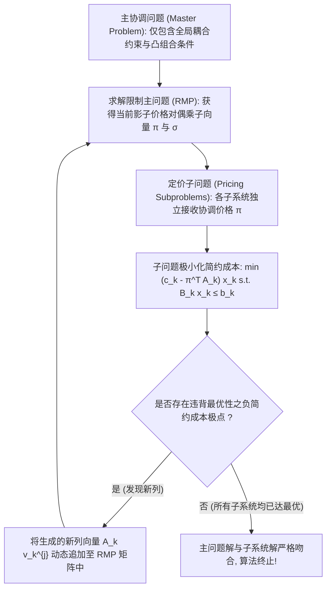

# Lec 7 大规模线性优化与 Dantzig-Wolfe 分解原理 (Large-Scale Linear Optimization and Dantzig-Wolfe Decomposition)

> MIT 15.C57 优化方法 · 讲义 7

## TL;DR

- 大规模系统通常展现出“局部子系统独立、全局微量资源耦合”的块角状稀疏结构。
- 丹齐格-沃尔夫（Dantzig-Wolfe）分解利用 Minkowski 凸表示定理将子问题解空间投影至主问题。
- 延迟列生成（Delayed Column Generation）通过定价子问题在指数级极点空间中动态添加极优基列。
## 大规模系统的块角状解耦结构

在多区域能源电网、跨国供应链集团以及大型航空公司的航班排班中，优化模型往往包含数千万个变量与约束。
然而，观察其约束矩阵 $A$，绝大多数并非随机稠密分布，而是呈现出极其鲜明的**块角状结构（Block-Angular Structure）**：
$$
\begin{aligned}
\min \quad & c_1^\top x_1 + c_2^\top x_2 + \dots + c_K^\top x_K \\
\text{s.t.} \quad & A_1 x_1 + A_2 x_2 + \dots + A_K x_K \le b_0 \quad && \text{(全局耦合约束 / Complicating Constraints)} \\
& B_1 x_1 \le b_1 \quad && \text{(子系统 1 局部约束)} \\
& B_2 x_2 \le b_2 \quad && \text{(子系统 2 局部约束)} \\
& \quad \dots \\
& B_K x_K \le b_K \quad && \text{(子系统 } K \text{ 局部约束)} \\
& x_k \ge 0, \quad \forall k=1,\dots,K
\end{aligned}
$$
若没有第一行的“全局耦合约束”（如全集团共享的资本预算总额或中央电网的输电联络线容量），整个大规模问题可以被瞬间肢解为 $K$ 个完全互不相干、可并行求解的小规模独立子问题。

1960 年 George Dantzig 与 Philip Wolfe 提出了著名的 **Dantzig-Wolfe 分解原理（DW Decomposition）**，开创了现代大规模数学规划的列生成与分布式协调范式。

## Minkowski 极点重构与限制主问题 (RMP)

DW 分解的核心思想基于凸多胞形的极点表示定理（Minkowski's Theorem）：
对于每个有界的局部子系统可行域 $X_k = \{x_k \ge 0 : B_k x_k \le b_k\}$，其内部任意一点均可严格表示为其有限个极点 $\{v_k^1, v_k^2, \dots, v_k^{P_k}\}$ 的凸组合：
$$
x_k = \sum_{j=1}^{P_k} \lambda_k^j v_k^j, \quad \sum_{j=1}^{P_k} \lambda_k^j = 1, \quad \lambda_k^j \ge 0
$$
我们将这一变量代换直接代入原问题的目标函数与全局耦合约束中。原问题等价变换为仅以凸组合权重 $\lambda_k^j$ 为决策变量的**完全主问题（Full Master Problem）**：
$$
\begin{aligned}
\min_{\lambda} \quad & \sum_{k=1}^K \sum_{j=1}^{P_k} \left( c_k^\top v_k^j \right) \lambda_k^j \\
\text{s.t.} \quad & \sum_{k=1}^K \sum_{j=1}^{P_k} \left( A_k v_k^j \right) \lambda_k^j \le b_0 \quad && (\text{对偶乘子 } \pi) \\
& \sum_{j=1}^{P_k} \lambda_k^j = 1, \quad \forall k=1,\dots,K \quad && (\text{对偶乘子 } \sigma_k) \\
& \lambda_k^j \ge 0
\end{aligned}
$$
这一重构带来了戏剧性的结构反差：
- **行约束数量急剧减少**：从原本数以百万计的约束，精简为仅包含 $m_0 + K$ 行；
- **列变量数量呈现天文数字爆炸**：极点总数 $\sum P_k$ 往往超过宇宙中的原子总数！

## 延迟列生成机制 (Delayed Column Generation)

面对天文数字般的列，我们显然无法将它们全部显式写出。
Dantzig 与 Wolfe 指出：**在任意时刻，单纯形基矩阵只需要 $m_0 + K$ 个活跃列**！
我们维护一个仅包含极少数候选列的**限制主问题（Restricted Master Problem, RMP）**，并利用对偶信息进行动态“列召唤”：

1. 求解当前的 RMP，得到关于耦合约束的影子价格 $\pi \ge 0$ 以及关于凸性约束的对偶乘子 $\sigma_k$；
2. 我们需要检查在所有尚未加入 RMP 的千亿个极点中，是否存在某个变量 $\lambda_k^j$ 的简约成本为负：
   $$
   \bar{c}_k^j = \left( c_k^\top v_k^j \right) - \pi^\top \left( A_k v_k^j \right) - \sigma_k = \left( c_k - \pi^\top A_k \right)^\top v_k^j - \sigma_k < 0
   $$
3. 这一检查无需遍历枚举，而是转化为求解 $K$ 个**独立的极小化定价子问题（Pricing Subproblems）**：
   $$
   z_k^*(\pi) = \min_{x_k \in X_k} \left( c_k - \pi^\top A_k \right)^\top x_k
   $$
4. 若求得的子系统最优值满足 $z_k^*(\pi) - \sigma_k < 0$，则该最优解 $v_k^* = x_k^*$ 所对应的列必然能使主问题目标进一步下降！我们将生成的列向量 $\begin{pmatrix} A_k v_k^* \\ e_k \end{pmatrix}$ 动态追加到 RMP 中；
5. 若所有子系统的最优值均满足 $z_k^*(\pi) - \sigma_k \ge 0$，则根据强对偶性，当前 RMP 的解已无可辩驳地达到全系统全局最优解，算法完美终止！

::: insight [计划经济与自由市场价格机制的数学证明]
DW 分解具有无与伦比的经济学思想深度：
主协调者（中央总部）并不需要插手各子公司内部极其琐碎的物理生产细节（约束 $B_k x_k \le b_k$）；
总部只需根据全集团共享资源的紧缺程度，向所有子公司广播一个统一的**内部转移定价信号（Shadow Prices $\pi$）**；
各子公司依据该价格信号追求自身利益最大化（求解 Pricing Subproblem），并将生成的业务方案上报给总部。
DW 分解在数学上证明了：通过中央价格调控与分散自主决策的有限轮迭代，系统必然能以全局最优效率达成全社会的资源协同分配！
:::
