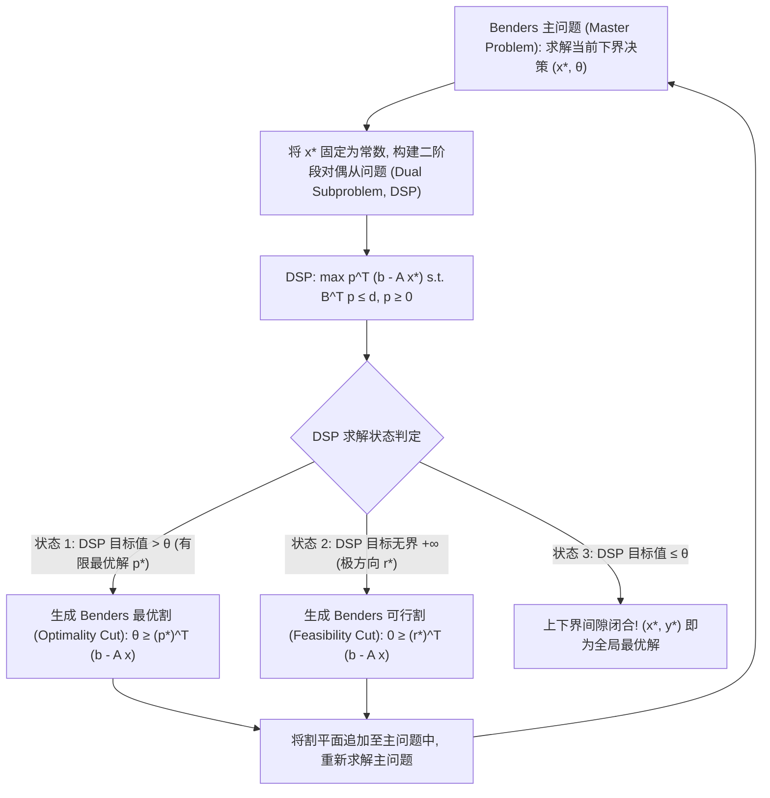

# Lec 8 Benders 分解算法与延迟约束生成 (Benders Decomposition and Delayed Constraint Generation)

> MIT 15.C57 优化方法 · 讲义 8

## TL;DR

- Benders 分解针对“存在少量恶劣耦合变量，一旦固定其余部分极易求解”的特殊结构。
- 通过对二阶段连续线性从问题进行对偶投影，向主问题动态添加极值割平面（Benders Cuts）。
- 严格区分可行割（Feasibility Cuts）与极值割（Optimality Cuts），奠定两阶段随机规划基石。
## 恶劣变量与结构投影

与上一讲 Dantzig-Wolfe 分解针对“行耦合”截然对偶，**本德斯分解（Benders Decomposition, 1962）**针对的是**“变量耦合（Complicating Variables）”**：
在许多混合整数优化或复杂网络设计中，决策变量可以天然划分为两组：
1. **一阶段决策 $x$（Master Variables）**：通常是复杂的二值离散变量或高阶战略投资决策（例如“是否在某城市斥资数亿建造物流枢纽”）；
2. **二阶段决策 $y$（Subproblem Variables）**：通常是连续的业务运营调度变量（例如“各仓库之间每天的具体货物调运量”）。

数学模型形式化表征为：
$$
\begin{aligned}
\min_{x \in X, y \ge 0} \quad & c^\top x + d^\top y \\
\text{s.t.} \quad & A x + B y \ge b
\end{aligned}
$$
若强行将二者放在一起作为整体 MILP 求解，由于维度过大且整数与连续相互纠缠，工业求解器往往会迅速陷入内存与节点爆炸。
Jacques F. Benders 提出了一个革命性的几何构思：**将连续变量 $y$ 彻底从原问题中“投影消除”（Projection），将原问题完全改写为关于一阶段变量 $x$ 的等价非平滑主问题**！

## 对偶极点与极端射线投影

为了消除 $y$，考虑当 $x$ 固定为常数向量时，关于 $y$ 的二阶段线性规划从问题（Subproblem）：
$$
g(x) = \min_{y \ge 0} \{ d^\top y : B y \ge b - A x \}
$$
原问题等价于：$\min_{x \in X} \left\{ c^\top x + g(x) \right\}$。
根据强对偶理论，从问题的最优值等于其线性对偶问题（Dual Subproblem, DSP）的最优值：
$$
\begin{aligned}
(DSP) \quad \max_{p \ge 0} \quad & p^\top (b - A x) \\
\text{s.t.} \quad & B^\top p \le d
\end{aligned}
$$
请注意一个极其优美的几何性质：**对偶问题的可行域 $\mathcal{D} = \{p \ge 0 : B^\top p \le d\}$ 完全不依赖于 $x$ 的取值**！
根据 Minkowski-Weyl 定理，该凸多面体 $\mathcal{D}$ 由有限个极点 $\{p^1, \dots, p^K\}$ 与有限个极方向（Extreme Rays $\{r^1, \dots, r^L\}$）完全刻画：

1. **可行性条件（从问题有解）**：
   根据 LP 判定定理，DSP 在方向 $b - A x$ 上有有限解（不发散至 $+\infty$）的充要条件是：对于其所有极方向，目标函数的增长必须小于等于零。
   这导出了关于 $x$ 的**Benders 可行割（Feasibility Cuts）**：
   $$
   (r^l)^\top (b - A x) \le 0, \quad \forall l = 1, \dots, L
   $$
2. **最优性表征（Epigraph 逼近）**：
   当可行时，DSP 的最大值必然在其某个极点上达到。引入标量辅助变量 $\theta \ge g(x)$，导出了关于 $x$ 与 $\theta$ 的**Benders 最优割（Optimality Cuts）**：
   $$
   \theta \ge (p^k)^\top (b - A x), \quad \forall k = 1, \dots, K
   $$

## 算法迭代流程与下界提升

在算法实际执行中，可行域的极点与极方向数量同样是指数级的，无法预先罗列。
Benders 算法采用**延迟约束生成（Delayed Constraint Generation）**：

1. **主问题（Master Problem）**：维护包含当前已生成的割平面的松弛主问题，求解得到候选决策 $(\hat{x}, \hat{\theta})$，并给出全问题的**有效目标下界（Lower Bound, $LB = c^\top \hat{x} + \hat{\theta}$）**；
2. **从问题检验**：将 $\hat{x}$ 带入 DSP 求解：
   - 若 DSP 判定无界，求解器提取出一条发散极方向 $r^*$，向主问题追加一条可行割：$(r^*)^\top (b - A x) \le 0$；
   - 若 DSP 得到有限最优解 $p^*$ 且目标值 $p^* (b - A \hat{x}) > \hat{\theta}$，说明当前下界低估了实际从问题成本。向主问题追加一条最优割：$\theta \ge (p^*)^\top (b - A x)$，同时更新全问题的**有效目标上界（Upper Bound, $UB = \min(UB, c^\top \hat{x} + d^\top \hat{y})$）**；
3. 循环往复，由于多面体 $\mathcal{D}$ 的极点与极方向总数有限，算法保证在有限步内实现 $UB - LB \le \epsilon$，精确收敛至全局最优解！

::: insight [现代分支切割树中的 Lazy Constraint 融合]
在 20 世纪，Benders 算法必须反复冷启动求解不同的主问题 MILP，导致整数节点探索大量浪费。
现代优化求解器（如 CPLEX / Gurobi）将 Benders 分解完全集成到了**单一分支定界树（Single Branch-and-Bound Tree）**之中：
主问题只建立一棵搜索树；每当求解器在树中发现一个新的整数可行节点 $\hat{x}$ 时，通过回调机制（Callback）在后台静默求解从问题，若不满足则作为 **惰性约束（Lazy Constraint）** 当场将割平面注入当前节点的割池中，彻底避免了外部重复建模的巨大开销！
:::
