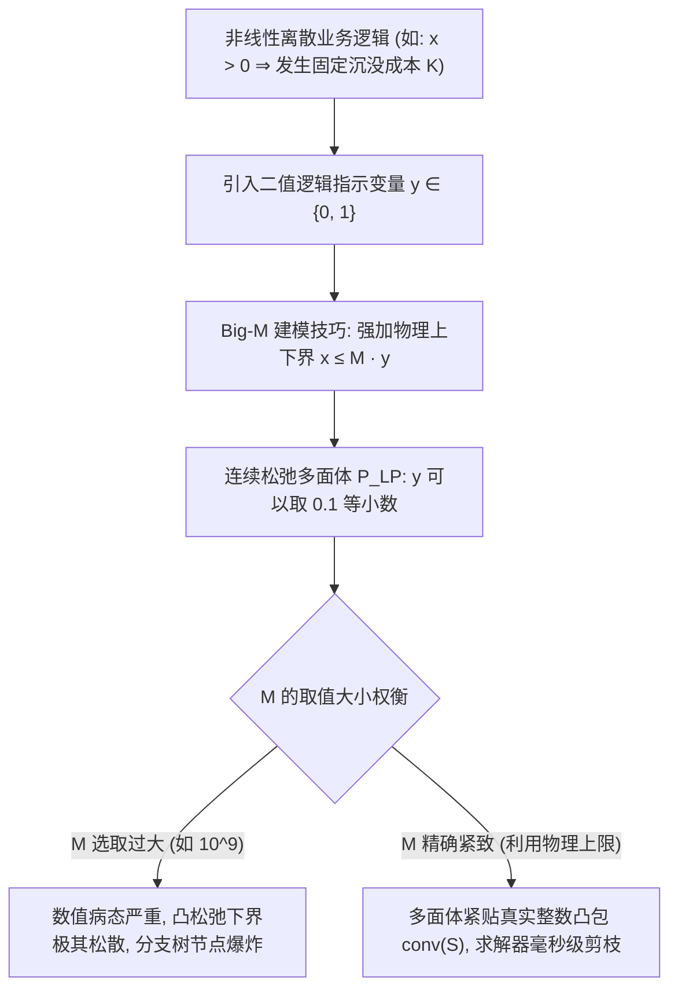

# Lec 9 整数规划建模艺术、逻辑约束与 Big-M 技术 (Integer Programming Formulations and Big-M Modeling)

> MIT 15.C57 优化方法 · 讲义 9

## TL;DR

- 混合整数线性规划（MILP）通过 0-1 二值变量表达开关、互斥与分段线性逻辑。
- 深度剖析 Big-M 约束在半连续变量与固定费用模型中的建模机制与下界松弛劣化风险。
- 对比凸包公式化（Convex Hull Formulation）与紧致公式化（Tight Formulations）对求解器分支树的决定性影响。
## 离散决策与整数规划的表达力

在工业调度、机组组合（Unit Commitment）、选址规划与投资组合选择中，决策不仅包含“生产多少吨钢材”这种连续变量，更充斥着本质不可分割的离散选择：
- “是否在某地投建新晶圆厂”（是/否决策）；
- “两个作业在同一台机床上处理的前后顺序”（二选一互斥决策）；
- “原材料采购阶梯批量折扣”（分段线性凹凸非线性成本）。

**混合整数线性规划（Mixed-Integer Linear Programming, MILP）**的一般形式为：
$$
\begin{aligned}
\min_{x, y} \quad & c^\top x + d^\top y \\
\text{s.t.} \quad & A x + B y \ge b \\
& x \ge 0, \quad y \in \mathbb{Z}_+^p
\end{aligned}
$$
其中 $y$ 包含离散整数变量。当 $y \in \{0, 1\}^p$ 时，称为 0-1 整数规划。

根据理论计算机科学中的还原论，任意一阶命题逻辑（Boolean Logic）公式、有限状态机与具有有界输入域的非凸分段线性函数，均可在多项式规模内精确编码为 MILP！

## 经典离散逻辑的代数建模技术

### 1. 固定费用与半连续变量 (Fixed Charge Problem)
若企业生产产品 $x$，只要产量 $x > 0$，就必须一次性支付巨额产线开机成本 $K$；若不生产（$x = 0$），则成本为 0。
总成本函数为 $f(x) = K \cdot \mathbb{I}_{\{x > 0\}} + c x$。
引入二值指示变量 $y \in \{0, 1\}$，建立如下线性约束：
$$
\min c x + K y \quad \text{s.t.} \quad 0 \le x \le M y, \quad y \in \{0, 1\}
$$
其中 $M$ 是变量 $x$ 在物理上绝对不可能逾越的理论上限（如工厂最大年设计产能）。

### 2. 析取约束 (Disjunctive / Either-Or Constraints)
在车间作业调度中，作业 1 与作业 2 不能在同一时间占用同一台冲压机。
设处理时长分别为 $p_1, p_2$，开始时间为 $s_1, s_2$。必须满足“要么作业 1 先于作业 2，要么作业 2 先于作业 1”：
$$
s_1 + p_1 \le s_2 \quad \lor \quad s_2 + p_2 \le s_1
$$
引入二值变量 $y \in \{0, 1\}$（$y = 1$ 表示 1 先于 2），结合充分大的常数 $M$：
$$
\begin{aligned}
s_1 + p_1 &\le s_2 + M (1 - y) \\
s_2 + p_2 &\le s_1 + M y
\end{aligned}
$$
当 $y = 1$ 时第一式生效、第二式平凡成立；当 $y = 0$ 时第二式生效、第一式平凡成立。

## Big-M 陷阱与模型紧致度哲学

虽然 Big-M 技巧在表达上无所不能，但在工业优化界，它被视为“双刃剑”甚至“性能毒药”。

::: pitfall [盲目选取过大 Big-M 导致的灾难性后果]
初学者常常为图省事，将 $M$ 直接设为 $10^7$ 或 $10^9$。这会导致两大致命缺陷：
1. **数值精度灾难（Numerical Issues）**：商用求解器的默认可行性容差通常是 $\epsilon = 10^{-6}$。若 $M = 10^7$，当 $y = 10^{-6}$ 时（被求解器判定为有效近似 0），$x \le M y = 10$！即实际变量可以在逻辑未激活时悄悄取到非零值（Trickle-flow），导致模型约束被系统性击穿；
2. **松弛下界极度恶化**：在连续松弛问题中，为了使 $x = 100$ 可行，求解器只需给 $y$ 分配极其微小的小数 $y = 100 / M = 10^{-5}$。此时目标函数中的惩罚项 $K y$ 近乎为零，导致连续线性规划松弛给出的下界极其脆弱，分支定界树不得不枚举数以亿计的节点！
:::

::: insight [凸包公式化与强公式化 (Strong Formulations)]
评估一个整数规划模型优劣的黄金标准是：**其连续松弛多面体 $P_{\text{LP}}$ 距离全整数解的真实凸包 $\text{conv}(S)$ 究竟有多近**！
若 $P_{\text{LP}} = \text{conv}(S)$，则连续松弛的极点天然全为整数，单纯形法直接求出最优整数解（如网络流的全单模性）；
在无法完全达到凸包时，运筹学家追求“强公式化”（如设施选址中采用包含 $O(n^2)$ 约束的紧致流平衡模型，而非用 Big-M 粗暴聚合为单一约束），宁可增加约束行数，也要将多面体棱角收紧，从而在根节点直接剪除 99% 的无效搜索分支。
:::
