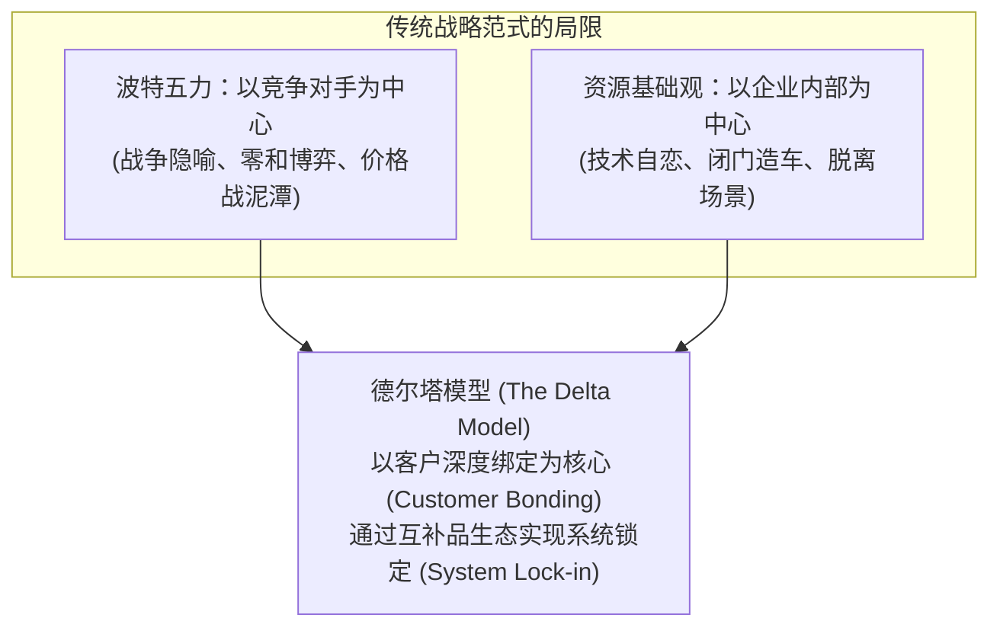
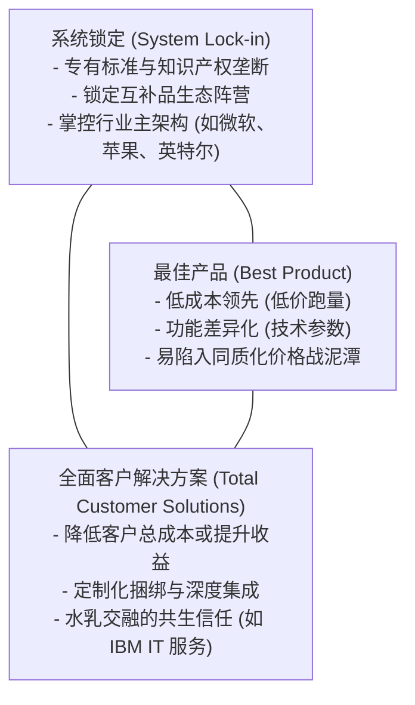

# Lec 01 德尔塔模型：超越波特与资源基础观的战略新范式 (The Delta Model: A New Strategic Framework)

> MIT Sloan School of Management · 15.902 Strategic Management I · Prof. Arnoldo Hax

## TL;DR

- 阿诺尔多·哈克斯（Arnoldo Hax）德尔塔模型打破传统“以竞争对手为中心”的战争隐喻，转向“以客户深度绑定为中心”。
- 德尔塔战略铁三角三大定位：最佳产品（Best Product）、全面客户解决方案（Total Customer Solutions）与系统锁定（System Lock-in）。
- 传统战略学派两大缺陷：波特五力将客户视为压榨博弈对象，资源基础观（RBV）容易导致企业陷入技术内卷。
- 战略实施四大关键流程：战略议程确立、客户细分对齐、能力束组合与颗粒度度量考核。

## 传统战略范式的危机与德尔塔模型的诞生 / The Genesis of the Delta Model

在过去半个世纪中，战略管理学界被两大主流学派所统治：
1. **迈克尔·波特（Michael Porter）的产业结构定位学派**：强调基于产业五力分析，选择“低成本”或“差异化”，视商业为一场打败竞争对手、压制供应商和客户的零和博弈战争；
2. **杰伊·巴尼（Jay Barney）的资源基础观（Resource-Based View, RBV）**：强调企业内部稀缺、不可替代的核心能力（VRIO 框架），主张向内挖掘独特技术护城河。

然而，麻省理工学院斯隆管理学院著名战略学大师阿诺尔多·哈克斯教授（Prof. Arnoldo Hax）在 15.902 课堂上提出了深刻的批评：**这两大主流理论都存在致命的盲区！波特理论过于关注竞争对手，把客户当成了博弈和攫取剩余价值的敌对客体；而资源基础观过度内省，往往导致工程师为了技术而技术，忽视了市场真实需求**。

为此，哈克斯教授开创了享誉全球的**德尔塔模型（The Delta Model，取自希腊字母 $\Delta$，象征变化与转型）**。

## 德尔塔战略铁三角三大战略定位 / The Delta Triangle

哈克斯教授将企业的战略选择抽象为一座等边三角形的三个顶点：

### 三大战略定位深度对比剖析

| 战略定位顶点 | 核心竞争逻辑与客户关系 | 典型商业模式与代表企业 | 潜在战略脆弱点 |
| :--- | :--- | :--- | :--- |
| **最佳产品 (Best Product)** | 依赖产品本身性价比与特性，与客户保持冰冷的“一手交钱一手交货”交易关系 | 早期的宏碁 PC、传统家电制造、普通服装代工 | 技术易被逆向工程抄袭，迅速沦为残酷的“去大宗化”价格战牺牲品 |
| **全面客户解决方案 (Total Customer Solutions)** | 深入客户内部流程，充当不可或缺的外部专家，为客户量身定制整体解决方案 | IBM 从服务器制造转型为企业数字化咨询服务、卡特彼勒设备租赁维保 | 服务交付高度依赖人力，规模化边际扩张成本较高，定制复杂 |
| **系统锁定 (System Lock-in)** | 掌控全行业事实标准，将终端客户、应用开发者与上游互补品厂商深度锁死在自身生态内 | 微软 Windows + Office、谷歌 Android 生态、英伟达 CUDA 算力网络 | 面临反垄断监管重锤，且在颠覆性技术轨道断层时容易遭遇集体逃逸 |

::: definition 客户绑定 (Customer Bonding)
德尔塔模型的核心灵魂是**“客户绑定（Customer Bonding）”**。企业不应将客户视为外部交易的对手，而应将客户视为战略共创的合伙人。客户绑定分为四个层级递进：
1. **纯产品交易（Product Transaction）**：最低层级，客户随时因 1% 的价差转向竞品；
2. **紧密业务协作（Direct Customer Relationship）**：建立专职大客户经理与定制接口；
3. **流程一体化集成（Process Integration）**：将双方的 ERP/CRM 数据库无缝打通；
4. **系统生态锁定（System Lock-in）**：最高层级，客户离开该系统的转换成本高到不可承受。
:::

## 德尔塔模型的战略管理四大核心流程

为了将宏观的战略铁三角落地为日常经营纪律，哈克斯教授确立了四大执行流程：
1. **战略议程的制定（The Strategic Agenda）**：明确界定未来 3 到 5 年全公司必须打赢的 5-8 项关键战略战役；
2. **客户细分与价值主张（Customer Segmentation & Value Proposition）**：坚决摒弃粗放的人口统计学划分，按照客户对“总成本降低”与“收益增长”的深层诉求重新聚类；
3. **能力束组合（The Firm as a Bundle of Competencies）**：梳理并培育支撑新战略落地所需的独特知识、IT 系统与组织流程资产；
4. **颗粒度度量考核（Granular Metrics）**：将抽象愿景拆解为涵盖平衡计分卡、EVA 经济增加值的量化监控仪表盘。

## 我的理解与实践洞察 / Personal Insight

德尔塔模型最大的思想贡献，是将企业家的心智从“与竞争对手互殴”解放为“与客户结盟”。

::: insight 商业竞争的终局是生态共赢
在商业战壕中，整天紧盯竞品举动并像素级跟进的企业，注定只能成为平庸的二流模仿者。**最卓越的战略家从不把精力浪费在打败对手上，他们将全部心血倾注于如何让客户的业务变得极其成功！**当你帮助客户赚取了前所未有的超额利润、当客户的日常生产流程已经完全融入你的系统底层时，竞争对手甚至连上牌桌向你挑战的机会都不复存在。
:::

## 思考题与实战研讨

1. 很多传统制造企业在研发出高技术产品后，依然停留在“最佳产品”的定价思维上，试图通过薄利多销打败对手。结合德尔塔模型，分析这类企业如何向“全面客户解决方案”跨越？
2. 比较英伟达（NVIDIA）在 GPU 算力竞争中的定位：它仅仅是一家销售“最佳芯片”的硬件商，还是通过 CUDA 软件生态和 NVLink 互联协议实现了“系统锁定”？
3. 如果你是一家年产值数千万的 B2B 工业软件初创企业 CEO，你会如何利用德尔塔铁三角来评估你当前的产品线？
