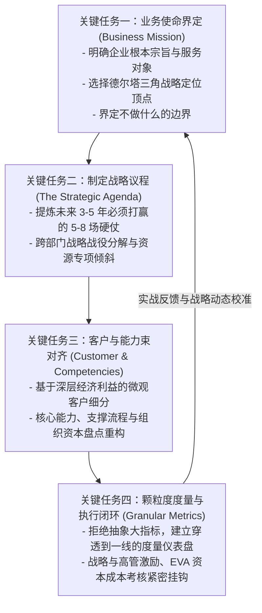
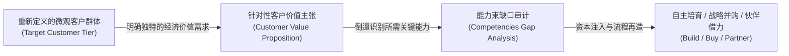

# Lec 10 战略关键任务系统集成 (Integrating the Critical Tasks of Strategy)

> MIT Sloan School of Management · 15.902 Strategic Management I · Prof. Arnoldo Hax

## TL;DR

- 战略若不能转化为可操作的日常管理行动，就只是锁在抽屉里的华丽宣讲 PPT。
- 哈克斯战略系统集成四大关键任务：业务使命界定、战略议程制定、客户-能力束对齐与颗粒度度量考核。
- 战略议程是连接宏观愿景与微观业务执行的枢纽，必须明确优先级、负责人与里程碑。
- 组织常见四大战略断裂：愿景与预算脱节、战略与绩效脱钩、能力与定位错位、各部门割裂内耗。

## 战略四项关键任务全景架构 / The Four Critical Tasks Architecture

企业界最普遍的悲剧不是缺乏高瞻远瞩的战略洞察，而是在落地执行中遭遇灾难性的组织脱节。阿诺尔多·哈克斯教授在 15.902 的下半程，将德尔塔模型从理念升华为一套严密、闭环、端到端的战略管理实践体系。

战略如果仅仅停留在战略规划部门的文件里，或者仅仅是每年秋季高管战略研讨会上的激情宣讲，那么它充其量只是一场昂贵的心智演习。绝大多数企业的战略之所以最终走向流产，并非因为宏观趋势研判失误，而是因为组织内部缺乏一套能够将抽象的定位选择逐层翻译为微观行动指针的系统化集成机制。

为了解决这一战略落地的经典顽疾，哈克斯教授提炼出了企业战略管理必须完整打通的四大核心关键任务。这四大任务层层递进、环环相扣，构成了战略从顶层设计走向一线执行的闭环控制框架：

这四大关键任务彼此咬合，构成了一台精密运转的战略发动机。任何一个环节的齿轮脱扣，都会导致整个战略飞轮彻底失去牵引力。业务使命决定了战场的边界，战略议程指明了突击的主攻方向，客户与能力束的对齐确保了武器弹药的充沛供应，而颗粒度度量考核则为前线指挥官提供了毫秒级的战场态势感知能力。

## 任务一与二：定义业务使命与确立核心战略议程 / Business Mission & Strategic Agenda

### 1. 业务使命的严谨界定（Business Mission）
一个合格的战略使命绝不是一两句虚无缥缈的广告口号。哈克斯教授要求企业在使命陈述中必须清晰回答三个根本问题：
- **我们的最终客户是谁？** 客户在产业生态链中处于何种经济地位？
- **我们在德尔塔三角中处于什么定位？** 我们是凭产品领先取胜，还是深入客户流程提供全面解决方案，亦或是构筑平台生态？
- **我们的战略红线是什么？** 哪些诱人的业务机会坚决不碰？

### 2. 战略议程的精炼确立（The Strategic Agenda）
战略议程是 CEO 统领全局的指挥棒：
- **数量控制法则**：整个企业在任何特定时期内，核心战略议程数量必须严格控制在 **5 到 8 项**，过多则意味着没有战略焦点；
- **战役化表达**：每一项议程必须使用极具行动导向的动词，明确责任副总裁（Executive Owner）与清晰的交付时间表；
- **打破部门竖井**：战略议程往往是跨部门的（如“建立客户供应链自动补货平台”需研发、IT、销售、物流通力协作），倒逼组织打破职能壁垒。

::: definition 战略议程 (The Strategic Agenda)
战略议程是连接企业高层抽象愿景与中基层日常运营执行的最高行动契约。它将长远战略定位转化为未来 12-36 个月内全公司必须集中稀缺资本与精英人才攻克的一组具备里程碑考核机制的关键优先事项集合。
:::

## 任务三：客户细分、价值主张与能力束深度对齐 / Customer-Competency Alignment

战略规划最容易出现的败笔，是战略报告中写满了宏大的“客户解决方案”，而企业内部的能力资产却依然停留在十年前的大规模廉价制造时代。

哈克斯教授强调，战略对齐的核心检验标准是：**每一项承诺给客户的核心价值主张，企业内部是否都有一组明确且具备防御力的能力束与之对应？** 如果价值主张承诺“24 小时驻场量身定制”，而企业考核体系却只考核标准品出货量，这种战略就注定会在一线彻底流产。

## 任务四：颗粒度指标拆解与组织执行闭环 / Granular Metrics & Closed-Loop Execution

战略执行最终必须体现为冰冷而客观的度量衡。哈克斯教授极度推崇“颗粒度（Granular）”这一概念：

### 为什么传统的“汇总指标（Aggregate Metrics）”具有误导性？
- **利润均摊的假象**：总营收和总净利润往往掩盖了 20% 的大客户贡献了 120% 的利润，而 80% 的尾部客户在持续烧损企业资本的残酷真相；
- **责任推诿的温床**：全公司层面的 ROI 和 ROE 无法直接追溯到某个具体销售团队或工厂车间的主观努力。

### 德尔塔颗粒度度量体系设计
1. **单客生命周期价值（Customer Lifetime Value, LTV）与单客获取成本（CAC）**；
2. **客户钱包份额（Share of Wallet）渗透率与客户流失率（Churn Rate）**；
3. **基于作业成本法（Activity-Based Costing, ABC）的单品、单客户与单渠道净利润率**；
4. **互补品开发者的活跃度、API 调用频次与生态留存率**。

## 战略失败的典型系统性断裂与防范 / Strategic Disconnects & Safeguards

在企业咨询实践中，哈克斯教授总结了导致战略崩塌的四大断裂陷阱：

| 战略断裂类型 | 核心病理表现 | 毁灭性后果 | 德尔塔系统解法 |
| :--- | :--- | :--- | :--- |
| **愿景与预算脱节** | 战略规划部门与财务预算部门各行其是，新战略缺乏资本配置支持 | 战略停留在 PPT 上，预算依然被传统存量老业务死死霸占 | 推行“战略资本专项切块”制度，优先为战略议程拨付预算 |
| **战略与激励脱钩** | 高喊转型创新，但一线人员的 KPI 与年终奖依然完全挂钩老产品出货量 | 员工表面附和，实际行动依然路径依赖于旧业务惯性 | 彻底重构绩效考核指标，将德尔塔客户绑定率纳入高管激励 |
| **能力与定位错位** | 雄心勃勃宣布进军解决方案，但组织内部全是只会推销标品的销售 | 解决方案无法专业交付，招致大客户严重投诉，声誉受损 | 开展严肃的能力差距审计，果断通过兼并收购补齐关键短板 |
| **部门协同竖井** | 研发、生产、市场各守一摊，信息严重孤岛化 | 响应大客户定制需求速度极其迟缓，丧失商业战机 | 围绕战略议程建立跨职能敏捷突击队，实行双线汇报机制 |

## 我的理解与实践洞察 / Personal Insight

战略是一套严丝合缝的系统工程，任何环节的松懈都会导致整个系统崩溃。

::: insight 战略的成败在系统接口处决出胜负
很多管理者自以为战略想得非常通透，却抱怨团队“执行力差”。
**事实上，世界上根本不存在脱离战略闭环设计的抽象执行力！**
当你的战略使命模糊不清、战略议程没有排他性优先级、客户需求与员工手头的工具箱根本不对齐、绩效考核还在奖励阻碍战略的行为时，团队的执行力越强，组织走向深渊的速度反而越快。卓越的 CEO 从不抱怨员工，他们像钟表匠一样精心校准四大关键任务之间的齿轮咬合。
:::

## 思考题与实战研讨

1. 某传统企业在制定年度战略时，一口气提出了 23 项重点工作，并且没有区分先后主次。运用哈克斯教授的“战略议程（Strategic Agenda）”法则，指导其管理层如何将这些工作压缩并聚焦至 5-8 项关键战略战役？
2. 结合德尔塔颗粒度度量原则，设计一套针对“全面客户解决方案”业务单元的平衡计分卡指标组合，说明如何避免员工为了短期营收指标而伤害长期客户绑定关系。
