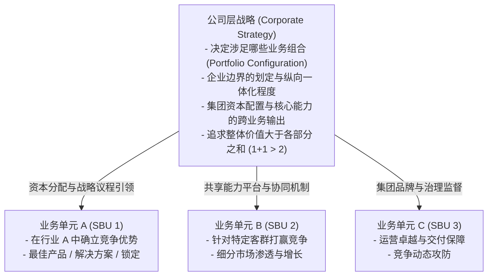
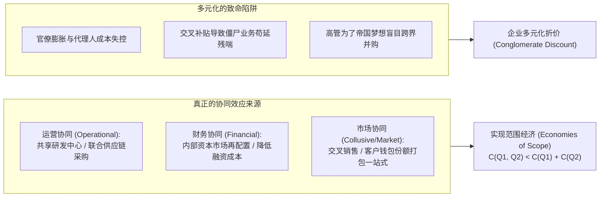
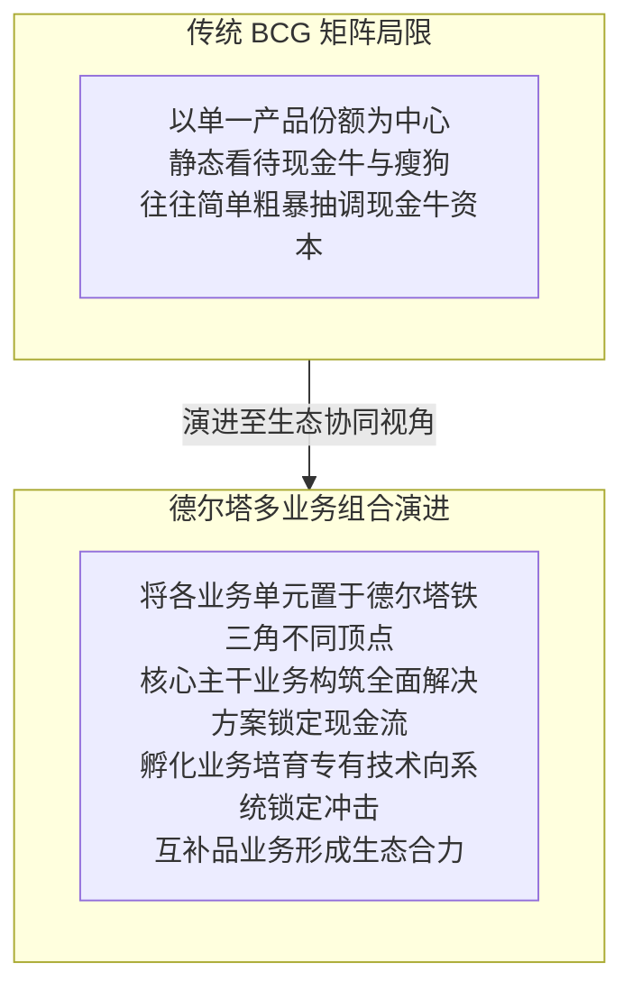

# Lec 11 公司层战略核心概念：多元化、边界与协同效应 (Corporate Strategy: The Core Concepts)

> MIT Sloan School of Management · 15.902 Strategic Management I · Prof. Arnoldo Hax

## TL;DR

- 业务层战略聚焦于“在特定行业中如何获胜”，而公司层战略聚焦于“企业应该涉足哪些行业组合”。
- 科斯交易成本理论与威廉姆森资产专用性，构成了界定企业纵向与横向边界的微观经济基石。
- 多元化战略的核心检验标准是“母合优势（Parenting Advantage）”与真正的范围经济。
- 绝大多数企业多元化最终走向价值毁灭，原因在于管理复杂性爆炸与伪协同效应的自我催眠。

## 业务战略 vs. 公司战略：本质区别与母合优势 / Business Strategy vs Corporate Strategy

在多业务跨国集团中，战略管理必须在两个完全不同的层次上清晰区分其职责与决策权。

业务层战略（Business-Level Strategy）关注的是单一行业或特定细分市场内的生存与竞争问题，其核心命题是“在我们所选定的这个赛道中，我们究竟应当如何超越竞争对手，构筑可持续的竞争优势”。它由具体的事业部总经理负责，涉及产品功能规划、客户细分对齐、渠道拓展与生产运营效率。

然而，当企业跨越单一业务边界，成长为拥有多个战略业务单元（Strategic Business Units, SBUs）的集团型企业时，战略的重心便上升到了公司层战略（Corporate-Level Strategy）。此时，CEO 和董事会关注的不再是某个具体产品的参数，而是更高维度的资产组合配置问题：“我们到底应该进入哪些行业？应该坚决退出哪些行业？如何让旗下的各个业务单元产生化学反应，使得整个集团的整体价值显著大于各个子公司独立运作时的价值之和？”

公司层战略的核心追求是**母合优势（Parenting Advantage）**：**某项业务如果独立作为一家上市公司运营，或者归属于其他集团，其价值是否会低于归属于我们集团？** 如果总部的存在不仅没有增加该业务的竞争力，反而摊派了巨额管理费用、延误了决策速度，那么该集团总部就是在净毁灭股东价值。卓越的集团总部必须扮演好“价值催化剂”与“能力放大器”的双重角色，通过调配稀缺的财务资本、技术知识与高管人才，为一线业务单元提供在公开市场上花钱也买不到的独特赋能。

## 企业边界理论：交易成本、资产专用性与纵向一体化 / Transaction Costs & Vertical Integration

企业应该自己制造（Make），还是从市场上采购（Buy）？应该自建渠道，还是依赖代理商？罗纳德·科斯（Ronald Coase）与奥利弗·威廉姆森（Oliver Williamson）的**交易成本经济学（Transaction Cost Economics, TCE）**提供了权威答案。

### 交易成本三大决定要素
1. **资产专用性（Asset Specificity）**：投入的资产（设备、场地、专用知识）是否只能用于特定合作？若资产具有极高的专用性，交易双方极易面临被对方“敲竹杠（Hold-up）”的机会主义威胁；
2. **不确定性与交易频率（Uncertainty & Frequency）**：市场环境越是不可预测、交易发生的频次越高，在市场上不断谈判、签署新合同并监督执行的外部交易成本就越高；
3. **有限理性与信息不对称**：面对技术未定型的全新领域，详细书面合同根本无法穷尽未来所有可能情况。

$$
\text{边界决策规则}: \quad \begin{cases} 
C_{\text{internal}} + G_{\text{governance}} < P_{\text{market}} + T_{\text{transaction}}, & \text{选择自建/纵向一体化 (Make)} \\ 
C_{\text{internal}} + G_{\text{governance}} \ge P_{\text{market}} + T_{\text{transaction}}, & \text{选择市场采购/外包 (Buy)} 
\end{cases}
$$

::: theorem 资产专用性与纵向一体化定理
当某项业务所依赖的实物资产、人力资产或场地资产具有极高的专用性，且外部市场充斥着不可预测的技术不确定性时，依靠外部市场契约的交易成本将趋于无穷大。此时，企业必须将该环节纳入公司边界内部，实施纵向一体化。
:::

## 多元化战略的逻辑、陷阱与协同效应分类 / Diversification Logic & Synergies

企业从单一业务向多业务扩张时，往往宣称是为了追求“协同效应（Synergies）”。然而，协同效应是商业世界中最常被滥用的借口：

### 相关多元化 vs. 非相关多元化
- **相关多元化（Related Diversification）**：新业务与现有核心业务在底层技术能力、生产流程或客户群体重合度高。具有极强的能力复用性和成功的概率；
- **非相关多元化（Unrelated Diversification / 跨界集团）**：跨入毫无关联的行业（如造纸企业跨界做房地产）。在资本市场健全的现代经济中，跨界多元化往往遭遇严重的“综合企业折价（Conglomerate Discount）”，因为股东自己可以在二级市场上分散投资组合，不需要企业高层代劳。

## 业务组合管理模型在德尔塔下的演进 / Portfolio Management Evolution

传统的业务组合分析工具（如波士顿 BCG 矩阵的“明星、现金牛、问号、瘦狗”，通用电气 GE-麦肯锡九宫格）主要基于市场增长率和相对市场份额：

哈克斯教授指出，在德尔塔框架下，评价一个业务单元的价值，**绝不能只看它账面上的独立利润，而必须看它对整个企业生态系统的战略锁屏价值**。如果某个业务本身毛利率低，但它能够牢牢吸附住顶级客户，或者它是吸引数万名应用开发者的关键互补品，它就绝不是应该被剥离的“瘦狗”，而是生态帝国的基石。

## 剥离、分拆与资本配置的最高纪律 / Divestitures & Capital Allocation

卓越的公司层战略不仅需要懂得何时进入，更需要懂得何时冷酷地退出：
1. **剥离非核心资产（Divestiture）**：当企业发现某项业务更适合在其他所有者手中创造价值时，果断出售并回收资本；
2. **分拆独立上市（Spin-off）**：消除业务单元之间的跨部门摩擦与官僚审批，激发团队创业精神；
3. **资本配置的纪律（Capital Allocation Discipline）**：拒绝基于历史习惯平均分配资本预算，始终将自由现金流投入到边际回报最高、能够显著增强德尔塔锁定的领域中。

## 我的理解与实践洞察 / Personal Insight

公司层战略最考验最高决策者的克制力与清醒认知。

::: insight 战略的节制胜于贪婪的扩张
平庸的企业家有一种与生俱来的“帝国扩张冲动”，渴望将企业版图填满所有能看到的行业，结果把企业变成了庞大臃肿、反应迟钝的四不像怪兽。
**卓越的公司层战略永远是极度克制的**。企业进入一个新领域的唯一理由，是你拥有能够对该行业实施降维打击的核心能力，或者该业务是完善你自身生态闭环不可或缺的拼图。如果你不能为被收购的企业带来超越同行的独特赋能，那么最好的公司战略就是把钱作为股息还给股东。
:::

## 思考题与实战研讨

1. 历史上通用电气（GE）在杰克·韦尔奇时代凭借非相关多元化大获成功，为何在数字化时代其庞大的金融与制造混合帝国最终分崩离析走向拆分？运用交易成本理论与母合优势进行剖析。
2. 很多互联网大厂通过烧钱补贴跨界进入社区团购或外卖领域，宣称具有“强大的流量协同效应”。运用本讲理论评估：纯粹的流量协同是否足以支撑起长期的范围经济？
