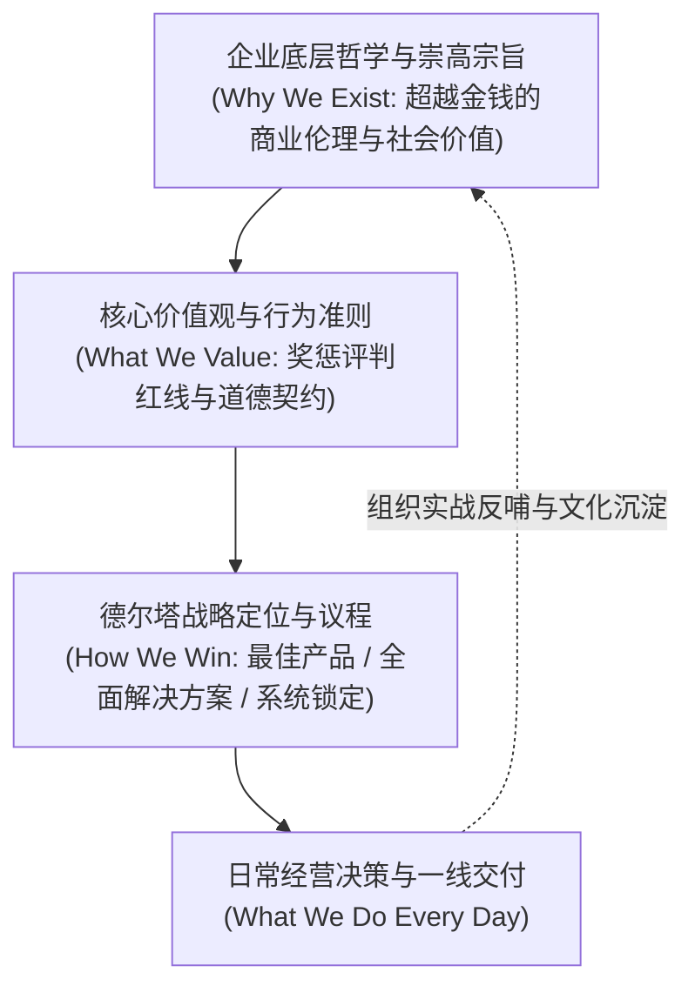
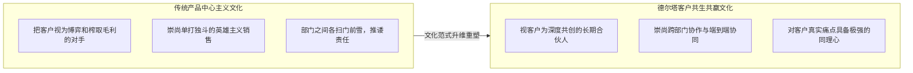

# Lec 12 企业哲学、价值观与组织文化建设 (Corporate Philosophy and Culture)

> MIT Sloan School of Management · 15.902 Strategic Management I · Prof. Arnoldo Hax

## TL;DR

- 企业哲学不仅是抽象的道德宣示，更是企业在充满不确定性环境中进行重大决策的最高罗盘。
- 德尔塔战略要求企业文化从冷酷对抗的“丛林狼性”彻底转向以同理心为底色的“客户共生”。
- 组织文化是最终极的隐性控制系统；当员工拥有共同心智模型时，无需繁文缛节即可实现分布式敏捷协同。
- 领导者必须成为企业文化的言行一致践行者与神圣守护者，否则虚伪的价值观口号将瓦解组织凝聚力。

## 企业哲学：战略的根基与崇高使命 / Foundations of Corporate Philosophy

彼得·德鲁克曾有名言：“文化能把战略当早餐吃（Culture eats strategy for breakfast）”。如果一项战略与企业的底层文化哲学背道而驰，那么再完美的分析工具与流程设计都会被无形的组织潜意识彻底绞杀。

阿诺尔多·哈克斯教授在 15.902 中极力倡导：**战略管理绝非单纯冷酷的财务数字游戏，它必须植根于一套深沉的企业哲学（Corporate Philosophy）**。

企业哲学回答了全公司上下最根本的形而上学问题：“我们为什么聚在一起？我们除了赚取利润之外，究竟为人类社会创造了什么不可磨灭的独特价值？”

## 价值观不仅是口号：行为准则与心智模型契约 / Core Values as Behavioral Anchors

许多企业的墙壁上贴满了“诚信、创新、客户至上、卓越”的漂亮标语，但在现实经营中，一旦面临短期利润与客户利益的冲突，这些标语就被抛之脑后。

哈克斯教授指出，真正的核心价值观（Core Values）必须具备**可验证的代价性（Costly Commitment）**：

::: definition 核心价值观的判别准则
一项信条只有当企业在面临巨大短期经济诱惑时，依然宁可牺牲账面利润也坚决不予妥协，它才配被称为核心价值观。如果一项价值观在任何时候都不需要付出沉没代价或利益牺牲，那么它只是一句廉价的公关修辞。
:::

### 核心价值观的落地转化机制
1. **晋升与淘汰的生死铁律**：业绩拔尖但价值观败坏的“野狗型员工”是否会被毫不犹豫地清理？
2. **重大冲突时的裁决基准**：当交付工期吃紧时，企业是选择蒙混过关还是宁可承受违约罚款也坚决召回有瑕疵的产品？
3. **一线授权的隐性边界**：普通客服人员是否有权调动数千美元的预算用于当场解决大客户的燃眉之急？

## 德尔塔文化：从对抗文化转向客户共生文化 / From Rivalry to Bonding Culture

战略选择与组织文化之间存在着深度的共生契约。波特式的竞争理论往往培育出一种充满敌意、崇尚零和博弈的组织文化；而德尔塔模型则要求彻底重塑组织的心智结构：

### 德尔塔共生文化的三大核心支柱
- **深度同理心（Radical Empathy）**：不仅倾听客户说了什么，更能洞察客户业务流程中未曾言明的隐性焦虑；
- **长期主义（Long-term Stewardship）**：坚决抵制任何可能损害长期客户互信的短期投机性收割行为；
- **生态开放包容（Ecosystem Openness）**：不仅赋能自身员工，更能以宽广的胸怀赋能外部互补品开发者与合作伙伴。

## 组织文化的培育、传递与变革路径 / Cultural Alignment and Transformation

文化无法通过行政命令强行植入，它是组织在一代代重大挑战与危机中共同演进沉淀的产物：

### 组织文化塑造的四项经典仪式
1. **英雄叙事（Heroic Narratives）**：在公司内部广泛传播那些为了兑现客户承诺不惜通宵达旦、甚至牺牲个人利益的平凡员工故事；
2. **惩戒案例（Exemplary Sanctions）**：公开惩处为了追逐短期业绩而欺瞒客户的高管，形成震撼心灵的制度震慑；
3. **日常仪式（Routines & Rituals）**：将深入一线调研客户、复盘战略失误固化为企业不可废除的管理例会机制；
4. **符号体系（Symbols & Language）**：在企业内部废除官僚层级称谓，倡导坦诚透明的扁平化沟通语境。

## 领导者作为文化守护者与战略布道者 / Leadership as Cultural Steward

在所有影响组织文化的因素中，CEO 与核心高管团队的**身教（Behavior Modeling）**具有绝对压倒性的决定权。

::: pitfall 领导力言行脱节导致的组织犬儒主义
如果高管在大会上呼吁“以客户为中心”，而在闭门会议中只关心“本季度财报能不能做上去”，一线员工就会立刻看穿这种伪善，并在组织内部滋生极度危险的**犬儒主义（Cynicism）**。员工会停止相信任何企业愿景，彻底退缩为只看眼前提成的雇佣军。
:::

卓越的领导者必须是“言行一致的信徒（Authentic Practitioner）”。他们将自己的绝大部分时间和心力，倾注于直接接触一线客户、践行战略议程，并通过每一次具体的资源配置向全员展示什么是企业不可动摇的信仰。

## 我的理解与实践洞察 / Personal Insight

很多商学院把战略讲成了纯粹的冷酷博弈计算，但德尔塔模型找回了商业的温度。

::: insight 战略的深度取决于企业灵魂的纯粹度
如果一个组织仅仅靠利益捆绑在一起，顺风顺水时自然皆大欢喜，但一旦遭遇技术断点或残酷的产业寒冬，树倒猢狲散将是必然的结局。
**真正能够穿越历史周期的伟大企业，无一不拥有超越利润之上的神圣信仰**。他们深信自己的存在让这个世界变得更加美好，深信通过赋能客户和生态伙伴能够创造出前所未有的文明价值。这种植根于骨髓的企业哲学与文化，构成了最强大的非线性竞争武器，任何试图用金钱和算法来复制它的对手都注定无功而返。
:::

## 思考题与实战研讨

1. 强生公司（Johnson & Johnson）拥有著名的《我们的信条》（Our Credo），在泰诺中毒危机中，强生管理层毫不犹豫下令全美召回数千万瓶药品。运用本讲的“代价性承诺”理论，分析这一举措如何将企业文化转化为历经百年不衰的品牌商誉？
2. 当一家追求“最佳产品”的企业试图向“全面客户解决方案”转型时，原有的“以出货量为中心”的狼性销售文化往往成为转型的最大阻力。请为该企业设计一套行之有效的文化变革路径。
