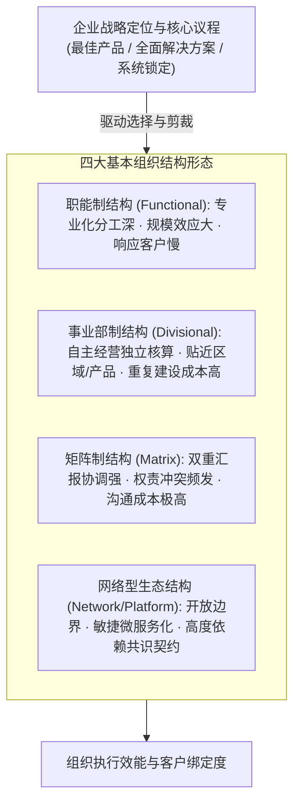

# Lec 13 组织设计的通用准则与架构权变 (General Principles of Organization Design)

> MIT Sloan School of Management · 15.902 Strategic Management I · Prof. Arnoldo Hax

## TL;DR

- “结构追随战略（Structure follows Strategy）”，组织架构是实现德尔塔定位的骨骼支撑。
- 职能制、事业部制、矩阵制与网络型组织各有权衡，不存在放之四海而皆准的万能模型。
- 德尔塔“全面客户解决方案”要求组织从以产品线为中心转向以客户行业或大客户团队为中心。
- 权变组织设计的核心准则是最小化跨部门协调摩擦，同时赋予前线接触客户的单元充分的决策权。

## 结构追随战略：组织设计的核心使命 / Structure Follows Strategy

阿尔弗雷德·钱德勒（Alfred Chandler）在战略史上的开创性论断指出：**组织结构必须无条件服从并服务于企业战略（Structure follows Strategy）**。如果战略已经从传统的标准化产品制造转向了高度定制化的整体解决方案，而组织骨架依然僵化地停留在按生产车间划分的传统职能制，战略必将遭受组织的剧烈抗拒。

阿诺尔多·哈克斯教授在 15.902 中系统阐述了现代企业组织设计的核心全景图。组织设计的本质并不是在图纸上绘制汇报层级虚实线，而是解决两大核心管理张力：
1. **分工与专业化（Differentiation）**：如何将庞大的业务目标拆解为具体的职能与责任单元；
2. **整合与协同（Integration）**：如何让各自为战的专业单元能够步调一致地服务于最终客户的价值创造。

组织架构的选择必须精确匹配企业的战略野心。当企业追求最佳产品时，高度集权的职能制能够将规模效益发挥到极致；但当企业迈向全面客户解决方案时，组织必须围绕客户群体打破职能边界，重组为敏捷的客户经营单元。

## 四大基本组织结构的特征与权衡剖析 / Structural Archetypes & Trade-offs

组织设计永远是一场充满妥协的权衡艺术（Art of Trade-offs）：

### 1. 职能制结构（Functional Structure）
- **适用场景**：单一业务、产品线相对简单、竞争依靠规模与成本优势的“最佳产品”战略；
- **核心优势**：专业技术深度积累极其深厚，设备与研发中心利用率最高；
- **致命弱点**：各职能部门（研发、制造、销售）极易形成利益孤岛，缺乏对最终端商业回报负责的统揽者。

### 2. 事业部制结构（Divisional Structure - 按产品/区域/客户划分）
- **适用场景**：多业务、跨国运营或面临多元化客群需求的大型集团；
- **核心优势**：将经营责任切实下沉到一线事业部总经理，对市场变化反应敏锐；
- **致命弱点**：各个事业部重复建设后台职能（如财务、人力、IT），导致管理成本上升与内部资源争夺。

### 3. 矩阵制结构（Matrix Structure）
- **适用场景**：既需要维持顶尖技术职能池，又需要跨职能攻克高价值战略大客户或重点工程项目；
- **核心优势**：打破横向与纵向的知识壁垒，极大提升高端专业人才的复用率；
- **致命弱点**：员工面临双头领导（Dual Reporting），在优先级冲突时容易引发高昂的沟通内耗与责任推诿。

### 4. 德尔塔导向的端到端网络型组织（Delta Network Architecture）
在全面客户解决方案与系统锁定战略下，哈克斯教授推崇一种以客户账户（Customer Account）为圆心的网状组织：**前端设立常驻大客户专属敏捷团队，后端设立标准化共享能力池（Shared Services & Competency Centers）**，由前线根据客户真实痛点反向调用后端模块。

::: definition 组织协调成本公理
任何试图通过增加管理汇报层级和审批流程来解决部门冲突的做法，都将指数级推高组织的内部交易成本。卓越的组织设计应当通过清晰的授权边界与透明的信息流，让最接近客户的一线人员拥有现场决策权。
:::

## 德尔塔战略定位与组织架构匹配矩阵 / Aligning Structure with Delta Triangle

组织结构必须与德尔塔铁三角的三个顶点形成严丝合缝的映射：

| 战略定位选项 | 主导组织架构设计 | 核心权力重心所在 | 关键绩效衡量基准 |
| :--- | :--- | :--- | :--- |
| **最佳产品 (Best Product)** | 高度集权的职能制结构 | 研发与供应链/制造主管 | 单位制造成本、良品率、标准品出货量 |
| **全面客户解决方案 (Total Solutions)** | 围绕重点客户集群的网状/事业群架构 | 大客户总监（Key Account Manager） | 客户钱包份额、单客生命周期价值、客户净推荐值（NPS） |
| **系统锁定 (System Lock-in)** | 开放的平台架构与开发者生态事业部 | 开发者关系（DevRel）与底层标准架构师 | 互补品开发者数量、生态 API 调用量、网络外生收益 |

## 组织设计的四大通用设计准则 / Four Core Design Principles

哈克斯教授为高管团队提炼了组织架构设计的四项基本准则：
1. **决策权与信息源就近匹配（Colocation of Knowledge and Decision Rights）**：谁掌握最丰富、最鲜活的现场信息，重大裁决权就必须授权给谁；
2. **控制幅度与层级扁平化（Span of Control & Flat Hierarchies）**：管理层级一般不宜超过 4-5 层，过多的层级会导致战略指令严重衰减失真；
3. **消除模糊地带（Clarity of Accountability）**：清晰定义 RACI 矩阵（谁负责、谁批准、谁咨询、谁知情），杜绝“人人负责等于无人负责”；
4. **横向协同机制的制度化（Institutionalized Lateral Coordination）**：通过设立跨部门常设委员会、敏捷项目制与数字化协同看板，抹平职能裂隙。

## 我的理解与实践洞察 / Personal Insight

许多企业在陷入增长停滞时，最喜欢的动作就是盲目换高管或折腾组织架构图。

::: insight 组织架构是土壤，文化与流程才是种子
画出一张漂亮的组织架构图只需要十分钟，但让活生生的人在新架构中顺畅协作往往需要数年。
**如果企业的底层激励机制没有变、高管的权力欲没有收敛、考核指标依然在奖励部门割裂，那么无论架构图怎么改，组织都会迅速退化回原来的老路**。卓越的战略家从不把组织架构视为静态的权力分配图，而是将其视为一条高速流动的信息公路网，唯一的目的就是让最优秀的资源以最短的路径奔赴客户最紧急的前线。
:::

## 思考题与实战研讨

1. 华为在向政企行业解决方案业务转型时，借鉴了著名的“铁三角”组织架构（客户经理 AR + 解决方案专家 SR + 交付专家 FR）。结合本讲的德尔塔组织设计原理，分析这种前线小组如何化解传统职能部门之间的推诿？
2. 一家跨国医药集团目前按“地区事业部（亚太、欧洲、美洲）”进行划分，但在面对全球超大跨国医院集团客户时屡遭失败。请为其重新设计一套兼顾本地合规与全球大客户统一作战的权变组织架构。
