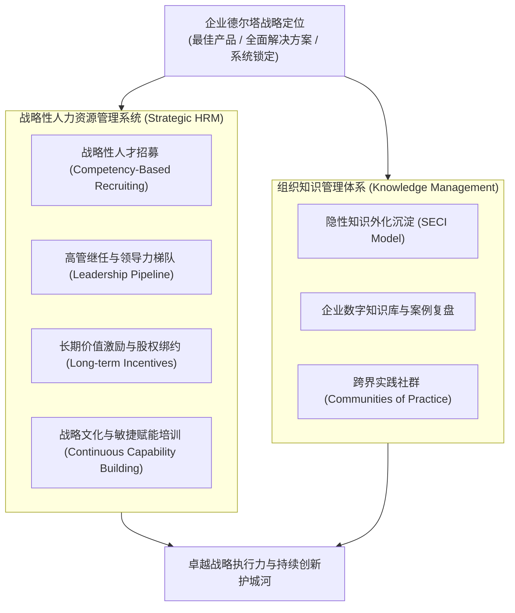
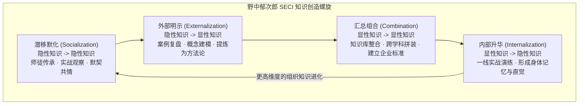

# Lec 14 人力资源战略与组织知识管理 (Human Resources Management & Knowledge Management)

> MIT Sloan School of Management · 15.902 Strategic Management I · Prof. Arnoldo Hax

## TL;DR

- 人力资源管理不是行政后勤，而是将战略野心转化为现实生产力最核心的引擎。
- 战略性人力资源管理（Strategic HRM）要求人才招聘、培育、激励与淘汰必须与德尔塔战略完全对齐。
- 野中郁次郎 SECI 模型揭示了隐性知识（Tacit）向显性知识（Explicit）螺旋上升的创造机制。
- 组织知识资产是不可复制的终极隔离机制，企业必须建立永不流失的知识仓库与学习型社区。

## 战略性人力资源管理的范式迁移 / From Administrative HR to Strategic HRM

在传统的工业时代，人事部门（Personnel Department）主要处理考勤、薪资发放和劳动合同纠纷，属于典型的行政被动角色。然而，在以智力资本、客户深度关系和生态协同为主导的现代战略语境下，阿诺尔多·哈克斯教授将人力资源定位为**战略落地最根本的第一生产要素**。

企业的任何战略抱负，无论是构筑基于技术专长的最佳产品，还是深入客户流程提供量身定制的全面解决方案，亦或是打造掌控行业事实标准的开放生态，最终都必须依托于有血有肉的人才队伍去落地兑现。没有合格的人才储备与知识传承体系，任何宏伟的战略规划都不过是空中楼阁。

战略性人力资源管理（Strategic HRM）的核心理念在于彻底打破人事职能与企业核心业务之间的割裂壁垒。它要求将人才的识别、招聘、配置、培育、激励与淘汰全流程，与企业的德尔塔战略定位以及未来三到五年的关键战略议程紧密对齐，形成一个由人才驱动战略、由知识沉淀护城河的良性自增强飞轮：

战略性人力资源管理（Strategic HRM）的核心主张是：**企业的每一项人才实践，都必须直接回应战略议程的需求**。如果战略议程要求建立“全球客户解决方案”，而 HR 部门还在按照十年前的流水线工人标准招募只懂执行既定 SOP 的推销员，战略就必然在人才源头枯竭。战略性 HRM 必须超越简单的后勤保障，成为最高管理层制定战略时的核心参谋长。

## 德尔塔定位下的人才画像与激励契约差异 / Talent Architectures Across Delta Triangle

不同战略定位所依赖的智力资产与关键人才胜任特征截然不同：

### 1. 最佳产品定位下的人才要求
- **核心人才**：顶级研发科学家、精益生产工程师与严谨的质量检验专家；
- **能力特征**：对专业技术具备极致的钻研精神，追求零缺陷与低容错；
- **激励机制**：专利成果奖金、项目交付节点里程碑奖与工序效率分成。

### 2. 全面客户解决方案定位下的人才要求
- **核心人才**：大客户咨询顾问、行业架构师与高情商的跨界项目管理者；
- **能力特征**：极强的商业同理心，能读懂客户高管的隐性痛点，具备跨部门资源调配的政治智慧；
- **激励机制**：客户长期留存率分红、客户资产增值分成与联合利润分享计划。

### 3. 系统锁定定位下的人才要求
- **核心人才**：生态布道师、开放开源平台架构师与标准制定战略家；
- **能力特征**：极高维度的生态视野，善于制定多方共赢的商业协议，具备强大的开发者社区号召力；
- **激励机制**：平台期权激励、生态规模衍生收益与长期股权激励。

::: pitfall 错位激励导致的行为扭曲
当一家企业宣布转型“以客户为中心的解决方案”，却依然沿用“按单个产品销售额提成”的考核制度时，销售人员会本能地推销最容易卖的单一硬件，甚至刻意隐瞒客户的复杂需求，因为复杂的定制化解决方案意味着更长的回款周期和更高的前期沟通成本。
:::

## 知识管理与 SECI 知识创造螺旋 / Knowledge Management & The SECI Spiral

企业最宝贵的资产并非趴在资产负债表上的厂房设备，而是游弋在数万名员工大脑中、随时可能随电梯下楼离开的**知识资本（Intellectual Capital）**。

日本学者野中郁次郎（Ikujiro Nonaka）与竹内弘高提出的 **SECI 知识螺旋模型**，揭示了个人知识如何升华为组织护城河的动态机制：

1. **潜移默化（Socialization）**：年轻咨询顾问跟随资深合伙人深入客户谈判现场，通过耳濡目染学习如何把握客户心理（隐性到隐性）；
2. **外部明示（Externalization）**：将攻克复杂客户难题的成功与失败经验撰写为深度案例研究报告与标准交付方法论（隐性到显性）；
3. **汇总组合（Combination）**：将不同部门的交付方案与全球技术组件整理汇编为企业级的“解决方案工具箱与代码库”（显性到显性）；
4. **内部升华（Internalization）**：新员工通过阅读知识库并在模拟沙盘中实操，将标准方法论融化为自己的下意识直觉（显性到隐性）。

::: definition 默会知识 (Tacit Knowledge)
默会知识是指高度个体化、难以用语言、文字或公式完全清晰表达的直觉、手艺、洞察与经验。它是资源基础观中因果模糊性的核心来源，构成了竞争对手无论如何都无法一比一抄袭的核心护城河。
:::

## 打造永不流失的学习型组织 / Building the Learning Organization

哈克斯教授指出，卓越的战略家必须将知识管理机制制度化：
- **无责复盘文化（Blameless Post-Mortem）**：在重大项目无论成功还是惨败之后，全员坦诚剖析根因，将教训沉淀为制度资产，绝不因犯错诛连个人；
- **实践社群（Communities of Practice, CoP）**：跨越事业部界限，鼓励具有相同专业兴趣（如数据湖架构、大客户交付谈判）的员工自发组织研讨社群；
- **知识共享的激励契约**：将“对组织知识资产的贡献度（知识库采纳率、导师带教成效）”作为员工晋升核心技术职级的强制门槛。

## 我的理解与实践洞察 / Personal Insight

人才与知识管理是衡量一家企业是否具有长寿基因的试金石。

::: insight 企业的本质是知识创造与传承的容器
机器会折旧，专利会过期，代码会落后。
**真正能够跨越技术周期而持续领先的企业，本质上是一个极其高效的知识繁育温床**。在这里，上一代领军者用无数真金白银和血泪教训换来的默会认知，能够以极高的保真度传递给下一代年轻人；当危机来临，组织内部沉淀的万千智慧能够迅速发生组合重构，催生出令对手目瞪口呆的新型打法。忽视人才与知识培育的战略家，只是在沙滩上搭建注定被海浪冲垮的虚妄城堡。
:::

## 思考题与实战研讨

1. 麦肯锡（McKinsey）等全球顶级管理咨询公司为何极少因为资深合伙人的离职而发生业务崩盘？运用 SECI 模型分析其跨国知识管理系统（PD Work、Practice Networks）如何实现核心能力的组织化沉淀？
2. 在全面客户解决方案战略下，企业应当如何设计知识产权保护与激励机制，以防止核心大客户团队“带着客户与方案直接跳槽单干”？
