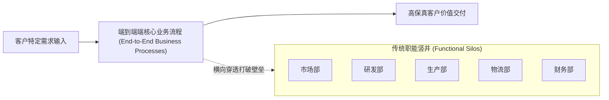
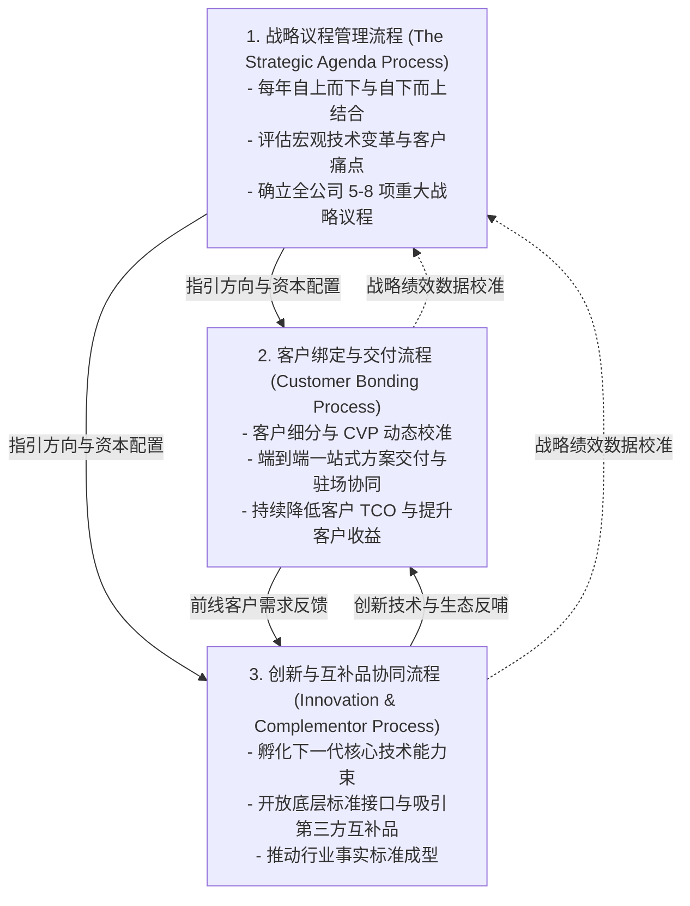

# Lec 15 核心业务流程重塑与全球供应链管理 (Business Processes & Global Supply Chain)

> MIT Sloan School of Management · 15.902 Strategic Management I · Prof. Arnoldo Hax

## TL;DR

- 战略意图最终必须通过端到端的核心业务流程转化为客户可感知的交付物。
- 业务流程重塑（BPR）坚决摒弃局部渐进式修补，主张从客户价值出发对全链路进行根本性反思。
- 德尔塔模型确立三大核心经营流程：战略议程管理、客户绑定流程与创新研发流程。
- 全球供应链管理已从成本最小化的采购职能演进为实现敏捷交付与互补品协同的战略武器。

## 流程视角：打破组织竖井的横向切面 / The Process View of the Firm

在传统的职能型企业中，每个人都坐在各自的孤岛里（研发、采购、制造、质检、销售、回款），客户的订单就像接力棒一样在漫长的部门流水线上辗转传递。每一处部门交界处都充斥着审批等待、信息失真与责任推诿。

阿诺尔多·哈克斯教授指出：**客户根本不在乎企业的内部组织架构有多宏伟，客户只在乎从提出需求到问题彻底解决的端到端体验！** 企业必须建立强大的**业务流程视角（Process View of the Firm）**，将流程定义为“将一组输入转化为对客户具有明确价值输出的逻辑关联活动集合”。

业务流程是横向穿透所有职能部门的激光束。卓越的企业通过重构核心流程，消除了成百上千个非增值环节（Non-value-added activities），从而在交付速度、定制精度和成本控制上构筑起对手难以企及的运营壁垒。

## 迈克尔·哈默业务流程重塑理论 / Business Process Reengineering (BPR)

麻省理工学院著名管理学家迈克尔·哈默（Michael Hammer）提出了名震全球的**业务流程重塑（Business Process Reengineering, BPR）**理论。哈克斯教授在 15.902 中深度融合了这一思想：

::: definition 业务流程重塑 (BPR)
业务流程重塑是对企业业务流程进行**根本性的重新思考（Fundamental Rethinking）**与**彻底性的重新设计（Radical Redesign）**，从而在成本、质量、服务和速度等当今衡量绩效的关键指标上取得戏剧性（Dramatic）的改善。
:::

### BPR 的四大核心革命性原则
1. **围绕目标结果而非任务分工进行组织（Organize around outcomes, not tasks）**：由一个跨职能团队或单一流程负责人对端到端交付结果负全责，彻底消灭交接摩擦；
2. **让使用流程产出的人直接执行该流程（Have those who use the output of the process perform the process）**：通过数字化授权，消除层层请示汇报；
3. **将信息处理工作融入产生该信息的实际工作之中（Subsume information-processing work into the real work）**：杜绝多部门重复录入对账；
4. **单点捕获信息，全网实时共享（Capture information once and at the source）**：建立统一数据底座，杜绝信息孤岛。

## 德尔塔三大核心管理流程的闭环运作 / Three Core Processes of Delta Model

在德尔塔模型中，哈克斯教授坚决反对将企业管理割裂为孤立的职能管理。相反，他将企业庞杂纷繁的日常经营高度凝练为三大相互咬合、持续流转的生命体基石流程。

这三大核心管理流程涵盖了从顶层战略方向的研判、到前线客户关系的深度绑定，再到未来技术与生态创新的孕育，构建起一个由战略到交付、再由前线实战数据反哺战略的自适应闭环系统：

这三大流程不是一年运转一次的形式主义报告，而是日常每周、每月都在持续运转的组织脉搏。

### 三大流程的协作运行机制
1. **战略议程流程是导航罗盘**：确保全公司的稀缺资本与精英智力始终聚焦在最能拉开竞争差距的攻坚战役上，防止组织陷入战略失焦与部门争夺资源的无序状态；
2. **客户绑定流程是一线战场**：直接穿透到大客户的核心业务流程内部，通过提供定制化、高附加值的整体解决方案，构筑起难以逾越的结构性转换成本；
3. **创新与互补品流程是未来引擎**：不仅关注企业内部实验室的技术攻关，更通过开放 API 接口与开发者计划，把外部成千上万的第三方互补品开发者吸纳为平台创新的主力军。三大流程协同共进，使得企业在深耕存量市场的同时，源源不断地开辟出全新的增量蓝海。

## 全球供应链管理的战略升维：从采购后勤到竞争武器 / Strategic Supply Chain Management

全球供应链早已不再是简单的物流配送，它是企业实现德尔塔战略定位的核心支柱：

### 1. 敏捷型供应链 vs. 精益型供应链
- **精益供应链（Lean Supply Chain）**：适用于需求稳定、可预测性高的“最佳产品”定位，核心目标是消灭一切库存浪费，压榨单位运输成本；
- **敏捷供应链（Agile Supply Chain）**：适用于需求高度不确定、定制化要求极高的“全面客户解决方案”，核心目标是极速柔性响应，宁可保留适度产能冗余也要确保按需准时交付。

### 2. 牛鞭效应（Bullwhip Effect）的根治
在多级供应链中，终端需求的微小波动会沿着批发商、分销商、制造商、原材料供应商逐级放大，造成灾难性的库存积压与产能过剩。
- **德尔塔解决方案**：通过与大客户建立战略互信，将双方的信息系统打通（如供应商管理库存 VMI 模式），实时监控客户实际消耗数据，从根本上熨平假性需求波动。

::: example 戴尔电脑（Dell）的直接客户流程与零库存奇迹
迈克尔·戴尔开创的“按单定制（Build-to-Order）”供应链流程，是 BPR 与客户绑定的经典代表。戴尔彻底取消了电脑零售商中间环节，直接通过电话和互联网接收终端客户配置需求；订单在数小时内流转至组装车间，零部件供应商在数小时内准时送达。戴尔不仅实现了“负营运资本周期（在支付供应商货款前就已经收到了客户预付款）”，更让客户享受到最新一代芯片上市时的第一手产品，构筑起巨大的运营壁垒。
:::

## 我的理解与实践洞察 / Personal Insight

战略的优雅往往体现在宏观愿景上，但战略的残忍却永远落实在微观流程中。

::: insight 流程是战略的肉身，细节是竞争的修罗场
如果一家企业的战略高喊要实现极致的客户体验，但客户开具一张发票需要经过七个副总裁盖章、退换货需要拨打三次客服电话且等待两周，那么这个企业的战略就只是一张废纸。
**真正伟大的战略家，必须拥有下沉到流程泥淖中解剖手术的勇气**。敢于斩断盘根错节的部门官僚切腹自肥流程，敢于让员工围绕客户价值重新排列组合，敢于将供应链从冰冷的买卖对立改造为心意相通的神经中枢。流程顺了，战略的气血才能通达全身。
:::

## 思考题与实战研讨

1. 某重型机械制造企业在尝试提供“设备全生命周期运营维护解决方案”时，发现一线维修工程师由于需要填写冗长复杂的跨部门备件审批单，导致平均停机维修时间长达 72 小时，客户怨声载道。运用 BPR 原则为其设计一套流程重构方案。
2. 结合戴尔与西麦斯（CEMEX）的供应链实践，探讨企业在向“全面客户解决方案”跨越时，供应链绩效考核指标应如何从单纯的“单位采购成本”转向“客户停线时间”？
