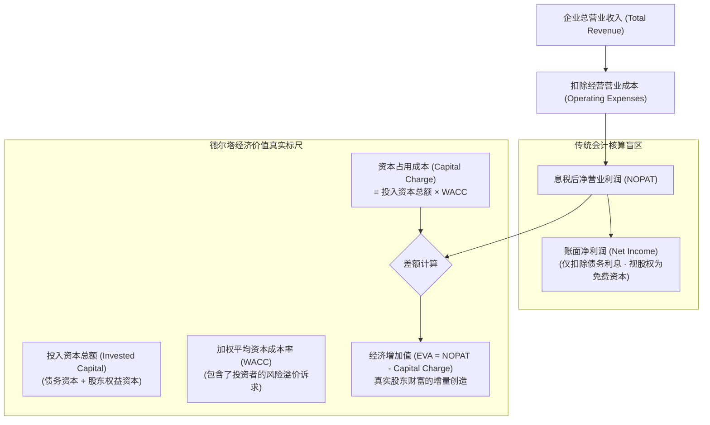
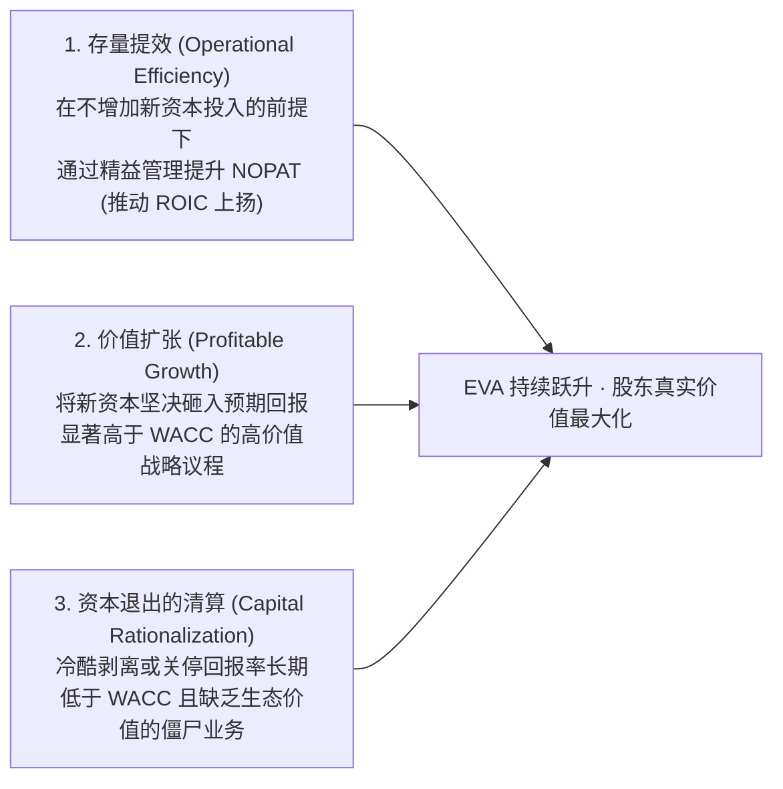

# Lec 16 企业价值创造度量：EVA 与财务驱动指标 (Metrics of Value Creation)

> MIT Sloan School of Management · 15.902 Strategic Management I · Prof. Arnoldo Hax

## TL;DR

- 会计利润的虚假繁荣会掩盖真实的价值毁灭，战略评估必须立足于经济利润。
- 经济增加值（EVA）严格扣除全部资本成本（股权与债务），是度量真实股东价值创造的核心标尺。
- EVA 三大提升途径：提高存量资产营运回报、将新资本配置于回报高于 WACC 的业务、果断剥离价值毁灭资产。
- 德尔塔模型将 EVA 深度拆解为与客户生命周期价值及互补品网络协同相映射的微观驱动树。

## 会计利润的幻觉与真实价值创造之谜 / The Illusion of Accounting Profit

在资本市场上，每年都有数以千计的企业向股东宣布自己实现了“创纪录的净利润（Net Income）”，然而其股票市值却在财报公布后断崖式下跌。这种看似矛盾的现象暴露出传统会计利润的核心缺陷：**会计报表只计算了债务资本的利息支出，却完全无视了股权资本的高昂机会成本！**

阿诺尔多·哈克斯教授在 15.902 中严肃指出：**天下没有免费的股权午餐！股东向企业投入的每一分资本，都承担了巨大的商业风险，必然要求相应的风险溢价回报**。如果一家企业动用了 100 亿元的股东权益，历经一年辛苦经营只赚取了区区 2 亿元的账面净利润（ROE 仅为 2%），而同期无风险国债利率为 3%，同风险行业的资本机会成本为 8%，那么这家企业在本质上不仅没有创造价值，反而净毁灭了股东整整 6 亿元的经济财富！

企业唯有建立以真实经济增加值（Economic Value Added, EVA）为核心的度量衡，才能驱散会计利润的障眼法，让战略决策回归商业本质。

## 经济增加值（EVA）的严谨数学机理与内涵 / Mathematical Foundations of EVA

经济增加值由斯特恩·斯图尔特（Stern Stewart）公司首创，并被哈克斯教授全面引入战略管理框架之中。其核心公式表达如下：

$$
\text{EVA} = \text{NOPAT} - (\text{Capital} \times \text{WACC})
$$

或者等价地表达为资本回报率与资本成本率的差额放大机制：

$$
\text{EVA} = (\text{ROIC} - \text{WACC}) \times \text{Capital}
$$

其中各项经济学参数的严格定义为：
- **NOPAT（Net Operating Profit After Tax）**：息税后净营业利润，排除了资本结构和非经常性损益的干扰；
- **Capital**：企业全部投入的营运资本存量（固定资产净值 + 净营运资本）；
- **WACC（Weighted Average Cost of Capital）**：加权平均资本成本率，综合反映了企业权益融资与债务融资的加权机会成本；
- **ROIC（Return on Invested Capital）**：投入资本回报率（$\text{ROIC} = \text{NOPAT} / \text{Capital}$）。

::: theorem EVA 价值创造定理
企业只有在其投入资本回报率（ROIC）严格大于加权平均资本成本（WACC）时，即 $(\text{ROIC} - \text{WACC}) > 0$，扩大投资规模才能够为股东创造真实增量财富。当 $\text{ROIC} < \text{WACC}$ 时，企业的营收扩张速度越快、投资规模越大，其对社会总资本的净毁灭程度就越深。
:::

## 提升企业 EVA 的三大经典战略路径 / Three Strategic Levers of EVA

企业在德尔塔战略落地过程中，提升 EVA 绝不是简单的削减差旅费，而是有系统性的三条战略杠杆：

### 1. 运营提效：盘活存量资产
通过优化供应链、消除呆滞库存、提高资产周转率，使得同样的厂房设备能够释放出更高的经营现金流，从而直接拉升 ROIC。

### 2. 战略扩张：精明配置增量资本
坚守资本配置纪律，每一笔重大资本开支（Capex）与研发并购投资，必须经过严苛的现金流折现（DCF）与 EVA 压力测试，确保未来现金流回报能充分覆盖风险溢价。

### 3. 资本收缩：斩断价值毁灭的脓疮
识别组织内部那些常年账面微利甚至亏损、占用大量营运资本的边缘业务。果断剥离并收回资本，用于偿还高息债务或回购股票，从而直接消除巨大的资本占用成本（Capital Charge）。

## 德尔塔视角下的价值创造微观驱动树 / Deconstructing the EVA Value Tree

哈克斯教授强调，CEO 不能只盯着最终的 EVA 总数，必须将 EVA 拆解为贯穿企业日常经营的**价值驱动树（Value Driver Tree）**：

| EVA 驱动层级 | 微观经营业务指标（德尔塔关联映射） | 战略管理干预动作 |
| :--- | :--- | :--- |
| **收入端增长 (NOPAT)** | 客户留存率（Retention）、大客户钱包份额、新解决方案交叉销售比率 | 从纯标品销售转型为高毛利的长期运维与集成服务合同 |
| **成本端压缩 (NOPAT)** | 客户服务响应周期、一次性交付合格率、非增值返工工时 | 推进业务流程重塑（BPR），打通数据壁垒，消除部门协调内耗 |
| **资本效率优化 (Capital)** | 应收账款周转天数（DSO）、存货周转天数（DIO）、在建工程交付周期 | 实施供应商管理库存（VMI），推行敏捷精益生产，缩短现金循环周期 |
| **风险成本压降 (WACC)** | 客户集中度多元化、生态共生稳定性、战略契约不可替代性 | 构筑强大的转换成本与系统锁定，降低企业经营现金流的系统性贝塔风险 |

::: example 西麦斯（CEMEX）运用 EVA 考核全球水泥并购
在墨西哥水泥巨头 CEMEX 的全球疯狂并购扩张中，CEO 赞布拉诺（Zambrano）严格执行 EVA 考核纪律。每当收购一家位于西班牙、美国或东南亚的本土水泥厂，CEMEX 立即派驻技术团队植入其自研的 IT 调度系统和卫星全球追踪平台，将收购标的冗长混乱的库存和物流流程彻底重组。短短 12 个月内，被收购企业的流动资产占用压缩 40%，营运利润飙升，使原本亏损的资产 ROIC 迅速超越当地 WACC，为股东创造了惊人的持续 EVA 净增量。
:::

## 我的理解与实践洞察 / Personal Insight

资本成本是商业世界最冷酷的重力加速度。

::: insight 懂 EVA 的 CEO 才是合格的资产受托人
平庸的管理者沉迷于制造宏大的“营收破千亿”、“全国网点第一”的虚荣故事，为此不惜在资本市场上疯狂定增圈钱，然后盲目铺摊子；等到行业周期下行，留下的是满地坏账、锈迹斑斑的闲置厂房和血本无归的股民。
**真正卓越的 CEO 始终对资本抱有深沉的敬畏**。他们明白自己每一天都在借用股东与债权人的血汗钱，每一分利息和机会成本都在滴答作响。唯有战战兢兢将资本精准灌溉到真正能建立德尔塔护城河、能跑赢资本成本的沃土上，企业才能在狂风暴雨中屹立不倒。
:::

## 思考题与实战研讨

1. 某软件 SaaS 企业年度财报显示净利润由正转负，出现了 5000 万元的亏损，但其自由现金流强劲，客户续约留存率高达 95%，且新客户获取成本（CAC）在 18 个月内即可被全部收回。结合 EVA 与真实价值创造理论，分析该企业是在创造价值还是毁灭价值？
2. 如果一家大型国企将下属各分公司的考核指标从单纯的“营业收入总额”切换为“EVA 经济增加值”，其各级干部的投资决策行为和库存管理模式将会发生哪些深刻的根本性转变？
