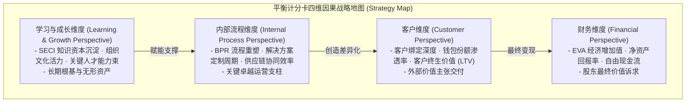

# Lec 17 平衡计分卡与颗粒度绩效度量 (The Balanced Scorecard and Granular Metrics)

> MIT Sloan School of Management · 15.902 Strategic Management I · Prof. Arnoldo Hax

## TL;DR

- 平衡计分卡（BSC）超越单纯财务指标滞后性，构筑财务、客户、内部流程、学习与成长四维因果链。
- 战略地图将抽象愿景转化为清晰的价值创造因果假设，让全员看清组织前行路径。
- 先行指标（Leading）驱动滞后指标（Lagging），度量衡必须保持毫秒级的颗粒度洞察。
- 德尔塔平衡计分卡核心是衡量客户绑定的深度与互补品生态的活跃度，而非机械填表。

## 传统绩效衡量的盲区与平衡计分卡的诞生 / The Evolution of Balanced Scorecard

开着只显示后视镜的汽车以 120 码的速度在高速公路上狂奔，是极其危险的自杀行为；然而绝大多数企业的高管正是这样管理企业的——他们仅仅依靠财务报表来评估企业的健康状况。财务数据（营收、利润、成本）虽然精确，但它们在本质上是**滞后指标（Lagging Indicators）**，反映的是企业在过去 6 到 12 个月内所采取行动的历史遗迹，根本无法预测企业在明天的生死存亡。

为了打破这种“后视镜管理”的致命缺陷，哈佛商学院罗伯特·卡普兰（Robert Kaplan）与戴维·诺顿（David Norton）开创了享誉全球的**平衡计分卡（Balanced Scorecard, BSC）**。阿诺尔多·哈克斯教授在 15.902 中，将平衡计分卡与德尔塔模型进行了深度嫁接与升维。



平衡计分卡的精髓不在于“平衡”，而在于四维之间坚不可摧的**因果逻辑链条（Cause-and-Effect Chain）**：如果组织拥有优秀的人才与知识资产（学习与成长），就能重塑出无懈可击的高效业务流程（内部流程）；高效流程必然为客户带来前所未有的减成本与增收收益（客户维度）；而客户的高度信任与深度绑定，最终必将水到渠成地转化为惊人的长期超额经济利润与 EVA（财务维度）。

## 战略地图：可视化假设检验系统 / Strategy Maps: Visualizing the Strategy

战略不是静态的文件，而是一组**关于因果关系的假说集合（A Set of Hypotheses）**。战略地图（Strategy Map）的作用，就是用一张清晰直观的架构图，把高管脑海中关于企业如何赚钱的底层因果逻辑彻底透明化：

::: definition 战略地图因果链假设
任何战略地图都必须能够用严格的“如果……那么……”语句自下而上进行逻辑推演：
- **如果** 我们对一线工程师进行德尔塔咨询顾问能力的深度轮训并沉淀案例库（学习与成长）；
- **那么** 我们就能将复杂企业工业解决方案的交付周期从 90 天压缩到 25 天（内部流程）；
- **那么** 核心大客户对我们的供应商综合评分与转换成本就会显著抬升，钱包份额突破 60%（客户）；
- **最终** 企业的单客营业利润率将大幅上扬，驱动 EVA 突破资本成本的束缚（财务）。
:::

如果年底财务指标未达预期，高管团队无需相互推诿指责，只需沿着战略地图的因果链条逆向排查：究竟是哪一个维度的假设在现实检验中被证伪了？是培训不到位？还是交付流程卡壳？抑或是价值主张本身没有打动客户？

## 先行指标 vs. 滞后指标的动态辩证 / Leading vs. Lagging Indicators

指标设计最忌讳一刀切。哈克斯教授要求管理层必须严格区分先行指标与滞后指标：

| 维度对比 | 先行指标（Leading Indicators / 驱动指标） | 滞后指标（Lagging Indicators / 结果指标） |
| :--- | :--- | :--- |
| **时间属性** | 实时、高频反映业务前线的即时变化（毫秒级态势感知） | 低频、按月/季/年统计的历史沉淀（事后验尸） |
| **可控程度** | 一线员工的主观行动可以直接施加影响并迅速见效 | 由无数复杂变量交织作用形成的最终结果，无法直接操作 |
| **典型案例** | 客户现场拜访频次、重大方案提报数、新代码提交测试通过率 | 季度净利润、总销售额、净资产回报率（ROE） |
| **管理陷阱** | 若指标设计不当，容易沦为员工应付差事的刷量游戏 | 只盯着滞后指标，等发现数字恶化时企业往往已经病入膏肓 |

卓越的管理仪表盘必须由 **20% 的滞后指标**（用于坚守终局结果）与 **80% 的先行指标**（用于指导日常战斗）紧密编织而成。

## 德尔塔颗粒度度量衡的设计铁律 / Principles of Granular Metrics

在德尔塔模型中，哈克斯教授对“颗粒度（Granular）”提出了极高的要求。粗放的宏观平均数不仅掩盖问题，更会杀死优秀员工的积极性：

```mermaid
flowchart LR
    Macro["粗放的宏观汇总指标 (Aggregate Trap)<br/>- 全公司总销售额<br/>- 全集团平均毛利率<br/>(掩盖 80% 业务正在烧损资本的真相)"]
    
    -->|颗粒度穿透下沉|
    
    Granular["德尔塔颗粒度微观监控 (Granular Dashboard)<br/>- 基于作业成本法 (ABC) 的单客户单单净净利率<br/>- 大客户决策链关键人员拜访渗透率<br/>- 互补品开发者首款插件上架周期<br/>- 客户停机故障首问彻底解决时长"]
```

### 德尔塔颗粒度指标体系三项核心法则
1. **穿透到最小经营单元**：指标必须能够清晰归因到具体的大客户经理、具体的项目战役突击队或特定的代码模块负责人；
2. **直指客户绑定本质**：考核重点坚决不能停留在“产品交货数量”，必须考核“客户系统与我方 API 打通的接口数量”、“客户将核心生产数据迁移至我方平台的比例”等能够锁死转移成本的关键行为；
3. **动态淘汰机制**：指标不是一成不变的石碑。一旦某个战略战役打赢、某项流程已经固化为员工肌肉记忆，该指标就应立刻从高管战略仪表盘中降级，腾出版位给最新的战略议程。

## 我的理解与实践洞察 / Personal Insight

许多企业把平衡计分卡做成了劳民伤财的“填表官僚盛宴”。

::: insight 度量的灵魂是激发思考，而不是制造考核枷锁
如果你去问很多公司的中层经理：“你们为什么填这个 BSC 表格？”他们会告诉你：“因为 HR 和战略部要收表打分扣年终奖。”
**当度量衡异化为惩罚员工的工具时，员工就会把所有的聪明才智用在如何伪造指标和讨好系统上**。
平衡计分卡最初的伟大构想，是为全员提供一张共通的战略语言蓝图，让前线的士兵和后方的将军能够在同一个认知频道上对话。唯有当员工真切感受到这些指标正在帮助他们打赢商业战役、正在帮助客户解决燃眉之急时，平衡计分卡才能真正释放其作为战略核武器的恐怖威力。
:::

## 思考题与实战研讨

1. 某大型 B2B 工业软件企业在推行平衡计分卡时，财务维度的“当季合同签约额”全线飘红，但客户维度的“系统日常活跃度”和“次年续费率”却暴跌 40%。运用战略地图的因果链逻辑，深度诊断该企业隐藏的战略危机。
2. 为一家立志实现“系统锁定”的新能源汽车电池平台企业，设计一份涵盖平衡计分卡四大维度的完整颗粒度指标清单（每个维度提炼 2-3 项最具战略杀伤力的先行与滞后指标）。
