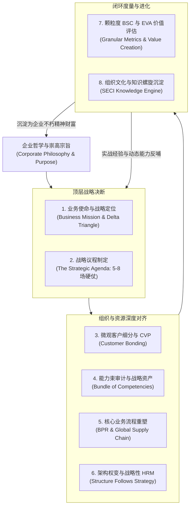
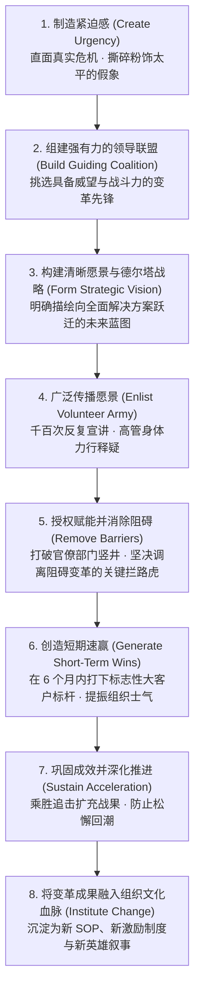

# Lec 18 组织领导力、执行力与全课知识大闭环 (Organizational Leadership & Integration)

> MIT Sloan School of Management · 15.902 Strategic Management I · Prof. Arnoldo Hax

## TL;DR

- 战略管理的终局不是理性分析的终结，而是领导力与组织变革意志的全面兑现。
- 德尔塔战略大师闭环：使命界定、议程确立、客户细分、能力束对齐、流程重塑、指标穿透与文化升华。
- 约翰·科特变革领导力八步法是打破组织惰性、推动战略转型的权威路线图。
- 卓越的战略领导者是兼具同理心与钢铁意志的清醒现实主义者，引领企业穿越周期风暴。

## 德尔塔全课知识体系大闭环 / The Delta Model Master Synthesis

历经 18 次深邃的思想激荡，麻省理工学院 15.902 战略管理课程由点及面、由外向内，最终汇聚成一座雄伟的现代战略思想大厦。阿诺尔多·哈克斯教授在最后一讲中，将整个学期的所有核心概念提炼为一台高度自洽、有机循环的**德尔塔战略主发动机（Delta Master Engine）**。

战略管理从来不是彼此割裂的分析工具拼盘。迈克尔·波特的五力模型与价值链、杰伊·巴尼的资源基础观（RBV）、钱德勒的组织结构权变理论、哈默的业务流程重塑（BPR）、斯特恩的 EVA 经济增加值、以及卡普兰与诺顿的平衡计分卡，在德尔塔模型的统一框架下，被赋予了崭新的生命力。它们不再是孤立的学派争论，而是共同服务于“客户深度绑定”与“生态系统锁定”这一终极战略目标。

在哈克斯教授看来，一个企业如果仅仅掌握零散的工具，就如同拥有无数精密的零件却无法组装出一台能够飞行的航空发动机。真正的战略大师必须具备高维的架构整合能力，能够看清企业哲学如何向下生根发芽为战略议程，战略议程如何转化为微观流程与组织阵型，而一线的实战数据又如何穿透回财务报表并最终沉淀为组织的不朽精神财富。

哈克斯教授将全课的知识精髓归纳为三大层次、八大关键构件的完整闭环控制系统：

这座大厦的基石是不可动摇的企业哲学；顶层是明确的战略定位与议程；中层是客户、能力、流程与架构的无缝对齐；底层是冰冷的 EVA 资本度量与生生不息的组织文化。任何试图割裂其中某个环节的企业，都无法在残酷的全球商业竞争中立于不败之地。

## 战略执行的硬道理：为什么组织变革如此艰难？ / The Realities of Change Management

正如马基雅维利在《君主论》中所写：“没有任何事情比引入一套全新的制度更加困难、成败更加不确定、操作起来更加危险。因为变革者把所有在旧制度中获利的人都变成了敌人，而所有可能在新制度中获益的人却只是三心二意的同盟。”

企业在推动德尔塔战略转型时，必然遭遇组织内部三大深层阻力：
1. **认知惰性（Cognitive Inertia）**：老员工习惯了旧有的思维定势，对外部技术断点视而不见，甚至抱团否认新市场的存在；
2. **既得利益反扑（Vested Political Interests）**：掌控传统老业务资源的元老高管，本能地阻挠将预算与人员转移至新兴战略战役；
3. **能力匮乏恐慌（Competency Anxiety）**：一线员工深感自己的旧技能在新战略面前即将被淘汰，出于自我防御本能而消极对抗变革。

## 约翰·科特变革领导力八步法在德尔塔中的落地 / Kotter's 8-Step Change Engine

推动一场涉及商业模式、组织架构与考核文化的全面战略变革，绝不能寄希望于下发红头文件后的自然发生。阿诺尔多·哈克斯教授深度借鉴了哈佛商学院约翰·科特（John Kotter）享誉全球的变革领导力理论，为推进德尔塔转型的企业最高决策者制定了一套环环相扣的实施路线图。

这套八步变革引擎不仅解决了变革在组织认知层面的阻力，更为企业搭建了一条从早期制造危机感、到组建精锐先锋队、再到攻克标杆客户、最终将变革成果固化为企业潜意识文化的坚实桥梁：

在科特的八步法中，哈克斯教授特别强调了“短期速赢（Short-Term Wins）”对德尔塔转型的生死意义。由于从“卖产品”转向“卖解决方案”需要重构能力束，如果不在前半年集中优势兵力打赢一两场标杆大客户的战役并证明新商业模式的超额毛利，怀疑论者和保守派就会迅速联合反扑，让原本前途光明的战略变革在中途夭折。

::: theorem 战略变革第一定律
如果一个组织的最高层在发起变革时，未能让至少 75% 的各级管理层真切感受到“如果不立刻彻底变革，企业在未来三年内必死无疑”的强烈紧迫感，那么后续所有的战略宣讲和流程重构都会沦为空洞的形式主义滑稽戏。
:::

## 卓越战略领导者的心智模型与精神境界 / The Character of a Strategic Leader

在课程结语中，哈克斯教授回归到对“人”的深刻关怀。战略最终不是写在白板上的箭头，而是领导者内心信念的投射。

卓越的战略领导者必须具备以下三种看似矛盾却高度统一的稀缺品质：
1. **残酷的现实主义与坚定的崇高信仰并存（The Stockdale Paradox）**：既要敢于直面当下最严酷、最血淋淋的商业现实与财务困境，又要对企业的长远愿景和终极胜利保持矢志不渝的神圣信念；
2. **深沉的同理心与铁血的执行力并存（Radical Compassion & Ruthless Execution）**：对客户的痛点与一线员工的疾苦充满无微不至的同理心，但在砍掉价值毁灭业务、清理价值观败坏人员时心如磐石、绝不手软；
3. **高瞻远瞩的生态格局与见微知著的细节敏锐并存（Telescope & Microscope）**：既能在 30,000 英尺的高空洞察全行业互补品标准的宏观走向，又能瞬间下沉到客户交付现场排查某一个接口延迟的微观细节。

## 我的理解与实践洞察 / Personal Insight

15.902 这门课带给每一个人最深刻的震撼，是重新定义了商业与企业家的尊严。

::: insight 商业是人类最伟大的合作艺术
在这个充满对抗、脱钩与零和撕裂的复杂时代，阿诺尔多·哈克斯教授的德尔塔模型如同一座明亮的灯塔，照亮了商业最本真的光芒。
**商业不是一场你死我活的血腥战争，商业是人类社会最精妙、最宏伟的价值共创与互信共生！**
当你不再把目光死死盯在如何踩死对手，而是把整个身心倾注于如何让你的客户变得更伟大、如何让成千上万的互补品伙伴因为你的存在而获得尊严与繁荣时，你所建立的事业就拥有了跨越时空的恒久生命力。这不仅是最高明的商业战略，更是一代战略领导者对商业文明最崇高的致敬与奉献。
:::

## 思考题与实战研讨

1. 回顾整个 15.902 课程所学的知识图谱，绘制一张属于你所在企业（或你最熟悉的一家商业机构）的“德尔塔战略闭环全景图”，指出目前该企业在哪个环节存在最大的系统性断裂？
2. 结合科特变革领导力八步法，为一位刚刚空降至一家面临巨额亏损、充斥着严重派系斗争与官僚惰性的传统国企的新任 CEO，制定一份前 100 天的铁血破局行动方案。
