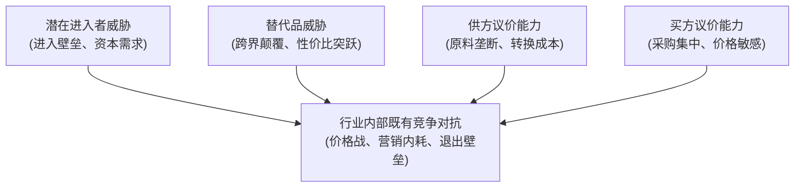
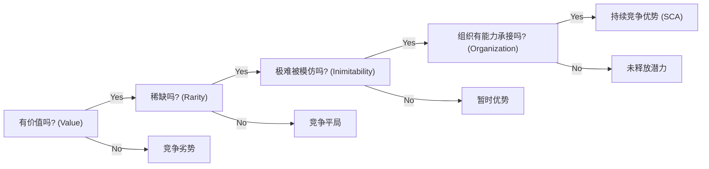

# Lec 02 波特五力分析与企业资源基础观（RBV）的辩证整合 (Porter vs Resource-Based View)

> MIT Sloan School of Management · 15.902 Strategic Management I · Prof. Arnoldo Hax

## TL;DR

- 迈克尔·波特五力模型（Five Forces）是解析产业吸引力与平均盈利潜能的外部宏观透镜。
- 资源基础观（RBV）与杰伊·巴尼 VRIO 框架是识别企业异质性战略资产的内部微观透镜。
- 战略管理的两难困境：好行业里的差公司 vs 差行业里的顶尖公司；外部定位与内部能力不可偏废。
- 哈克斯教授的辩证统合：能力束必须通过动态适配产业结构的薄弱环节转化为客户溢价。

## 外部结构决定论：迈克尔·波特五力分析 / Porter's Five Forces

在战略管理史上，迈克尔·波特 1980 年出版的《竞争战略》（*Competitive Strategy*）开创了现代产业组织经济学（Industrial Organization, I/O）应用于企业管理的先河。波特的核心论断是：**企业的盈利能力首先不是取决于管理层有多聪明，而是取决于该企业所处的产业结构（Industry Structure）**。

::: definition 波特五力分析模型 (Porter's Five Forces Framework)
决定一个行业长期平均资本回报率的五种底层竞争作用力：
1. **现有竞争对手之间的竞争激烈度 (Rivalry Among Existing Competitors)**：行业集中度、退出壁垒与固定资产重置成本；
2. **潜在新进入者的威胁 (Threat of New Entrants)**：规模经济壁垒、专利门槛与渠道控制力；
3. **替代品或服务的威胁 (Threat of Substitute Products)**：跨行业性价比替代（如高铁对支线航空客运的替代）；
4. **买方的议价能力 (Bargaining Power of Buyers)**：大客户采购集中度、产品标准化程度与买方后向一体化威胁；
5. **供方的议价能力 (Bargaining Power of Suppliers)**：核心零部件技术垄断、高转换成本与供方前向一体化威胁。
:::

波特指出，当一个行业的五种作用力全部极度残酷时（例如传统的钢铁或民航客运业），即使全行业高管每天工作 18 个小时，全行业的平均股东资本回报率也难以超越社会无风险利率；而当行业五力结构优美时（例如高端白酒或专有操作系统），平庸的管理也能坐享暴利。

## 内部异质资产论：企业资源基础观与 VRIO 框架 / Resource-Based View (RBV)

然而，波特五力分析无法解释一个普遍存在的现实：**为什么在同一个五力极其恶劣的烂行业里，依然诞生了西南航空（Southwest Airlines）这样连续四十年盈利的奇迹企业？**

为了解答这一问题，伯格·沃纳菲尔特（Birger Wernerfelt）与杰伊·巴尼（Jay Barney）在 1980 至 1990 年代建立了**资源基础观（Resource-Based View, RBV）**。

::: theorem 资源基础观两大核心公理 (RBV Core Assumptions)
1. **企业资源异质性 (Resource Heterogeneity)**：同一行业内的不同企业，所掌握的战略资源与能力束存在长期的异质性差异；
2. **资源非完全流动性 (Resource Immobility)**：这些独特的战略资源无法在要素市场上自由购买并以零摩擦成本平移迁移。
:::

### 检验核心竞争力的终极武器：巴尼 VRIO 框架

巴尼教授提出了严密审视企业某项内部资源能否带来“持续竞争优势（SCA）”的四大判据：

| 评估维度 | 核心审查提问 | 战略价值评估标准与现实表现 | 最终竞争地位结论 |
| :--- | :--- | :--- | :--- |
| **V - 价值性 (Value)** | 该资源能否帮助企业抓住外部环境机遇或抵御致命威胁？ | 若无法降低成本或提升客户支付意愿，该资源就是无用负担 | 若否：**竞争劣势 (Competitive Disadvantage)** |
| **R - 稀缺性 (Rarity)** | 该资源是否仅被全行业极少数现存或潜在竞争对手所掌控？ | 若全行业每个玩家都能在市场上采购到，它只能维持平庸竞争 | 若否：**竞争平局 (Competitive Parity)** |
| **I - 不可模仿性 (Inimitability)** | 缺乏该资源的企业在复制它时，是否面临巨大的成本劣势与时间迟滞？ | 受制于独特的历史历史径路径依赖、因果模糊性（Causal Ambiguity）与社会复杂性 | 若否：**暂时竞争优势 (Temporary Advantage)** |
| **O - 组织支撑度 (Organization)** | 企业的组织架构、薪酬流程与治理体系能否充分捕获该资源的价值？ | 拥有顶级专利但缺乏商业化流程与敏捷交付团队，资产沦为废纸 | 若否：**未利用的潜能 (Unused Competitive Advantage)** |

若四项全部满足，企业才拥有无可争议的**持续竞争优势（Sustainable Competitive Advantage, SCA）**。

## 辩证整合：哈克斯教授的双透镜战略罗盘

阿诺尔多·哈克斯教授指出，波特五力与 RBV 绝非水火不容，而是卓越战略家不可或缺的左右眼：
- **波特五力是“望远镜”**：审视外部星空的引力场，看清利润池在产业链中究竟沉淀在哪个环节；
- **RBV 与 VRIO 是“显微镜”**：审视自身基因与肌肉束，确立不可复制的看家本领；
- **德尔塔模型则是两者的终极粘合剂**：将企业经由 VRIO 检验的核心能力，精准对齐外部产业中最有利可图的客户细分，从而在摆脱五力绞杀的同时，筑牢客户绑定的护城河。

## 我的理解与实践洞察 / Personal Insight

“选择比努力重要，但能力决定了你是否有资格做选择。”

::: insight 警惕战略内卷与行业宿命论
在实战管理中，很多企业家容易滑向两个极端：一种是患上“行业宿命论”，整天抱怨大环境不好、行业竞争太卷，却从不审视自身能力的平庸；另一种是患上“技术自恋症”，关起门来狂点科技树，造出一堆 VRIO 指标看似惊人但市场上根本无人买单的高精尖玩具。**卓越的战略是内外力场的精准共振——用内部独特的稀缺能力，去破解外部产业结构中最痛苦的瓶颈**。
:::

## 思考题与实战研讨

1. 运用波特五力模型，分析当前全球智能手机代工制造行业（如富士康、立讯精密）的五力结构。为什么这类企业的净利润率通常长期被死死压制在 3% 到 5% 的微薄区间？
2. 运用巴尼的 VRIO 框架，深度拆解特斯拉（Tesla）的核心竞争力：其一体化压铸车身技术、超充网络、自研 FSD 芯片以及马斯克的个人品牌号召力，哪一项最符合“不可模仿性（Inimitability）”的定义？
3. 如果你接盘了一家处于五力结构极其恶劣行业的传统化工企业，作为新任战略副总裁，你该如何利用资源基础观挖掘其隐性资产以实现突围？
