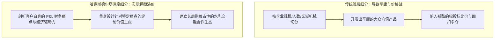
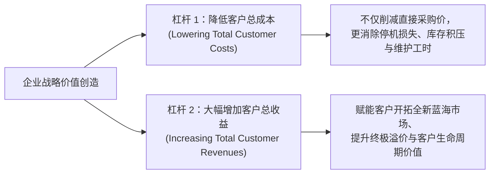

# Lec 03 客户细分与客户价值主张设计 (Customer Segmentation & Value Proposition)

> MIT Sloan School of Management · 15.902 Strategic Management I · Prof. Arnoldo Hax

## TL;DR

- 传统基于人口统计学或行业维度的粗放细分，是导致产品陷入同质化价格战的根源。
- 哈克斯客户细分法：基于客户经营的“经济驱动力（Economic Drivers）”与战略诉求重新聚类。
- 客户总拥有成本（TCO）与客户总收益（Total Customer Revenues）两大价值创造杠杆。
- 客户价值主张（CVP）的量化契约属性：绝非宣传广告词，而是必须用财务数据闭环验证的投资回报承诺。

## 传统客户细分的平庸陷阱 / The Pitfalls of Traditional Segmentation

绝大多数企业的市场部在做“客户细分（Customer Segmentation）”时，往往习惯性地翻开外部咨询公司的分类模板：
- 按照企业规模分为：大企业、中型企业、小微客户；
- 按照地理区域分为：华北区、华南区、海外市场；
- 按照采购金额分为：金牌客户、银牌客户、普通客户。

阿诺尔多·哈克斯教授在 15.902 课堂上毫不留情地指出：**这种基于表层属性的划分在战略上几乎毫无价值！因为它完全无法解释客户‘为什么购买’以及‘客户愿意为怎样的价值支付超额溢价’**。一个年营收十亿的传统制造业国企，与一个年营收十亿的高频量化对冲基金，其对软件和硬件采购的深层价值诉求存在着十万八千里的本质鸿沟。

## 剖析客户的经济驱动力：两大价值创造杠杆

德尔塔模型主张：企业的一切战略思考，必须始于**对客户自身损益表（P&L）与资产负债表的极限解剖**。哈克斯教授指出，企业能够为客户创造的真实价值，在数学上严格归结为两大途径：

### 1. 降低客户总拥有成本（Lowering Total Cost of Ownership, TCO）
许多平庸的销售只会在产品出厂单价上降价 5%；而卓越的战略家懂得从客户全生命周期的 TCO 入手：
- 设备的直接采购单价往往只占其十年生命周期总成本的 15%；
- 剩下的 85% 隐藏在：**安装调试停机损耗、高额备品备件库存、操作工人培训成本、高昂能耗以及不可预测的突发故障停产损失**；
- 如果你能向客户承诺：“采用我的系统，单机售价贵 20%，但我的预测性维护算法能将你的非计划停机时间直接降低 80%，三年累计为你省下 500 万美元的维护开销！”客户会毫不犹豫地签下高溢价合同。

### 2. 增强客户的盈利与营收获取能力（Enhancing Customer Revenues）
这是比降本更高维的价值交付：
- 不仅帮客户省钱，更帮客户去赚取原本属于他们的外部财富；
- 例如，利乐包装（Tetra Pak）不仅向乳品企业销售无菌利乐枕包装纸，更直接为蒙牛、伊利提供从欧洲原装进口的高速灌装生产线、全球流行风味配方实验室以及商超货架视觉陈列方案，直接助推客户打造百亿级爆款大单品。

## 客户价值主张（CVP）的严谨设计规范

阿诺尔多·哈克斯强调，一份真正合格的**客户价值主张（Customer Value Proposition, CVP）**，绝不是挂在官网上的空洞公关口号，而是一份具备法律和财务契约属性的严肃商业承诺：

| CVP 核心构成支柱 | 战略设计准则与硬核标准 | 典型空洞口号（负面反例） | 卓越的量化契约 CVP（正面范例） |
| :--- | :--- | :--- | :--- |
| **目标细分边界 (Target Segment)** | 清晰界定该方案只服务哪一类具有特定经营死锁的客户，敢于对非目标客户说不 | “为全行业所有中小微企业提供最优质服务” | “专为全美拥有 50 架飞机以上、主打点对点支线航运的低成本航空公司” |
| **量化效益承诺 (Quantified Metrics)** | 给出明确、可核算的财务或运营改善指标，与客户设立联合对赌考核机制 | “大幅提高您的管理效率，实现数字化腾飞” | “在 90 天内将您的发动机机队周转率提升 12%，每年减少 1400 万美元燃油损耗” |
| **独特交付机制 (Unique Mechanism)** | 明确指出该效益是通过我方哪一项经过 VRIO 验证的核心能力所独家交付的 | “凭借我们顶尖的专业团队和无微不至的关怀” | “依托我们拥有专利的声学传感器阵列与神经网络实时数字孪生算法” |

## 我的理解与实践洞察 / Personal Insight

“不要卖牛排，要卖煎牛排时的滋滋声；更不要卖机器，要卖客户买下机器后的财务报表增长。”

::: insight 商业成功的唯一秘诀是让客户赢
在 B2B 与复杂战略博弈中，很多销售人员抱怨客户刁钻挑剔、只会拼命压价。**客户之所以拼命压价，是因为你拿给他的产品没有任何差异化，他只能把你当成大宗商品来讨价还价！**一旦你能跳出单件商品买卖的狭隘视角，真正看懂客户公司的 CEO 每天晚上因为什么经营指标而睡不着觉，并拿出切实可行的系统级方案帮他化解危机，客户不仅不会压价，反而会将你奉为不可替代的战略座上宾。
:::

## 思考题与实战研讨

1. 很多大型 IT 软件公司在向制造业客户兜售 ERP 或 MES 系统时，往往遭遇客户车间主任的消极抵触。结合本讲理论，分析软件销售人员在“客户细分与价值主张设计”上忽略了哪些不同层级利益相关者的诉求差异？
2. 试为一家工业机器人制造初创企业，起草一份面向“中小型高精密五金压铸厂老板”的量化客户价值主张（CVP）。你该如何从 TCO（总拥有成本）角度打消其对昂贵工业自动化投资的顾虑？
3. 比较苹果零售店（Apple Store）的“天才吧（Genius Bar）”与传统电脑城维修柜台在客户价值主张上的本质升维。
