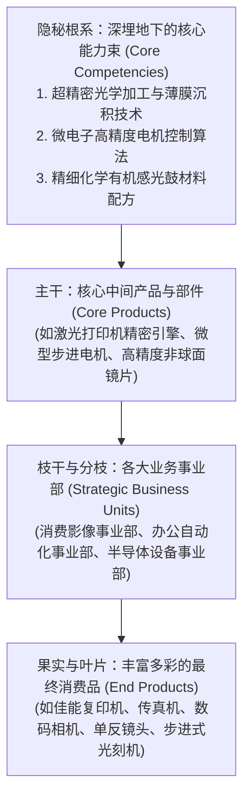
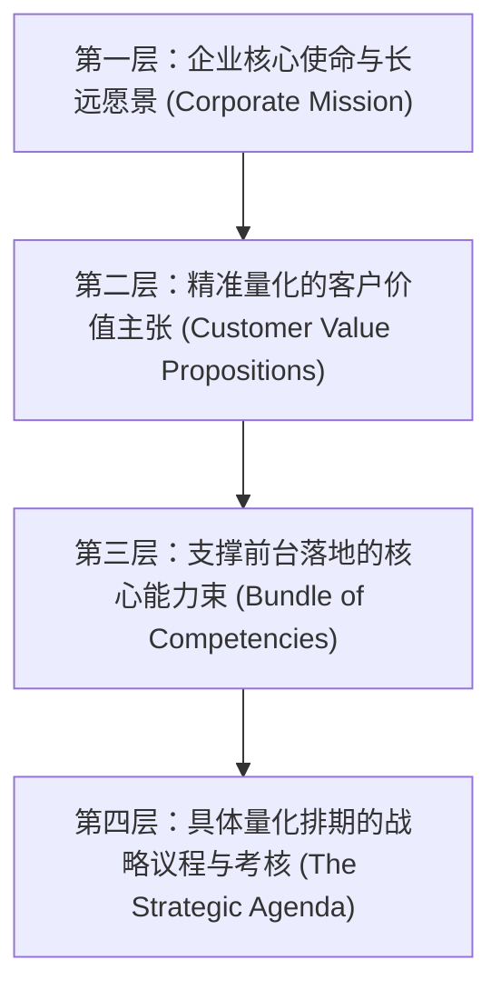

# Lec 04 企业作为核心能力束与战略要素整合 (The Firm as a Bundle of Competencies)

> MIT Sloan School of Management · 15.902 Strategic Management I · Prof. Arnoldo Hax

## TL;DR

- 哈梅尔与普拉哈拉德核心竞争力理论：企业绝不是独立事业部的机械拼凑，而是跨业务协同的核心能力束（Bundle of Competencies）。
- 核心能力的三大试金石：提供通往多元化市场的潜在通道、为最终用户带来显著感知价值、竞争对手极难复制模仿。
- 德尔塔战略要素整合矩阵：将企业使命、客户价值主张与底层能力池进行三维强力缝合。
- 能力折旧与能力陷阱防范：防止昔日的核心能力异化为阻碍变革的核心刚性（Core Rigidities）。

## 破除事业部深井：企业是一棵根系繁密的参天大树 / The Tree Metaphor

在传统的公司金融与财务管理视角中，一家大型跨国集团往往被描绘成一个由多个独立事业部（Strategic Business Units, SBUs）组成的投资组合（Portfolio of Businesses）：
- 财务报表上是一行行独立的损益表（P&L）；
- 高管们像投资经理一样，依据当期资本回报率对不同事业部进行资金拆借与利润抽调。

然而，加里·哈梅尔（Gary Hamel）与 C.K. 普拉哈拉德（C.K. Prahalad）在 1990 年《哈佛商业评论》传世名篇《企业核心竞争力》（*The Core Competence of the Corporation*）中指出：**这种将企业拆解为互不相干事业部的机械视角，正在亲手摧毁企业的长期战略耐力！**

阿诺尔多·哈克斯教授在 15.902 课堂上深化了著名的“大树隐喻（The Tree Metaphor）”：

::: definition 核心竞争力 (Core Competencies)
核心竞争力是指：**组织内部跨越不同业务部门边界、协调多样化生产技能与集成多重技术流的集体学习能力（Collective Learning）**。它深植于组织流程与工程师的隐性手感之中，无法通过简单的资产并购在一夜之间买到。
:::

## 核心竞争力的三大经典识别标准

哈梅尔与普拉哈拉德确立了检验一项技术或能力是否配得上“核心竞争力”称号的三大黄金标准：

| 评估维度 | 核心检验标准与提问 | 经典产业实证案例 | 若未通过该检验的定性 |
| :--- | :--- | :--- | :--- |
| **1. 市场延展性 (Market Potential)** | 该能力是否能像树根一样，为企业跨界进军看似毫不相关的全新产品市场提供潜在通行证？ | 佳能凭借其在精密光学与微电机的核心积累，在长达三十年里自然衍生出照相机、复印机、激光打印机引擎与芯片光刻机 | 仅仅是一项局限于单一产品的特定生产技能 |
| **2. 客户显著价值 (Customer Value)** | 该能力是否对终端客户所感知的核心收益与产品差异化做出了决定性、不可替代的贡献？ | 本田汽车凭借在精密内燃机设计上的极端核心能力，让本田摩托车、汽车乃至割草机在全球消费者心中建立了“动力充沛、绝不抛锚”的封神声誉 | 属于后台行政或冗余流程，无法转化为客户溢价 |
| **3. 极度难以复制 (Inimitability)** | 竞争对手即使花费数年时间、投入数十亿美元，是否依然极难通过简单挖角或逆向工程完成像素级抄袭？ | 丰田精益生产系统（TPS）背后盘根错节的现场看板调度、安灯拉绳止停机制与一线工人改善文化，通用汽车尝试学习了三十年依然形似神不似 | 属于可以在市场上自由采买的通用标准化设备 |

## 德尔塔能力束与战略要素整合矩阵 / Integrating Strategic Elements

阿诺尔多·哈克斯教授强调，梳理出核心能力仅仅是第一步，战略管理的最高艺术在于**“系统整合（Putting It All Together）”**：

在卓越的企业中，这四层架构呈现出严丝合缝的逻辑咬合：
- 企业使命决定了我们绝不从事哪些业务；
- 客户价值主张明确了我们在细分战场上向客户做出的不可撤销承诺；
- 底层能力束确保了我们在兑现这一承诺时拥有压倒性的工程与管理底气；
- 战略议程则将长远能力建设分解为未来 180 天内各战区司令员的军令状。

## 我的理解与实践洞察 / Personal Insight

“不要用战术上的勤奋，去掩盖战略根系上的营养不良。”

::: insight 警惕‘空心化’的外包陷阱
很多西方企业在 1980 至 1990 年代为了迎合华尔街对高净资产收益率（ROE）的短期狂热，盲目将所谓“非核心”的制造、元器件加工甚至基础工程设计外包给亚洲代工厂，自身只保留光鲜亮丽的品牌营销与软件界面。其惨痛恶果是：**十年之后，企业的大树根系被彻底斩断，丧失了对物理底层工程工艺的全部手感，最终被当年为自己代工的学徒企业全面反超颠覆**。坚守底层能力束的深耕，是企业穿越周期的唯一定海神针。
:::

## 思考题与实战研讨

1. 很多大型互联网大厂推行“内部赛马机制”，允许不同事业部各自为政、重复开发相同的底层中台与算法架构。结合哈梅尔与哈克斯关于“核心能力束”的论述，这种管理模式在激发基层活力的同时，对企业底层核心竞争力的沉淀带来了怎样的内耗与破坏？
2. 试剖析苹果公司（Apple）深埋在地下的核心能力束：从自研 A/M 系列芯片架构、软硬件一体化调优到对全球超精密制造供应链的极致控制，苹果是如何通过这套底层能力，横跨智能手机、平板电脑、个人电脑与智能手表四大截然不同的产品市场的？
3. 如果你的公司在过去十年里依靠某项独特的工艺赚取了丰厚利润，但现在该工艺正面临着数字化的全面颠覆，作为首席战略官，你该如何带领团队克服“核心刚性”，实现能力束的无痛嫁接与基因突变？
