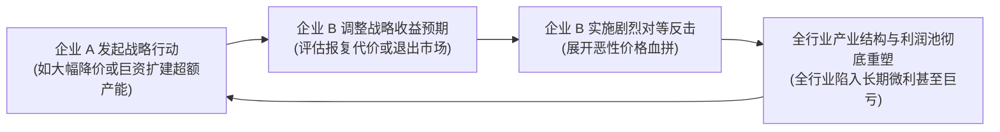
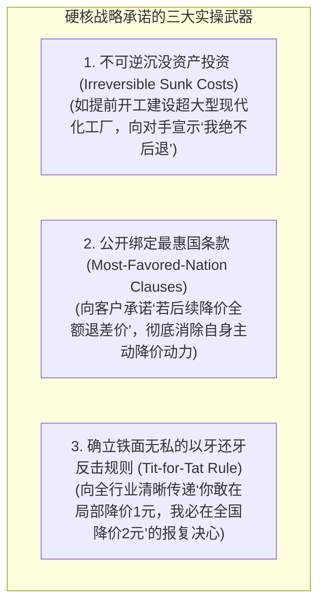

# Lec 05 产业结构分析与竞争互动博弈 (Industry Structure & Competitive Interaction)

> MIT Sloan School of Management · 15.902 Strategic Management I · Prof. Arnoldo Hax

## TL;DR

- 产业结构并非静态的背景板，而是企业在多期动态博弈中不断塑形与重构的演化力场。
- 纳什均衡与博弈收益矩阵：在寡头垄断行业中，单边追求自身利益最大化往往导致囚徒困境与双输价格战。
- 战略承诺的硬核威慑力（Strategic Commitments）：通过沉没资本投资、产能过剩预留与不可逆契约改变竞争对手的收益预期。
- 协同演进与商业生态博弈：超越你死我活的零和厮杀，确立基于共同利益联盟的竞合（Co-opetition）新范式。

## 超越静态结构：动态博弈视角的引入 / Dynamic Competitive Interaction

在第 2 讲中，我们学习了迈克尔·波特的产业五力模型。然而，波特经典模型的最大软肋在于其假设**“产业结构在很大程度上是外生给定且静态不变的”**。

阿诺尔多·哈克斯教授在 15.902 第五讲中引入了博弈论（Game Theory）与产业组织演进论：在现实商战中，尤其是在双寡头或几大巨头并立的行业里（如波音 vs 空客、可口可乐 vs 百事可乐、AMD vs 英特尔），**企业迈出的每一步战略棋子，都会立刻引发对手的激烈战术反制，而对手的反制反过来又会彻底颠覆原有的产业收益结构！**

## 寡头博弈经典模型：囚徒困境与价格战的毁灭性螺旋

哈克斯教授运用经典的收益矩阵（Payoff Matrix），向学员们展示了理性管理者在缺乏沟通与互信机制时，是如何一步步滑入深渊的：

| 企业 A \ 企业 B | 企业 B 坚守高价（维持行业默契） | 企业 B 大幅降价促销（背叛行业共识） |
| :--- | :--- | :--- |
| **企业 A 坚守高价** | **双赢合作均衡**：企业 A 获利 100 亿，企业 B 获利 100 亿（全行业共享超额垄断利润） | **单边被收割**：企业 A 份额被蚕食获利 20 亿，企业 B 席卷市场获利 140 亿 |
| **企业 A 大幅降价** | **单边掠夺**：企业 A 席卷市场获利 140 亿，企业 B 份额被蚕食获利 20 亿 | **囚徒困境纳什均衡**：企业 A 获利 30 亿，企业 B 获利 30 亿（**双输价格战毁灭行业**） |

::: definition 纳什均衡与理性悲剧 (The Tragedy of Rationality)
在上述非合作博弈中，无论对手选择降价还是坚守，对企业 A 而言，**降价促销在单期决策中都是其严格占优策略（Dominant Strategy）**！双方同时做出“最理性的利己计算”，最终却无可挽回地走向了全行业利润蒸发 70% 的悲惨纳什均衡点。
:::

## 战略承诺的艺术：如何改变对手的博弈心智？

真正深谙竞争互动博弈的战略大师，懂得如何在竞争对手做出非理性冲动之前，通过**“战略承诺（Strategic Commitments）”**在物理上锁死局势：

### 托马斯·谢林与“自我束缚的威力”
诺贝尔经济学奖得主托马斯·谢林（Thomas Schelling）指出：在博弈中，**削弱自己的灵活性、切断自己的退路，往往能够释放出全宇宙最强大的威慑力！**
- 如果你保留了随时可以根据市场降价退出的灵活选择权，对手就会毫不犹豫地向你发起压迫性进攻；
- 而如果你向全行业展示你已经砸下十亿美元建造了无法转产的专用生产线、并在合同中写死了违约将面临天价罚款的条款时，对手就会清醒地意识到：你已经破釜沉舟，任何对你的正面进攻都将演变为双方同归于尽的核战争。此时，理性的对手只能选择退让或寻求和平共处。

## 从零和争夺走向“竞合理论” / Co-opetition

哈克斯教授强调，战略管理的终极飞跃，在于从单纯的博弈论（Game Theory）跃升为**竞合理论（Co-opetition）**（由布兰登伯格 Brandenburger 与内勒巴夫 Nalebuff 提出）：
- 商业不仅包含“争夺蛋糕分额（Value Capturing）”的零和撕咬；
- 更包含与竞争对手联合起来“做大产业蛋糕（Value Creation）”的协同智慧；
- 例如，在制定新一代通信标准（5G/6G）、共同游说政府建立透明监管法规、联合出资建设跨国底层物流枢纽等领域，昨天在货架上刺刀见红的死对头，今天在幕后必须成为唇齿相依的战略盟友。

## 我的理解与实践洞察 / Personal Insight

“战略的最高境界，是不战而屈人之兵。”

::: insight 商业威慑的底层是心理学博弈
很多年轻高管误以为商战就是谁嗓门大、谁先降价。然而，**恶性价格战是缺乏战略智力的无能者最绝望的下策**。卓越的博弈家永远在对手开枪之前，通过精密的规则设计、清晰透明的报复信号与牢不可破的利益同盟，让潜在进攻者在脑海中自动推演出进攻失败后的惨痛代价，从而主动收起刀枪。在博弈中构建基于规则的稳定和平，是顶级商业智慧的皇冠。
:::

## 思考题与实战研讨

1. 很多电商平台为了争夺市场份额，频繁向消费者承诺“全网最低价，买贵双倍退差价（Low-Price Guarantees）”。从表面上看这是让利给消费者，但从博弈论视角分析，为什么这种承诺在本质上是一种阻挠竞争对手降价促销的垄断卡特尔暗号？
2. 在波音与空客争夺远程宽体客机（A380 vs 波音 787 梦想客机）的世纪博弈中，两家公司是如何通过公开签署航空公司意向订单（Firm Orders）来打压对方新型号研发信心的？
3. 如果你所在的行业目前正陷入一场毁灭性的全员恶性价格战泥潭，所有同行均在亏损边缘挣扎，作为行业排名第二的企业 CEO，你应该如何迈出第一步来向行业传递停火信号，并重建竞合秩序？
