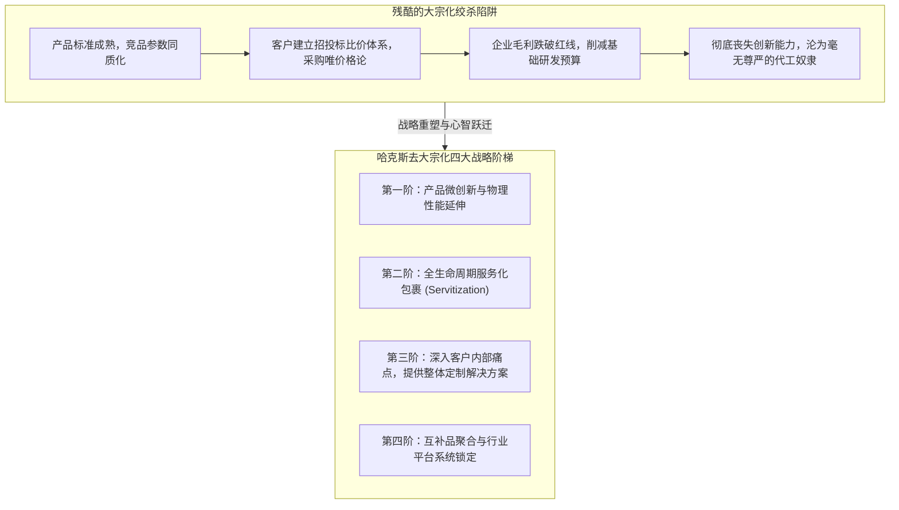

# Lec 06 摆脱商品化陷阱：去大宗化战略 (The Decommoditization of a Business)

> MIT Sloan School of Management · 15.902 Strategic Management I · Prof. Arnoldo Hax

## TL;DR

- “商品化陷阱（Commoditization Trap）”：产品技术成熟导致同质化、买方采购唯价格论、企业毛利断崖式滑坡。
- 去大宗化四大突围路径：产品功能微创新、服务延伸包裹、客户流程无缝嵌入与系统生态锁定。
- 经典案例复盘：CEMEX 墨西哥水泥如何将一袋微不足道的沙石水泥转变为具有高科技调度的高溢价数字物流服务。
- 战略转型的底层挑战：从工程师“交付物理硬件”的传统心智，蜕变为全员“对客户业务结果负责”的解决方案文化。

## 大宗化泥潭：所有成熟产业的终极宿命 / The Commoditization Trap

在激烈的自由市场竞争中，每一家企业都在与一条冷酷的经济学规律抗争——**大宗化/商品化（Commoditization）**：
- 当一项新技术刚刚诞生时（如早期的个人电脑、液晶电视或锂电池），产品稀缺、性能出众，企业能够享受高达 60% 以上的暴利溢价；
- 随着技术扩散、标准成熟与代工厂产能过剩，所有竞争对手的产品在外观、参数与使用寿命上变得毫无二致；
- 此时，客户在采购时唯一关心的指标只有**“谁的单价更低”**；
- 行业进入生不如死的大宗化泥潭：销售人员沦为讨价还价的机器，微薄的毛利甚至无法覆盖机器设备的日常折旧，任何一次原材料价格波动都可能让企业陷入亏损深渊。

阿诺尔多·哈克斯教授在 15.902 第六讲中掷地有声地指出：**大宗化不是不可抗拒的自然规律，它是缺乏战略想象力的平庸管理层所犯下的懒惰罪行！任何一门看似最底层的传统商品，都可以通过系统设计实现惊天动地的“去大宗化（Decommoditization）”逆袭！**

## CEMEX 奇迹：一袋建筑水泥的去大宗化封神之战

哈克斯教授在课堂上深度解剖了管理学史上最经典的去大宗化案例——**墨西哥水泥巨头 CEMEX 的世纪大逆转**。

::: example 墨西哥水泥（CEMEX）如何把泥巴卖出高科技软件的溢价？
- **绝望的行业现实**：在所有工业品中，水泥是公认最彻底的大宗商品（Commodity）：它是灰色的粉末，各家厂商的化学成分完全遵循国家标准，没有任何人能在一包水泥上做出所谓的“品牌情感差异化”。在墨西哥和拉美，水泥厂常年陷入残酷的价格内耗；
- **洞察工地的真实血泪痛点**：
  CEMEX 的战略调研团队没有在实验室里改良水泥分子，而是穿上安全帽深入建筑工地现场。他们震惊地发现了整个建筑行业最大的成本黑洞：**现浇混凝土（Ready-mix Concrete）的现场浇筑混乱**！
  - 混凝土搅拌车装上湿水泥后，由于水泥在罐内会迅速水化凝结，必须在 90 分钟内必须浇筑完毕，否则整罐价值数千美元的水泥将彻底硬化报废；
  - 而建筑工地的现实充斥着混乱：挖土机突然抛锚、工人没到齐、雅加达或墨西哥城的早高峰交通大瘫痪；
  - 建筑承包商由于害怕混凝土车迟到导致工期延误，往往在早上同时向三家不同的水泥厂下虚假订单，哪家先到就用哪家的，后到的直接拒收退货。全行业面临高达 30% 以上的惊人损耗与无休止的官司扯皮！
- **CEMEX 的高科技降维升维手术**：
  CEMEX 管理层做出了颠覆全行业的战略重构：**“我们卖的不再是水泥粉末，我们卖的是‘绝对确定性的准时交付履约服务’！”**
  1. **军工级实时调度中枢系统**：CEMEX 斥巨资为所有搅拌车安装了 GPS 全球卫星定位系统、车载移动通信终端与计算机动态航线算法，在蒙特雷总部建立了如同休斯顿航天局一般的巨型调度监控大厅；
  2. **将披萨外卖承诺引入重工业**：CEMEX 破天荒地向全行业建筑商推出了震撼人心的承诺——**“保证水泥搅拌车在预定时间的 20 分钟窗口内准时抵达工地浇筑；若迟到超过 20 分钟，全车水泥免费赠送，并赔偿停工损失！”**
  3. **改变客户行为习惯**：这一承诺彻底消除了承包商的恐慌心理，承包商不再需要同时向多家供应商多头虚假下单；
- **惊人的去大宗化商业战果**：
  CEMEX 借此彻底摆脱了价格战泥潭！建筑承包商心甘情愿向 CEMEX 支付比竞争对手高出 **20% 以上的超额溢价**；CEMEX 的车队空驶率与损耗率暴跌至行业最低，一跃从一家偏居一隅的墨西哥本地小厂，迅速跨国并购扩张为全球前三大顶级跨国建材帝国！
:::

| 战略维度 | 传统商品化水泥厂的死路 | CEMEX 去大宗化解决方案帝国 |
| :--- | :--- | :--- |
| **战略定义** | 制造与销售合格标号的硅酸盐水泥熟料 | 提供零延误、高弹性的工程现场准时浇筑保障服务 |
| **考核指标** | 每吨水泥制造成本、回转窑能耗、出厂毛利 | 客户准时交付率（OTIF）、车辆动态调度稼动率 |
| **竞争优势壁垒** | 几乎为零（极易被更便宜的竞争对手撬走） | 高壁垒的数字调度算法、车队网络效应与深层客户信任 |

## 去大宗化的四大系统性演进路径

哈克斯教授总结了任何深陷红海的企业都可以参考的四大突围维度：

1. **服务化包裹（Servitization）**：将一次性物理商品销售，转化为包含定期保养、耗材更换、软件升级的长期服务合同（例如罗尔斯·罗伊斯航空发动机的“按飞行小时付费 Power-by-the-Hour”模式）；
2. **前向与后向流程整合（Process Integration）**：将自身的业务系统与客户的采购和生产系统通过数字化接口深度锁定，帮客户管理其原材料库存，使客户离不开你的后台支撑；
3. **客制化风险共担（Risk-Sharing Partnerships）**：放弃传统的采购买卖合同，转而与客户签署“基于节约成本或增加效益提成”的联合对赌协议；
4. **重新定义消费体验与情感共鸣**：通过独特的人机交互、美学工业设计或环保可持续发展溢价，赋予冰冷的工业品以鲜活的品牌文化灵魂。

## 我的理解与实践洞察 / Personal Insight

“世界上没有垃圾行业，只有垃圾的商业模式。”

::: insight 商业想象力是唯一的解药
当无数企业家在抱怨自己的行业是‘夕阳产业’、‘传统大宗商品’时，他们往往忘记了水泥、钢铁、纺织、农业恰恰是人类文明最不可或缺的千亿美元刚需底盘。**一门生意之所沦为平庸的大宗商品，是因为你给客户提供的价值太单薄、太浅层！**只要你愿意走出舒适的工厂大门，走进客户充满灰尘与混乱的作业现场，你永远能找到海量未被解决的系统性痛点。将技术与服务编织进这些痛点之中，哪怕是卖泥巴，你也能创造出令人敬仰的商业传奇。
:::

## 思考题与实战研讨

1. 结合 CEMEX 案例，审视你当前所在的行业或业务：在终端客户使用你的产品或服务的整个生命周期中，存在哪些类似于“现浇混凝土 90 分钟凝结”这样让客户痛不欲生的系统性风险？
2. 很多传统硬件设备制造商在转型推行“按效果付费”的服务化（Servitization）模式时，往往遭到财务总监与审计委员会的强烈反对（因为这会将原本一次性确认的设备销售收入推迟为长达数年的微薄服务费）。企业该如何设计平稳的过渡期财务与融资方案？
3. 如果你是一家普通大宗商品塑料颗粒原料的供应商，在面对上游中石化、中石油的原料涨价与下游塑料制品厂的死命压价时，你会如何通过“去大宗化战略”打破双向挤压的困局？
