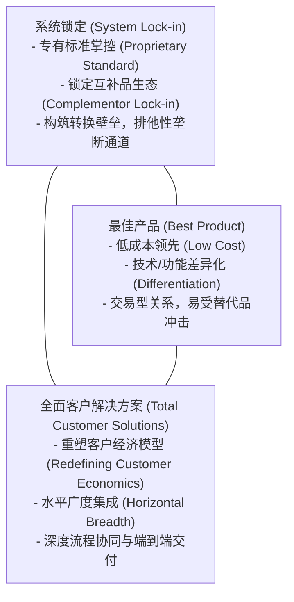
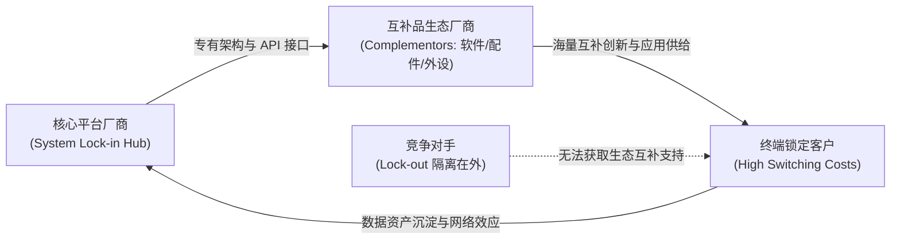

# Lec 07 战略定位三大选项：最佳产品、全面客户解决方案与系统锁定 (Competitive Positioning: The Delta Triangle)

> MIT Sloan School of Management · 15.902 Strategic Management I · Prof. Arnoldo Hax

## TL;DR

- 德尔塔战略铁三角提供三种互斥的根本定位：最佳产品、全面客户解决方案与系统锁定。
- 最佳产品依赖规模或差异化，客户粘性最低，最容易沦入价格战与去大宗化困境。
- 全面客户解决方案通过水平拓宽、降低客户总成本或提升收益，构建共生信任护城河。
- 系统锁定掌控事实标准，驱动互补品繁荣，形成“赢家通吃”的最强隔离机制。

## 德尔塔战略铁三角的深层逻辑与三大顶点 / The Three Vertices of Delta Triangle

战略的本质是做出取舍（Trade-offs）并明确企业与客户、互补品之间的价值连接方式。在阿诺尔多·哈克斯教授构建的德尔塔模型中，企业竞争定位不再是简单的“成本还是溢价”，而是企业在由三大战略顶点构成的空间中的落点选择。

在传统的商学院教学中，战略往往被简化为波特式的二元对立：要么走极致的低成本道路，要么走高溢价的差异化道路。然而哈克斯教授敏锐地指出，这种二元对立仅仅局限于“产品”这一个孤立的物理载体，完全忽略了企业与客户之间千丝万缕的信任连接，更忽视了由软件、硬件、外设、开发者和分销渠道所构成的庞大互补品网络。

德尔塔铁三角正是为了打破这种局限而设计的全新全景罗盘。每个顶点代表了完全不同的战略思维、运营流程、能力储备以及与客户的绑定深度：

这三大定位的选择直接决定了企业的组织结构设计、绩效指标体系以及研发资源的配置方向。当企业选择立足于“最佳产品”时，它必须将资源聚焦于内部生产线和独立技术研发；当企业迈向“全面客户解决方案”时，它必须建立跨职能的客户成功团队并重构交付流程；而当企业志在“系统锁定”时，它的核心使命则是制定全行业通用的架构标准，并慷慨地赋能所有第三方的互补品参与者。

## 最佳产品定位：低成本与差异化的运营陷阱 / Best Product: Cost & Differentiation Traps

最佳产品（Best Product）建立在传统产业组织理论的基础上。其主导逻辑是“以产品为中心（Product-Centric）”，企业通过卓越的研发或极致的供应链效率，生产出性能最强、成本最低的单一产品，并通过分销渠道推销给大众客户。

### 1. 战略执行路径
- **低成本领先（Low Cost）**：追求规模经济、学习曲线效应与供应链采购议价能力（如沃尔玛、早期的格兰仕微波炉）。
- **差异化（Differentiation）**：通过技术创新、设计美学或品牌溢价打造独特卖点（如早期的索尼特丽珑彩电）。

### 2. 致命的战略陷阱
哈克斯教授强调，最佳产品是竞争最惨烈、防御力最弱的定位：
- **商品化魔咒（Commoditization Trap）**：技术扩散与竞品逆向工程速度极大加快，任何产品领先优势的半衰期都在急剧缩短；
- **冷酷的交易关系（Transactional Distance）**：客户购买的是产品而非关系，竞品只要提供 5% 的折扣或微小的性能提升，客户就会毫不犹豫地移情别恋；
- **过度关注竞品**：企业往往陷入与同行逐项比拼参数的军备竞赛，忽视了终端客户业务流程中真正未被满足的痛点。

::: pitfall 陷于“参数军备竞赛”的工程师幻觉
许多高科技企业坚信“只要把跑分提高 20%，客户就会自动买单”。然而在成熟市场中，边际性能提升往往超出客户吸收阈值。盲目追求最佳产品参数不仅无法带来定价权，反而会推高研发开销，使企业深陷低毛利泥潭。
:::

## 全面客户解决方案：从产品中心转向客户总成本降低 / Total Customer Solutions

全面客户解决方案（Total Customer Solutions）将企业战略重心从“销售单个产品”转向“降低客户的总拥有成本（TCO）或显著提升客户的业务收入”。

### 核心运作支柱
1. **重塑客户经济模型（Redefining Customer Economics）**：深入分析客户的损益表（P&L）和作业流程，找出能够帮助客户减员、提效、降库存或增收的环节；
2. **水平广度（Horizontal Breadth）**：不仅提供核心硬件，还将软件、易耗品、维护运营与金融租赁服务深度捆绑，提供“一站式交钥匙”方案；
3. **流程一体化集成（Customer Integration）**：将自身技术系统和常驻工程人员嵌入客户日常运营（如嘉实多润滑油直接承包汽车工厂的液体管理，按每台下线合格车辆收费）。

::: example 嘉实多（Castrol）从卖机油到“流体管理合伙人”
英国嘉实多（Castrol）在工业润滑油领域面临严峻的价格战。嘉实多果断放弃单纯售卖润滑油桶的“最佳产品”模式，转型为“全面客户解决方案”：它派遣润滑专家进驻汽车制造商车间，承担起整座工厂所有机床切削液与润滑剂的调配、监控、过滤与环保回收工作。嘉实多的合同收入不再挂钩机油消耗量，而是挂钩客户机床的无故障运行时间。这种深度绑定彻底隔绝了低价竞品的干扰，使双方结成难以分割的利益共同体。
:::

## 系统锁定：掌控事实标准与互补品网络 / System Lock-in

系统锁定（System Lock-in）是德尔塔模型中最高阶、护城河最深的竞争定位。在这一维度上，企业竞争的范围超出了狭隘的行业边界，涵盖了由互补品厂商（Complementors）、分销网络、应用开发者和终端用户共同构成的商业生态圈。

### 三大系统锁定子定位
1. **专有标准掌控（Proprietary Standard）**：拥有行业事实标准的底层架构与知识产权（如 Windows 操作系统、高通 CDMA/5G 基带芯片专利）；
2. **锁定互补品（Complementor Lock-in）**：通过友好的开发工具、利润分成机制和庞大装机量，吸引全球开发者优先为本平台开发应用（如苹果 App Store、英伟达 CUDA 开发者网络）；
3. **排他性渠道锁定（Exclusive Channels）**：垄断关键分销与基础设施通道，使得竞争对手因缺乏触达途径而无法进入市场。

::: theorem 系统锁定条件公理
当一家企业建立起“用户越多 $\rightarrow$ 互补品开发者越多 $\rightarrow$ 系统整体价值越高 $\rightarrow$ 吸引更多用户”的正向自增强网络正反馈循环，且客户迁移至替代系统的总转换成本（$C_{\text{switch}}$）远大于竞品带来的边际体验增益（$\Delta V$）时，系统锁定即告达成。此时，竞争对手将遭遇结构性的“系统锁定在外（Competitor Lock-out）”。
:::

## 三大战略定位演进路径与战略权变选择 / Strategic Positioning Transitions

企业并非生来就能实现系统锁定。在实际商业历程中，大多数伟大企业经历了一条清晰的战略升维路径：

| 维度对比 | 最佳产品 (Best Product) | 全面客户解决方案 (Total Customer Solutions) | 系统锁定 (System Lock-in) |
| :--- | :--- | :--- | :--- |
| **价值主张** | 极致性价比、独立功能领先 | 降低客户总成本、端到端集成托管 | 行业主导标准、繁荣互补品生态 |
| **客户关系** | 冰冷的分销交易、低转换成本 | 互信共生的长期战略伙伴 | 结构性不可逆绑定、平台依赖 |
| **核心驱动力** | 内部研发、制造成本与物流效率 | 深刻的客户洞察与定制服务能力 | 生态吸引力、平台网络效应、开发者治理 |
| **盈利模式** | 单件硬件/软件销售毛利 | 服务订阅费、效益分成、长期运维合同 | 平台抽成、生态授权费、标准专利使用费 |
| **防御机制** | 专利保护、规模效应（脆弱） | 深度流程嵌套、高昂替换磨合成本 | 双边/多边网络效应、生态规模报酬递增 |

企业必须根据自身资源禀赋、技术生命周期和行业网络效应强度，谨慎评估自身应立足于哪个顶点，并制定向更高维度跃迁的分阶段行动纲领。

## 我的理解与实践洞察 / Personal Insight

哈克斯教授的德尔塔铁三角彻底重构了管理者的战略视野。

::: insight 商业模式的层级跃迁本质是客户转移成本的构建
从“最佳产品”走向“全面客户解决方案”，再跃升至“系统锁定”，本质上是**企业不断将自身的能力注入到客户的生命周期和整个产业的协作生态中**。
当你仅仅是一个供应商时，客户随时可以用采购招标比价来压榨你的毛利；当你成为客户业务底层的共同运营者时，客户换掉你等于给自己做外科大手术；而当你成为全行业互补品的共同底层依托时，你便拥有了定义商业规则的无上特权。战略家的天职，就是坚决摆脱只卖产品的低级趣味，不断向生态上游攀登。
:::

## 思考题与实战研讨

1. 微软公司在个人电脑时代依靠 Windows + Office 达成了教科书级的“系统锁定”。分析在当今云计算与大模型时代，微软（Azure + OpenAI）是否再次构筑了新的系统锁定？其互补品阵营发生了什么变化？
2. 一家生产工业精密轴承的制造企业目前正遭受低价竞品的残酷挤压。请为其设计一套从“最佳产品”向“全面客户解决方案”跨越的切实战略落地路径。
