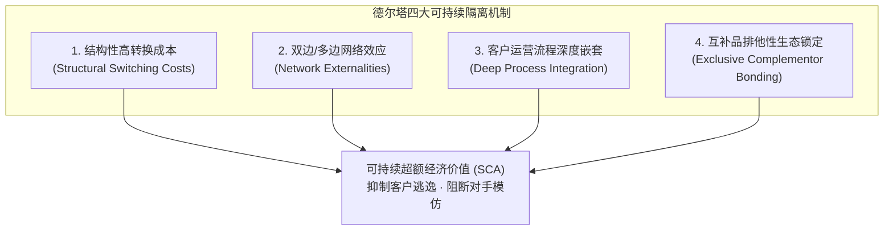
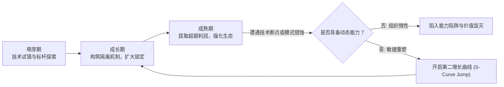

# Lec 08 维持持续竞争优势：隔离机制与动态演进 (Sustaining Competitive Advantage)

> MIT Sloan School of Management · 15.902 Strategic Management I · Prof. Arnoldo Hax

## TL;DR

- 任何无法维持的短期优势只是暂时的超额租金，战略的核心使命是建立坚不可摧的隔离机制。
- 德尔塔框架下的四大核心隔离机制：转换成本、双边网络效应、流程深度嵌套与互补品专有排他性。
- 因果模糊性与时间压缩不经济构成了竞争对手不可逾越的学习屏障与复制壁垒。
- 持续竞争优势并非一劳永逸的静态堡垒，必须依靠动态能力完成生命周期跨越与自我革新。

## 竞争优势的侵蚀与可持续性之谜 / The Erosion of Competitive Advantage

在完全竞争的市场经济中，超额经济利润具有强烈的自我毁灭倾向。任何一家企业如果发现了高利润领域并取得暂时优势，都会像磁铁一样迅速招致大量模仿者、跟进者和资本涌入：

$$
\lim_{t \to \infty} \Pi_{\text{economic}}(t) = 0 \quad (\text{在无隔离机制保护的完全竞争均衡下})
$$

战略管理的核心终极命题在于：**企业如何阻止超额租金被竞争对手套利侵蚀？如何使当下的超额回报能够跨越多个经济周期而长盛不衰？**

哈克斯教授指出，传统的竞争理论往往寄希望于法律专利保护或单一资产壁垒，但这些都极易被规避。真正可持续的竞争优势（Sustainable Competitive Advantage, SCA），必须在企业与客户、互补品之间构建起复合型的**隔离机制（Isolating Mechanisms）**。

## 德尔塔框架下的四大核心隔离机制 / Four Isolating Mechanisms

在德尔塔模型中，隔离机制被赋予了更加立体和生态化的内涵。隔离机制不仅阻挡竞争对手的进入，更将客户自愿锁留在企业的价值网络之中。

### 1. 结构性转换成本（Structural Switching Costs）
转换成本是指客户从现有供应商迁移至替代供应商时所需承担的一次性成本：
- **投资沉没与学习成本**：员工重新培训、掌握新系统操作界面的时间损失；
- **数据迁移与兼容风险**：历史数据格式转换可能导致的业务中断与致命错误；
- **合同与忠诚度绑定**：提前终止协议面临的高额违约金与阶梯返利作废。

### 2. 双边与多边网络效应（Network Externalities）
当产品或平台的价值随着使用该平台的用户及互补品数量增长而内生增加时，网络效应即生效。直接网络效应驱动同边扩张，间接网络效应驱动跨边繁荣，竞争对手即使提供免费替代品也无法抵消生态整体价值差距。

### 3. 客户运营流程深度嵌套（Deep Process Integration）
在全面客户解决方案中，企业不是站在客户围墙之外卖东西，而是直接将自研的软硬件探针、信息系统和工程驻场团队打入客户的心脏地带。此时更换服务商不仅意味着采购变更，更意味着客户自身的生产线面临停工风险。

### 4. 互补品专有排他性（Exclusive Complementor Bonding）
在系统锁定维度，企业通过与关键互补品厂商建立排他性合作或提供独家底层接口支持，使得竞品平台无法获得关键软件与应用配件支持，从根源上斩断竞争对手对终端客户的吸引力。

::: definition 隔离机制 (Isolating Mechanisms)
隔离机制是经济学中李嘉图租金与熊彼特创新租金得以长期存续的防护网。它指的是阻止或推迟行业内其他竞争对手模仿、复制或压低领军企业独特资源配置与客户关系的经济、技术及组织障碍。
:::

## 因果模糊性与时间压缩不经济 / Causal Ambiguity & Time Compression Diseconomies

为什么即使领军企业的财务数据和战略规划完全公开，竞争对手依然无法复制其成功？哈克斯教授与资源基础观学者共同提炼了深层次的微观组织壁垒：

### 1. 因果模糊性（Causal Ambiguity）
企业的成功往往源于数十个相互交织、默会且高度协同的微观行动系统，而非单一关键因素。
- 竞争对手可以轻易买到相同的硬件设备、招募相同背景的毕业生；
- 但对手无法看清成千上万名员工在日常沟通、跨部门协作、异常处理与客户响应中所沉淀的**默会知识（Tacit Knowledge）**；
- 这种“知其然不知其所以然”的迷雾使得任何机械式抄袭都会走向形似神不似的失败。

### 2. 时间压缩不经济（Time Compression Diseconomies）
企业核心竞争力的积累是一个遵循严格时间递进的路径依赖（Path Dependency）过程：

$$
\text{能力沉淀} = \int_{0}^{T} (\text{组织学习} \times \text{实战试错}) \, dt
$$

- 哪怕竞争对手在一年内砸入领军企业过去十年投入的十倍资金，也无法在一年内走完需要十年市场反馈与技术迭代才能完成的演进周期；
- 试图通过短期大水漫灌资金来压缩时间的做法，往往会导致极高的组织摩擦、资源浪费与系统崩溃。

::: theorem 时间压缩不经济假说
在战略资产的积累过程中，两倍的资本投入在减半的时间内，无法产生与原有积累周期等价的组织能力存量。时间本身是组织能力凝练不可或缺的关键内生变量。
:::

## 动态能力与优势生命周期重塑 / Dynamic Capabilities & Advantage Lifecycle

没有任何一项隔离机制可以永远抵挡时代浪潮。持续竞争优势的真正内涵并非“固定某项优势至死不渝”，而是企业具备在旧优势被侵蚀之前，敏锐感知市场信号并迅速孕育新优势的**动态能力（Dynamic Capabilities）**。

1. **感知能力（Sensing）**：洞察技术断层、非共识客户需求及互补品阵营的细微变化；
2. **捕获能力（Seizing）**：打破部门利益藩篱，果断将关键资本与人才转移至全新业务前线；
3. **重构能力（Transforming）**：主动瓦解曾经带来辉煌的旧组织惯性与激励体系，实现战略范式的代际平滑跃迁。

## 我的理解与实践洞察 / Personal Insight

许多管理者对“护城河”的理解停留在冷冰冰的静态资产上。

::: insight 真正的护城河不是资产，而是共同进化的生态共生体
如果你的优势仅仅来自于买得起的机器、建得起的工厂，那么只要市场上出现更有钱的野蛮人，你的护城河就会瞬间瓦解。
**最高阶的持续竞争优势，永远建立在企业与外部世界构建的共生关系之中**。当你的客户把他们最具挑战的核心业务交给你，当成千上万的互补品开发者依靠你的平台养家糊口，整个生态都在拼尽全力帮你阻挡竞争对手。此时，企业已经不是孤军奋战的城堡，而是庞大生态网络的神经中枢。
:::

## 思考题与实战研讨

1. 结合“时间压缩不经济”原理，分析为什么通用汽车（GM）和大众汽车（Volkswagen）投入数百亿美元研发智能电动车软件架构，却依然难以在短时间内赶超特斯拉在 FSD 数据闭环上的飞轮积累？
2. 德尔塔模型的“全面客户解决方案”在面对客户采购部门推行的“去单一来源化（Dual-sourcing）”策略时，应采取哪些深层隔离手段化解被替代的风险？
