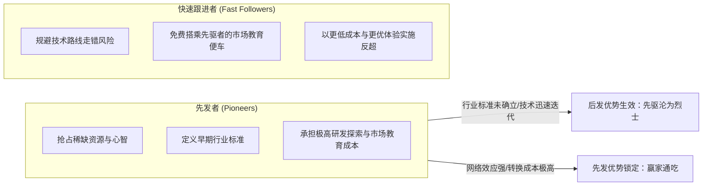
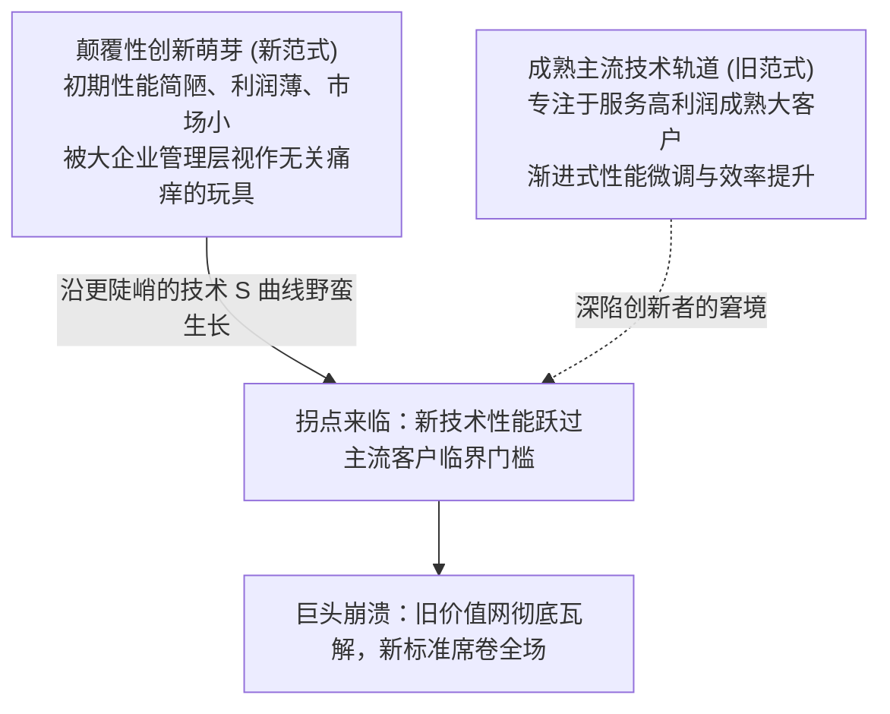

# Lec 09 竞争动态学与颠覆性产业变革 (Competitive Dynamics)

> MIT Sloan School of Management · 15.902 Strategic Management I · Prof. Arnoldo Hax

## TL;DR

- 静态产业结构分析无法捕捉技术突变与对手快速响应，战略必须引入动态竞争与博弈论视角。
- 先发优势具有极高价值，但伴随着高昂的先驱试错成本；成熟快速跟进者往往通过后发优势实施降维打击。
- 产业演进遵循“间断平衡（Punctuated Equilibrium）”，非连续性技术颠覆会彻底重构行业竞争版图。
- 德尔塔模型主张通过扩展客户解决方案与绑定互补品阵营，构建抵御颠覆性创新的动态弹性体系。

## 动态竞争理论演进与博弈视角 / Foundations of Competitive Dynamics

传统波特五力分析提供了一张静态的行业盈利快照，然而真实商业世界永远处于熊彼特“创造性毁灭”的汹涌洪流之中。动态竞争理论（Competitive Dynamics）聚焦于企业行动与竞争对手反制之间的因果互动链条：

$$
\text{企业战略行动} (A_t) \xrightarrow{\text{感知与评估}} \text{对手响应行动} (R_{t+1}) \xrightarrow{\text{市场反馈}} \text{全新产业格局} (S_{t+2})
$$

### 动态竞争分析的核心 AMC 框架
1. **觉察（Awareness）**：竞争对手是否能察觉并准确理解本企业的战略行动意图？
2. **动机（Motivation）**：对手是否具有足够的财务动力或防御压力采取反制措施？
3. **能力（Capability）**：对手内部是否具备调动资源快速跟进与还击的实际执行力？

若企业能够选择在对手“无法觉察”、“缺乏动机”或“无力还击”的盲区发动战略奇袭，便能在对手做出反应之前构筑起坚固的市场防线。

## 先发优势与后发赶超陷阱 / First-Mover Advantage vs Fast Follower

企业究竟应该勇做第一个吃螃蟹的开拓者，还是做深思熟虑的快速跟进者？哈克斯教授指出，两者的战略收益与风险权衡高度依赖于行业技术演进特征：

### 先发优势与后发优势维度矩阵

| 战略考量维度 | 先发者优势（First-Mover Advantage） | 快速跟进者/后发优势（Late-Mover Advantage） |
| :--- | :--- | :--- |
| **技术成熟度** | 容易押注错误的技术标准路线（如索尼 Betamax 录像带） | 坐等主导设计确立后，以成熟技术大规模量产（如 VHS 联盟） |
| **客户心智与品牌** | 确立品类代名词，抢占最早期的品牌忠诚度 | 借助先驱培育好的成熟市场，省去巨额市场启蒙营销支出 |
| **关键资源排他性** | 优先抢占黄金货架位置、核心矿产专利或稀缺牌照 | 能够以更便宜的价格采购最新一代高效率生产设备 |
| **最终成败关键** | 能否以极快速度建立网络效应和客户锁定壁垒 | 能否在产品体验、供应链整合与规模化交付上实现降维打击 |

## 颠覆性技术冲击与断点平衡 / Punctuated Equilibrium & Technological Disruption

产业的演变并非匀速线性发展，而是表现为长时间的平缓演进（渐进式创新）被突如其来的巨幅动荡（非连续性颠覆）所打断的**间断平衡模型（Punctuated Equilibrium）**。

### 为什么成熟巨头屡屡倒在颠覆浪潮之下？
1. **被最优良的客户所绑架**：最赚钱的存量客户明确要求对现有产品做微小改良，而不是采购简陋的新技术；
2. **基于存量利润率的资本配置机制**：大企业成熟的财务核算体系会自动否定毛利率低、市场体量小的新兴探索；
3. **组织认知傲慢**：行业翘楚习惯于在原有跑道上碾压对手，无法理解竞争规则与评判维度的根本迁移。

## 德尔塔视角下的动态竞争攻防博弈 / Delta-Driven Competitive Tactics

面对动态竞争与颠覆威胁，阿诺尔多·哈克斯教授提出了超越传统进攻防御维度的战略解决方案：

::: definition 德尔塔战略双轮驱动
企业在应对动态竞争时，必须同时运转两套飞轮：
1. **存量维度的客户锁定加固（Customer Bonding Deepening）**：通过“全面客户解决方案”，把客户的转换摩擦成本推向极致，即便竞品在单一硬件指标上有所超越，客户也无法轻易割舍一体化协同；
2. **增量维度的互补品生态吸收（Ecosystem Absorption）**：在“系统锁定”维度，将潜在的颠覆性技术提供者吸纳为自身生态的互补品开发者，化敌为友，实现平台的共同演进。
:::

## 我的理解与实践洞察 / Personal Insight

动态竞争是检验战略成色最残酷的试金石。

::: insight 战略的最高境界不是消灭竞争对手，而是让对手的攻击彻底失效
很多公司在面对新对手挑起的降价或新技术挑衅时，第一反应是迎头反击打消耗战，结果双双失血。
**真正的高维竞争，是改变战场的物理规则**。当对手在前端拼命打价格战、推硬件新参数时，你早已深入客户后端掌管了客户的全套工作流；当对手终于做出了一款好产品时，全行业的软件开发者早已都在你的平台上扎根。让对手的挥拳打在棉花上，在对手看不懂、够不着的生态层级持续深耕，才是最深邃的战略从容。
:::

## 思考题与实战研讨

1. 智能手机兴起初期，诺基亚（Nokia）拥有庞大的现金储备、顶尖的硬件制造供应链和全球第一的品牌，为何会在面对苹果 iPhone 与谷歌 Android 的动态进攻中迅速溃败？运用 AMC 框架与德尔塔互补品理论进行复盘。
2. 当一家初创企业试图挑战一个在传统市场上拥有深厚客情关系的老牌行业巨头时，它应当如何利用动态竞争中的“动机不对称（Motivation Asymmetry）”找到切入点？
