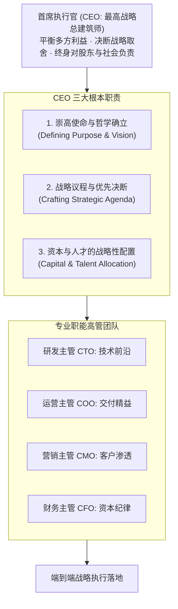

# Lec 01 CEO 战略总览与德尔塔实战框架 (Course Overview & The Delta Model in Action)

> MIT Sloan School of Management · 15.904 Strategy and the CEO · Prof. Arnoldo Hax

## TL;DR

- 站在首席执行官（CEO）视角审视企业顶层战略架构，超越单纯职能管理。
- 德尔塔模型在最高决策层落地：将企业资源从产品价格战引导至客户深度绑定与生态锁定。
- 贯穿全课的实时演练案例：DMK 企业在传统业务遭遇增长瓶颈时的战略转型大考验。
- CEO 的三大根本职责：确立企业崇高使命、制定排他性战略议程、配置稀缺资本与关键人才。

## CEO 的战略职责：从职能经理到企业总建筑师 / The Role of the CEO

在现代企业中，各个职能部门的负责人（如营销副总裁、研发总监、供应链副总裁、CFO）都有其局部的专业追求。研发部门渴望最尖端的技术参数，生产部门追求极致的流水线平稳与规模效应，销售部门关注当季订单出货量，财务部门则死守短期费用预算。

阿诺尔多·哈克斯（Arnoldo Hax）教授在 15.904 的开篇中强调：**CEO 绝不是所有职能副总裁汇报工作的汇总打卡机，CEO 是整座企业大厦的最高总建筑师（Chief Strategic Architect）**。

CEO 必须具备从局部利益中超脱出来的广阔视野，统一全公司的战略意志：

CEO 核心职责在于回答三个根本问题：我们的企业究竟为什么存在？在未来的 3 到 5 年内，全公司必须集中稀缺资源打赢哪 5 到 8 场关键战役？当各个部门发生激烈冲突时，我们基于什么底层哲学进行战略裁决？

## 德尔塔实战框架在高管层的投射 / The Delta Model in the C-Suite

在 15.902 的理论基础上，15.904 重点考察德尔塔模型在企业 CEO 办公室中的高维应用。哈克斯教授指出，CEO 必须带领高管团队完成从“以竞争对手为中心”向“以客户深度绑定为中心”的心智大迁徙。

### 德尔塔战略铁三角在最高决策层的落地抉择
1. **最佳产品（Best Product）**：CEO 必须清楚，如果公司选择此路径，企业将面临永无休止的“去大宗化（Decommoditization）”苦战，毛利率随时面临竞品的价格屠杀；
2. **全面客户解决方案（Total Customer Solutions）**：CEO 必须下决心改造内部激励机制，打破产品事业部竖井，建立大客户终身经营团队，以降低客户总拥有成本（TCO）为衡量标准；
3. **系统锁定（System Lock-in）**：CEO 必须具备产业生态号召力，制定底层开放架构，积极赋能互补品开发者，构筑让对手彻底失去竞争资格的排他性壁垒。

::: definition 战略总建筑师 (Chief Strategic Architect)
战略总建筑师是指企业最高领导者不陷于微观运营细节，而是站在产业生态和资本价值的顶峰，统筹设计企业的商业模式、客户绑定机制、组织架构与考核分配制度，确保企业在充满不确定性的外部环境中保持系统性竞争优势。
:::

## 贯穿全课的核心演练案例：DMK 企业的战略十字路口 / The DMK Enterprise Case

为了让学员真刀真枪地体验 CEO 的决策痛苦，15.904 引入了跨国工业制造与消费品巨头 **DMK 公司** 作为全学期的连续推演案例。

### DMK 公司的现实困境
- **主营业务遭遇天花板**：DMK 的传统核心产品市场趋于饱和，行业新进入者凭借低廉的人工与设备成本大打价格战，DMK 的毛利率连年滑坡；
- **客户关系高度商品化**：大客户采购部门将 DMK 的产品视为标准大宗物资，每次续约都要求 5%-8% 的价格折扣，否则直接转投竞品；
- **内部组织严重竖井化**：三大事业部各自为政，甚至为了争夺同一个大客户的预算而在客户面前互相拆台；
- **董事会与华尔街的严厉拷问**：股东权益回报率（ROE）持续走低，激进做空机构开始在二级市场对管理层施加巨大重组压力。

学员在整个学期中将以 DMK 新任 CEO 及其核心执委会的身份，逐一推演客户细分、能力束重组、战略议程制定、运营卓越改善、创新生态孵化与颗粒度度量考核。

## 我的理解与实践洞察 / Personal Insight

担任 CEO 是一场对心智、魄力与商业认知的终极考验。

::: insight CEO 最大的敌人是组织的“舒适区假象”
在很多面临衰退的企业中，副总裁们拿给 CEO 的报表往往看起来一片祥和：销售额还在微增、生产线运转如常、各部门都在加班。
**但卓越的 CEO 能穿透报表的假象，看清潜藏在水面下的冰山**：客户虽然还在买你的产品，但仅仅是因为还没找到更便宜的替代品；员工虽然在忙碌，但都在做低价值的重复劳动；企业看似庞大，实则没有一项能够锁死客户的不可替代能力。CEO 的第一美德，是在组织尚未流血之前，以无畏的勇气打破平静，推动企业向德尔塔高维生态蜕变。
:::

## 思考题与实战研讨

1. 面对 DMK 传统产品陷入价格战与大客户采购压价的危机，如果新任 CEO 仅仅采取“全员降薪、削减研发支出 15%”的成本削减方案，运用德尔塔模型评估其可能引发的次生灾害。
2. 比较微软前任 CEO 鲍尔默（重视 Windows 最佳产品授权出货）与现任 CEO 纳德拉（拥抱云端全面解决方案与开发者开放生态），分析两位战略领导者在德尔塔三角上的根本定位差异。
