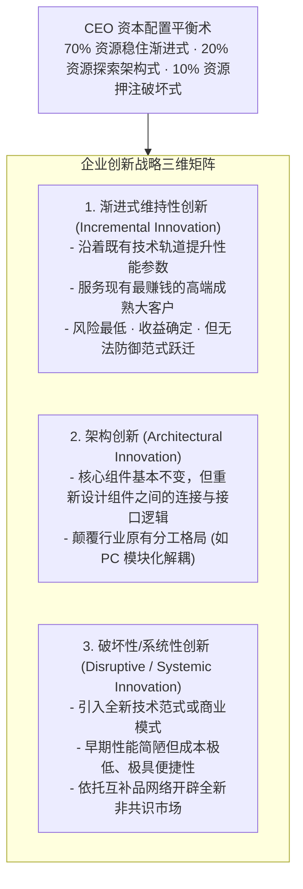
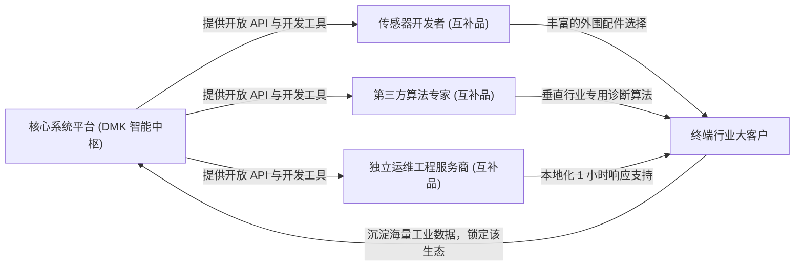

# Lec 10 创新战略与互补品生态构建 (Innovation Strategy & System Complementarity)

> MIT Sloan School of Management · 15.904 Strategy and the CEO · Prof. Arnoldo Hax

## TL;DR

- 创新不是盲目的科研烧钱，而是将技术突破转化为可持续商业价值的战略系统工程。
- 区分三种创新形态：渐进式维持性创新、架构创新与非连续性破坏性创新。
- 德尔塔“系统锁定”的核心密码：积极培育并锁定互补品厂商（Complementors）。
- DMK 案例演进：从单一硬件设备制造商，蜕变为开放的工业流体智能控制技术生态中枢。

## 创新的战略分类学：突破单一实验室视角 / The Strategic Taxonomy of Innovation

很多传统工业企业的 CEO 认为，创新就是给中央研究院拨付巨额研发经费，然后等待科学家们在显微镜下发明出轰动世界的新材料或新结构。然而历史无数次证明：**大量拥有顶尖科研成果的企业最终走向破产，而许多极少从事基础科学发现的企业却赚得盆满钵满**。

创新的本质从来不是纯粹的技术自嗨，而是将技术突破与商业模式、客户需求以及生态协作网络紧密编织在一起的价值创造系统。如果高管团队缺乏对创新类型的敏锐感知，往往会把有限的资金平均撒在各种互不相干的研究项目上，最终在渐进式改良中被突如其来的颠覆者彻底淘汰。

阿诺尔多·哈克斯教授在 15.904 中系统梳理了创新的三大维度，指导最高决策者建立清晰的创新投资组合：

CEO 核心职责在于防止组织将全部资源死死压在渐进式创新上，必须建立容错机制，为颠覆性探索保留充沛的战略种子资金。卓越的创新战略必须兼顾当下的生存现金流与未来的战略入场券，让企业在深耕存量市场的同时，源源不断地开辟出全新的增量蓝海。

## 互补品力量的觉醒：从闭关自守到生态共荣 / The Power of Complementors

在传统的波特五力模型中，企业周围只有四面楚歌的对手：竞争对手、潜在进入者、替代品威胁、买方砍价与供方压价。这种视界将整个商业生态看成了一场人人自危的黑暗森林角斗。

哈克斯教授指出，德尔塔模型最颠覆性的贡献之一，是在战略分析中引入了决定胜负走向的第六种力量——**互补品厂商（Complementors）**：

::: definition 互补品厂商 (Complementor)
如果客户在同时拥有企业 A 的产品与企业 B 的产品时，对企业 A 产品的估值与满意度显著高于单独拥有 A 时的价值，那么企业 B 就是企业 A 的互补品厂商。例如：硬件芯片与操作系统、游戏主机与独占游戏大作、新能源电动车与超充补能网络。
:::

当企业立志于实现“系统锁定”时，**你的成败并不取决于你自己招聘了多少名工程师，而取决于全行业有多少外部互补品厂商自愿围绕你的平台进行二次开发和配套！**

## DMK 创新生态路线图推演 / DMK Innovation & Ecosystem Roadmap

在 15.904 的第十讲作业中，学员们为 DMK 制定了一份跨越三年的技术与生态创新推进时间表：

| 演进阶段 | 创新核心主题 | 关键技术动作与产品形态 | 互补品网络治理策略 |
| :--- | :--- | :--- | :--- |
| **第一阶段（第 1 年）** | **硬件智能化打底** | 为现有核心设备标配物联网通信模组与标准化工业总线接口 | 联合 5 家顶级工业传感器大厂，制定统一的数据通讯标准 |
| **第二阶段（第 2 年）** | **开放工业软件中台** | 推出“DMK Flow-OS”工业流体监控云平台，提供标准化 SDK | 举办首届工业算法开发者大赛，吸引全球科研团队上架故障诊断模型 |
| **第三阶段（第 3 年）** | **行业事实标准确立** | 将平台协议捐赠给国际标准化组织，推动其成为行业事实标准 | 对通过认证的互补品厂商给予“DMK Inside”品牌背书与应用商店分成 |

通过这一路线图，DMK 彻底跳出了与同行死磕金属材料强度的低层次竞争，转而成为整个产业生态的“数字操作系统规则制定者”。

## 我的理解与实践洞察 / Personal Insight

创新是企业最高领导者眼界格局的折射。

::: insight 自闭者终将窒息，开放者得道多助
许多传统企业的管理者有一种偏执的“自大狂倾向”：总觉得自己技术天下第一，什么都要自己研发、什么钱都要自己赚，对外部合作伙伴严防死守。
**然而在技术大爆炸的现代商业世界，任何一家单一企业的智力资源，都绝不可能超越全行业所有外部开发者智慧的总和！**
苹果之所以能击败拥有百年工艺的诺基亚，不是因为乔布斯的工程师比诺基亚多，而是因为 App Store 将全球数百万名开发者的创造力汇聚成了浩瀚的海洋。卓越的 CEO 敢于打开大门、舍得让利，通过赋能生态伙伴来构筑自己坚不可摧的商业帝国。
:::

## 思考题与实战研讨

1. 英伟达（NVIDIA）不仅销售顶尖的 GPU 芯片，更在过去十五年中耗资数十亿美元打造了免费的 CUDA 开发者生态系统。运用哈克斯教授的互补品理论，深度剖析 CUDA 如何将全球数百万 AI 研究员转变为英伟达最忠诚的互补品大军？
2. 在 DMK 推动“Flow-OS 开放平台”时，内部研发高管强烈反对向竞争对手开放 API 接口，主张“独家闭源使用以保持自身优势”。作为 CEO，你将如何向董事会论证开放生态的长期战略价值？
