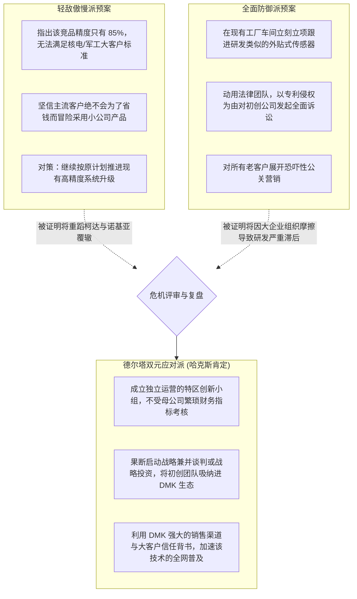
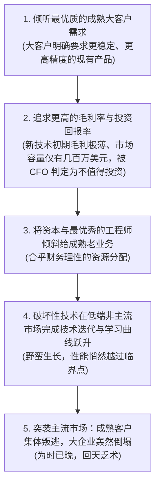

# Lec 11 破坏性创新应对与企业创新引擎实战 (Disruptive Innovation & Ecosystem Innovation Case)

> MIT Sloan School of Management · 15.904 Strategy and the CEO · Prof. Arnoldo Hax

## TL;DR

- 各高管小组对 DMK 应对行业突发破坏性技术挑战的战略演习答辩。
- 克里斯坦森“创新者的窘境”在传统巨头身上的残酷验证：为什么好管理会杀死大企业。
- 双元组织（Ambidextrous Organization）的顶层设计：右手抓主营业务剥削，左手抓新物种探索。
- 设立企业内部风投（CVC）与独立孵化器，以“反熵增机制”战胜大企业病与认知傲慢。

## 实战研讨答辩：DMK 遭遇突发技术颠覆的应急演练 / Group Workshop & Disruptive Case

在 15.904 的第十一课中，哈克斯教授给全体学员抛出了一枚震撼弹——**突发技术危机模拟**：

> “一家名不见经传的硅谷工业物联网初创公司，刚刚联合一家低成本海外代工厂，发布了一套全新的无线超声波外贴式传感器系统。该系统无需切断客户管道或更换既有阀门，仅需 10 分钟即可贴在任何管道外壁上，结合其自研的轻量化云端算法，能以传统系统 1/5 的成本实现高达 85% 的泄漏预测精度。目前已有 3 家 DMK 的二线潜在客户宣布试用该方案！”

面对这起教科书式的“低端破坏性创新（Low-end Disruption）”奇袭，各高管小组紧急召集执委会会议，登台汇报应对预案。现场的讨论不仅是对管理层商业直觉的考验，更是对大企业面临破坏性威胁时能否克服本能傲慢与防御心理的极限检验：

哈克斯教授赞赏了方案三的高维格局，并以此展开了对大企业应对破坏性创新的深层机制解构。方案一代表了最典型的“创新者傲慢”，往往在嘲笑对手粗糙简陋的过程中错失防御窗口；方案二虽然有了紧迫感，但在大企业官僚体系中另起炉灶往往效率低下且容易陷入侵权泥潭。唯有方案三，以包容的生态胸怀将外部颠覆力量化敌为友，才是战略大师的大智慧。

## 创新者的窘境机制解剖：为什么卓越管理往往导致死亡？ / The Mechanics of Innovator's Dilemma

克莱顿·克里斯坦森（Clayton Christensen）提出的“创新者的窘境”，揭示了一个令人胆寒的规律：**那些倒在技术变革浪潮中的大企业，在破产之前几乎每一步决策都完全符合商学院经典教材中的‘最优商业逻辑’！**

如果 CEO 仅仅依据传统的“净现值（NPV）”和“投入产出比”来审批新项目，组织就会在理性的计算中，一步一步走向自我毁灭的深渊。

## 双元组织架构设计：探索与利用的动态平衡 / The Ambidextrous Organization

为了破解这一组织悖论，CEO 必须在企业内部推行**双元组织（Ambidextrous Organization）**顶层设计：

| 组织维度 | 利用型业务（Exploitation - 存量现金牛业务） | 探索型业务（Exploration - 破坏性创新孵化） |
| :--- | :--- | :--- |
| **战略使命** | 成本领先、精益生产、去大宗化、捍卫存量现金流 | 模式试错、敏捷突进、颠覆自我、抢占未来赛道 |
| **组织架构** | 严谨的职能制/事业部制，严格遵循 SOP 与层级审批 | 完全独立的特区编制、扁平敏捷、直接向 CEO 一人汇报 |
| **考核文化** | 零缺陷、EVA 资本回报率、季度财务预算刚性兑现 | 鼓励快速失败、考核早期客户验证频次与技术探索里程碑 |
| **领导风格** | 权威型、精细化运营、风险厌恶 | 创业型、敏捷试错、高度包容模糊与不确定性 |

::: theorem 双元组织生存假说
能够长盛不衰穿越技术周期的领军企业，必须同时具备两套完全不同的组织心智：一套心智如同严谨冷酷的钟表匠，把成熟业务的运营效率压榨到极致；另一套心智如同充满好奇心与冒险精神的探险家，在边缘非共识领域不断播撒颠覆性创新的火种。
:::

## 建立企业创新引擎的制度化防线 / Building Institutionalized Innovation Safeguards

哈克斯教授为跨国企业 CEO 提炼了三道抵御创新的制度化防火墙：
1. **设立企业风险投资战投基金（Corporate Venture Capital, CVC）**：哪怕母体无法立即开展研发，也要以小额参股方式在行业初创圈广撒网，将其作为企业探查未来技术走向的早期雷达；
2. **推行内部特许孵化机制（Internal Skunkworks）**：允许顶尖骨干带薪脱产半年进行颠覆性方案闭门攻关，若项目通过前线客户验证，团队可获得该孵化实体的高额期权分红；
3. **CEO 专属创新豁免权（Executive Immunity）**：规定探索型孵化业务在成立的前三年内，完全免于母公司的任何财务指标考核，其预算由 CEO 专属创新基金全额兜底。

## 我的理解与实践洞察 / Personal Insight

颠覆性创新是对企业最高领导者自我革命意志的终极拷问。

::: insight 战略的最高智慧，是敢于亲手颠覆昨天的自己
商业史上绝大多数巨头的陨落，不是因为对手太强大，而是因为自己被昨天的辉煌彻底绑架了。
**当你躺在毛利高达 60% 的旧业务功劳簿上，要你主动去培育一个毛利只有 20%、甚至会抢走老客户订单的新技术时，这种断腕之痛会遭到整个组织既得利益集团的疯狂抵制**。卓越的 CEO 明白：如果今天你不主动对自己开刀，明天市场就会带着更锋利的手术刀来要你的命。敢于在阳光灿烂的日子里修理屋顶，敢于以大无畏的勇气杀死昨天的摇钱树以换取明天的入场券，这才是商业领袖最顶级的英雄主义。
:::

## 思考题与实战研讨

1. 柯达公司（Kodak）的工程师早在 1975 年就发明了全球第一台手持数码相机，为何柯达最终依然倒在了数码转型的浪潮之中？运用克里斯坦森“创新者的窘境”与哈克斯“双元组织”理论进行深刻复盘。
2. 在 DMK 应对外贴式低成本传感器挑战的推演中，如果 DMK 决定出资 3000 万美元全资收购该硅谷初创公司，作为 CEO，你应如何设计该团队的投后治理架构与独立汇报线，以防止其被母体原有的官僚体制同化吞噬？
