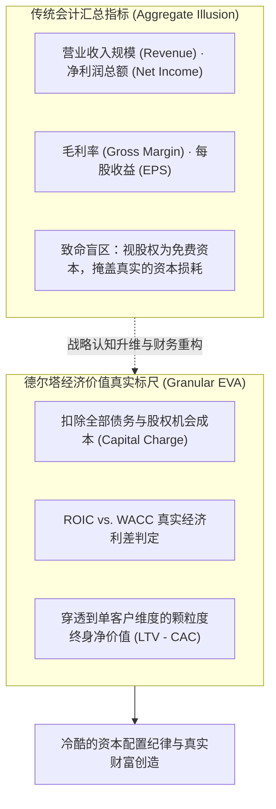

# Lec 12 宏观与颗粒度绩效指标体系与财务价值评估 (Aggregate & Granular Metrics and Financial Evaluation)

> MIT Sloan School of Management · 15.904 Strategy and the CEO · Prof. Arnoldo Hax

## TL;DR

- 战略必须接受资本市场的最终审判：从财务报表走向真实股东价值创造（EVA）。
- 加权平均资本成本（WACC）是企业经营的生死警戒线，任何低于 WACC 的增长都是在自杀。
- 德尔塔微观颗粒度度量衡：穿透传统平均数，精准核算单客、单单、单流程的真实净回报。
- DMK 案例推演：建立贯通 C-Suite 到车间班组的动态财务评估仪表盘。

## 战略的最终审判席：资本市场与股东价值创造 / Strategy Meets Capital Markets

战略构想无论多么宏大迷人，如果最终不能转化为可量化、可持续的资本增值，那么它在商业世界中就毫无意义。阿诺尔多·哈克斯教授在 15.904 的后半程，将战略的视角彻底拉回到冰冷残酷的资本市场现实面前。

战略不能是一场自说自话的空中楼阁。很多企业的经营报表看似歌舞升平，营收规模连创新高，但在二级市场上，其股票市值却连年阴跌，甚至面临激进投资者的敌意收购。这是因为传统的财务指标往往给管理层制造了**虚假繁荣的幻觉**。

传统的会计核算体系仅仅记录了历史显性成本，却完全忽视了投资者将资金托付给企业时所承担的机会成本与风险补偿。为了打破这一层认知的障眼法，CEO 必须建立超越会计报表的经济价值创造大闭环：



CEO 的第一天职，是成为股东委托资产的忠诚受托人。企业的一切经营活动，必须立足于创造超越全部资本机会成本的真实经济剩余。如果一项新战略需要耗费数亿美元的巨额资本开支，但其预期的边际投资回报率连基准折现率都无法覆盖，那么这种战略在本质上就是在合谋侵吞股东的真实财富。

## WACC 的经济学机理与战略警戒线 / The Economic Imperative of WACC

资本成本（Cost of Capital）是商业宇宙中最基础的重力定律。哈克斯教授要求每一位走向 CEO 岗位的学员，必须将加权平均资本成本（WACC）烙印在自己的决策直觉之中：

$$
\text{WACC} = \left( \frac{E}{V} \times K_e \right) + \left( \frac{D}{V} \times K_d \times (1 - t) \right)
$$

其中：
- $E$ 为企业股权市值，$D$ 为债务市值，$V = E + D$ 为企业总资本；
- $K_e$ 为股权投资者的期望回报率（由无风险利率 + 行业系统性贝塔风险溢价决定）；
- $K_d$ 为债务借贷利率，$t$ 为企业所得税率。

### 价值创造的黄金分割线
- **当投入资本回报率 $\text{ROIC} > \text{WACC}$ 时**：企业的每一笔新投资都在创造超额财富，企业的市净率（P/B）将显著大于 1，扩张速度越快，股东价值增值越巨大；
- **当投入资本回报率 $\text{ROIC} < \text{WACC}$ 时**：企业处于“价值毁灭状态（Value Destruction）”。此时，营收增长率越高，意味着企业在以更快的速度把股东的钱烧成灰烬！

::: theorem 资本配置第一禁令
当一个业务单元的长期预期投入资本回报率（ROIC）无法跨越加权平均资本成本（WACC）门槛，且该业务在德尔塔生态中不具备任何互补品锁屏战略价值时，企业坚决禁止对其进行任何形式的追加资本开支。盲目为了做大营收而进行低回报扩张，等同于对股东资产的蓄意侵害。
:::

## 德尔塔微观颗粒度度量衡的威力 / The Power of Granular Metrics

哈克斯教授极度推崇“颗粒度（Granular）”这一分析哲学。宏观汇总报表就像从万米高空俯瞰森林，看到的是一片郁郁葱葱的绿意；而颗粒度分析则是深入林间，发现 30% 的树木其实早已枯死并长满了蠹虫：

```mermaid
flowchart LR
    MacroPnl["宏观汇总利润表 (Aggregate P&L)<br/>总销售额: 10 亿美元<br/>账面总利润: 5000 万美元<br/>(看起来处于盈利健康状态)"]
    
    -->|基于作业成本法 (ABC) 穿透|
    
    GranularReality["颗粒度真实画像 (Granular Reality)<br/>- 顶尖 20% 战略客户贡献了 1.2 亿美元的真实经济利润<br/>- 中间 50% 客户微弱保本，贡献利润为零<br/>- 尾部 30% 毒瘤客户净亏损 7000 万美元，持续烧毁资本！"]
```

### 德尔塔颗粒度度量衡的四项实施要点
1. **基于作业成本法（Activity-Based Costing, ABC）的单客核算**：将仓储物流、非标工程设计、售前方案支持等巨额间接费用，精准分摊到每一个具体客户身上，杜绝大客户倒贴尾部客户的假象；
2. **客户钱包份额（Share of Wallet）渗透追踪**：不再仅仅考核本年度销售总额，而是考核企业在客户该领域全套支出中所占的比重；
3. **单客获取成本（CAC）与单客生命周期价值（LTV）的比率**：确保面向新赛道的探索业务，其客户终生价值至少达到获客成本的 3 倍以上（$\text{LTV} / \text{CAC} \ge 3$）；
4. **互补品生态收益分成（Complementor Revenue Sharing）**：监控通过第三方互补开发者网络所衍生出的附加服务与授权收入。

## DMK 财务价值评估模型推演 / DMK Financial Valuation Synthesis

在第十二讲的实战作业中，学员们对 DMK 各大业务板块展开了一场无情的全面财务与 EVA 大体检：

| DMK 业务板块 | 投入资本总额 (Invested Capital) | NOPAT 息税后利润 | 实际 ROIC | DMK 基准 WACC | 年度净 EVA 创造额 | CEO 的最终战略处置裁决 |
| :--- | :--- | :--- | :--- | :--- | :--- | :--- |
| **传统重型铸件制造厂** | 4.5 亿美元 | 1800 万美元 | **4.0%** | 9.0% | **-2250 万美元 (严重毁灭价值)** | **冷酷关停或整体挂牌剥离出售** |
| **标准化泵阀流体硬件** | 8.0 亿美元 | 7200 万美元 | **9.0%** | 9.0% | **0 美元 (勉强保本)** | **推行极端精益制造与自动化，压缩资本占用** |
| **大客户一体化运维服务** | 2.5 亿美元 | 4500 万美元 | **18.0%** | 9.0% | **+2250 万美元 (巨大增量创造)** | **作为全公司第一战略主航道，全力倾斜资本扩张** |
| **智能物联网软件与算法** | 1.0 亿美元 | -500 万美元 | **-5.0%** | 11.0% | **-1600 万美元 (早期研发亏损)** | **锁定互补品与关键大客户试点，考核先行指标** |

这组震撼的数据分析，彻底击碎了 DMK 内部保守派高管的借口，为 CEO 在全公司范围内推行战略议程、剥离劣质资产提供了无懈可击的数据铁证。

## 我的理解与实践洞察 / Personal Insight

数据是商业世界中最冷酷、却也最慈悲的真理。

::: insight 战略的崇高，必须经得起数学的洗礼
有些管理者把战略当成了一门充满感性的演讲艺术，张口闭口“情怀、梦想、生态化反”。
**但在资本市场无情的账本面前，任何脱离商业常识和资金成本的狂想，最终都会被摔得粉身碎骨**。
卓越的 CEO 从不排斥冰冷的财务数字，相反，他们对数字保持着宗教般的虔诚与严谨。能够清晰算清每一笔投入的资本成本，能够穿透宏观报表揪出侵蚀企业的毒瘤，能够用精确的数学模型证明德尔塔全面解决方案带来的真实财富增量——这种将宏伟战略直觉与严密财务理性融为一体的能力，正是区分平庸管家与商业战略大师的分水岭。
:::

## 思考题与实战研讨

1. 某工业自动化企业为了实现三年内营收翻番的目标，推行“买设备送五年免费上门保修”的促销战略，营收暴增 80%，但应收账款和售后工程师开销飙升，当年 EVA 录得巨额负数。运用本讲的 EVA 与作业成本法原理，剖析该增长战略的致命缺陷。
2. 在 DMK 的财务评估中，智能物联网软件板块目前处于净亏损状态（EVA 为负），为何 CEO 依然决定对其追加投资而非将其剥离？请结合德尔塔战略铁三角的互补品生态理论给出充分的战略辩护。
