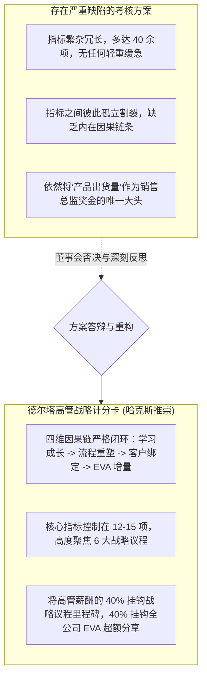
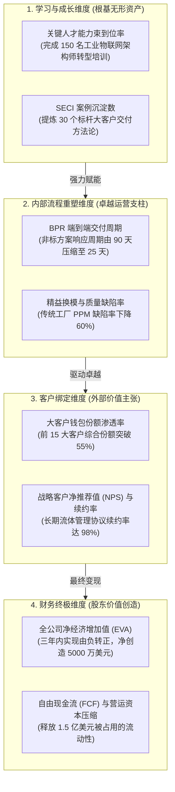

# Lec 13 颗粒度指标落地与高管平衡计分卡复盘 (Granular Metrics Dashboard & C-Suite Scorecard Review)

> MIT Sloan School of Management · 15.904 Strategy and the CEO · Prof. Arnoldo Hax

## TL;DR

- 各高管小组关于 DMK 高管平衡计分卡与颗粒度指标仪表盘的实战答辩。
- 拒绝平衡计分卡沦为“填表形式主义”：构筑自下而上的四维铁血因果逻辑链。
- 高管薪酬与长期激励机制的重构：将 CEO 及执委会奖金与德尔塔客户绑定率和真实 EVA 刚性挂钩。
- 建立数字化战略指挥室（Executive War Room），实现全链路关键经营指标的实时态势感知。

## 实战研讨答辩：DMK 高管平衡计分卡方案碰撞 / Group Workshop & Scorecard Review

在 15.904 的第十三次课程中，各小组登台展示了各自为 DMK 设计的高管平衡计分卡（Balanced Scorecard, BSC）与绩效监控体系。

绩效考核是指引组织全体员工行为的无形指挥棒。如果一家企业高喊要推进数字化与大客户解决方案，而在绩效考核表上依然按照传统的出货吨位来决定高管奖金，那么战略转型就注定会沦为一句空洞的口号。

哈克斯教授要求学员直接代入 DMK 董事会薪酬委员会的角色，对各组设计的计分卡进行极为苛刻的审计。现场暴露出传统考核方案在面临战略转型时的典型失调：

哈克斯教授强调：**如果企业的考核指标还在奖励昨天的行为，那么全公司无论开多少次战略动员大会，组织都绝不可能迈向明天的德尔塔新定位！**

## 平衡计分卡四维因果链的钢铁逻辑 / The Iron Logic of Cause-and-Effect

一个卓越的平衡计分卡，绝不是四项分类的简单拼盘，它是一台**自我验证的因果逻辑推进器**。在传统考核中，财务指标与非财务指标往往处于脱节状态，管理层无法解释为什么客户满意度上升了但利润却下降了。

卡普兰与诺顿的平衡计分卡之所以能成为战略落地的革命性工具，核心在于其四维之间坚不可摧的**因果逻辑假说系统**。企业如果不能建立清晰的因果映射，考核就会沦为各部门为了刷高自身分数而损害公司整体利益的数字游戏。通过将学习与成长、内部流程重塑、外部客户绑定以及财务终极回报紧密咬合在一起，平衡计分卡为 CEO 提供了一张全景透视的战略导航罗盘。

在 DMK 的转型实战中，哈克斯教授带领学员推导出了严密的因果演绎链条，使得每一个维度的目标都能自下而上层层驱动最终的股东价值创造：

每一位高管都必须对这个链条中属于自己的环节立下军令状：如果 HR 无法交付合格的架构师团队，后方的流程重塑就会瘫痪；如果流程交付持续延误，客户绑定就会破裂；而客户的流失，最终必将导致财务报表的全面崩溃。通过这一份清晰的可视化逻辑图，组织上下每一名员工都能看清自己的日常工作与全公司宏观战略之间的血脉联系。

## 高管薪酬与长期激励契约的重构 / C-Suite Compensation & Incentive Alignment

战略转型的成败，最终取决于高管团队的个人利益与企业长期命运是否彻底绑定。

在 DMK 方案中，哈克斯教授指导学员废除了传统的“按底薪 + 部门营收提成”的旧模式，确立了具有革命意义的**德尔塔高管激励三元结构**：

| 薪酬构成模块 | 占总薪酬比重 | 考核核心指标与对赌条件 | 战略管理目的 |
| :--- | :--- | :--- | :--- |
| **基础保障薪酬 (Base Salary)** | 30% | 维持高管基本生活与行业对标中位数 | 提供基本的安全感，防止高管为短期生计铤而走险 |
| **战略战役里程碑奖金 (Strategic Bonus)** | 35% | 个人挂帅的战略议程（The Strategic Agenda）交付达成率（按季评估） | 强制高管将 70% 的工作精力聚焦于打赢战略攻坚战 |
| **长期超额 EVA 分红池 (Long-term EVA Pool)** | 35% | 全公司连续三年的累计增量 EVA，存入虚拟“奖金银行（Bonus Bank）”延期分期兑现 | 彻底杜绝高管为了当年奖金而透支公司未来的短期投机行为 |

::: definition 奖金银行机制 (Bonus Bank)
奖金银行是指将高管基于当年超额业绩所获得的巨额奖金，不立即全额发放，而是存入一个虚拟的递延账户，分 3-5 年平滑发放。如果在后续年份中企业因为前期的隐患爆发导致 EVA 出现巨额亏损，奖金银行内的未发放存量将被无情扣回。这一机制将高管彻底绑在长期股东价值的战车之上。
:::

## 打造数字化战略指挥室（War Room） / The Executive Strategy Dashboard

在课程总结中，哈克斯教授演示了现代跨国集团 CEO 的作战神经中枢——**数字化战略指挥室（Executive War Room）**：
- **拒绝厚重的纸质报表**：全公司所有关键经营数据全部实现系统直连，每周一清晨自动生成最新的战略仪表盘；
- **异常穿透与下钻（Drill-down）**：当某个大客户的满意度亮起红灯时，CEO 只需在触控屏上轻点三下，即可瞬间下钻到该客户所在的具体车间、查阅导致停机的具体阀门批次与现场驻场工程师的排查记录；
- **透明平等的扁平沟通**：战略仪表盘对全公司前 100 位核心管理者全员公开，彻底消除信息特权与部门壁垒，营造坦诚透明的现代战略治理文化。

## 我的理解与实践洞察 / Personal Insight

考核指标是组织潜意识的指挥棒。

::: insight 员工不听你怎么宣讲，员工只看你如何考核
很多 CEO 抱怨战略无法在一线落地，抱怨员工缺乏大局观、不愿意拥抱创新。
**然而，99% 的执行力瘫痪，根源都在于领导者制定了荒谬自相矛盾的考核制度！**
你一边在大会上声嘶力竭呼吁大家转型做大客户解决方案，一边却把每月销售冠军的大奖颁发给那个只会甩卖廉价标品的推销员；你一边要求大家打破部门壁垒协同作战，一边却把奖金完全绑定在部门内部的狭隘指标上。
员工是高度理性的生物。卓越的 CEO 从不用空洞的道德说教去感化员工，他们像顶级精算师一样校准绩效与薪酬机制，让打赢战略议程成为每一个员工实现个人财富与职业尊严的唯一坦途。
:::

## 思考题与实战研讨

1. 某软件企业在推行平衡计分卡时，设立了“大客户净推荐值（NPS）”作为关键客户指标，但发现一线销售人员为了拿高分，故意联合客户采购主管进行人情打分刷单。针对这种指标异化现象，作为 CEO，你应采取哪些微观治理与审计机制防范作弊？
2. 结合本讲介绍的“奖金银行（Bonus Bank）”机制，分析为什么这一制度能够有效遏制金融机构高管为了追逐短期高额承销佣金而向客户兜售高风险有毒资产的道德风险？
