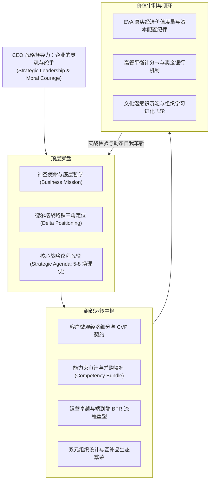

# Lec 14 CEO 战略领导力、组织转型与全课终极闭环 (Strategic Leadership, Transformation & Executive Synthesis)

> MIT Sloan School of Management · 15.904 Strategy and the CEO · Prof. Arnoldo Hax

## TL;DR

- 15.904 全课思想终极大熔炉：统领战略愿景、德尔塔定位、组织重塑与资本纪律。
- DMK 转型大结局：新任 CEO 执委会如何带领传统工业巨头涅槃重生，实现市值与声誉的跨越式跃迁。
- 战略领导力的终极试金石：在惊涛骇浪与多方利益冲突中，维持不可动摇的战略定力。
- 德尔塔 CEO 实战行动纲领（The Delta CEO Playbook）：留给未来商业领袖的永恒管理遗产。

## 15.904 全课知识体系终极熔铸 / The Grand Synthesis of Strategy and the CEO

历经 14 次震撼人心的实战淬炼，麻省理工学院 15.904 课程迎来了最庄严的终章。阿诺尔多·哈克斯教授走上讲台，带领全体高管学员俯瞰整座现代战略思想体系的宏伟全貌。

CEO 的工作从来不是处理孤立的事务，而是驾驭一个庞大复杂的**生命体系统（Living Enterprise System）**。在真实商业世界中，战略的失败往往不是因为某一个具体零件失灵，而是因为齿轮与齿轮之间的咬合机制出现了致命断裂。当高层的崇高愿景无法转化为一线的战略战役，当财务预算还在给老业务输血，当考核机制还在惩罚跨部门协同，整座企业大厦就会陷入空转。

哈克斯教授将全课的所有思想精华熔铸为一台浑然一体的企业战略主发动机，指导 CEO 统领全局：



从企业哲学出发，经过战略定位与议程的聚焦，穿透到客户细分、能力束、运营流程与生态互补品，最终由 EVA 和平衡计分卡完成价值的严格闭环并反哺组织进化。任何一个环节出现断裂，CEO 的职责就是毫不犹豫地扑向断点，重新校准齿轮的咬合。在这座大厦中，战略不是一张静态的图纸，而是一团永不停歇、自我进化的生命之火。

## DMK 案例推演大结局：涅槃重生的商业史诗 / The DMK Transformation Finale

在课程的收官阶段，哈克斯教授向全班公布了 DMK 公司历经三年铁血转型后的真实答卷。

通过新任 CEO 带领核心团队坚定不移地推行德尔塔战略转型，DMK 实现了从深陷泥潭的传统制造企业向现代工业智能解决方案中枢的惊天逆袭：

```mermaid
flowchart LR
    subgraph Year0["转型前：至暗时刻"]
        A1["深陷低成本红海价格战"]
        A2["毛利率跌破 18%，EVA 为严重负值"]
        A3["大客户将产品视同标准大宗物资"]
        A4["部门各自为政，高管互不信任"]
    end

    -->|三年德尔塔铁血战略转型|

    subgraph Year3["转型后：光辉涅槃"]
        B1["前 15 大客户全部签订长期流体管理协议"]
        B2["毛利率飙升至 38%，三年累计创造 EVA 超过 1.2 亿美元"]
        B3["Flow-OS 平台连接数万台设备，互补开发者突破 500 家"]
        B4["企业市值翻了三倍，被华尔街誉为工业数字化转型标杆"]
    end
```

DMK 的成功雄辩地证明：**没有落后的行业，只有落后的商业认知与僵化的战略思维！** 哪怕是最古老、最传统、最被资本市场嫌弃的传统工业板块，只要用德尔塔模型重新武装，深入客户经济流程去创造不可替代的共生价值，就能重新绽放出璀璨的商业生命力。

## 战略领导者的品格修炼：在不确定性中建立秩序 / The Character of Strategic Leadership

在全课的告别寄语中，哈克斯教授脱离了具体的技术工具，深情探讨了企业领导者的精神品格。

他指出，一位卓越的战略领导者必须在内心深处调和三种终极张力：
1. **战略定力与动态敏捷的平衡**：对最终的战略定位与企业使命保持坚如磐石的执着，但在微观的战术执行和产品迭代上保持水一样的柔韧与敏捷；
2. **制度理性与人文关怀的平衡**：在资本配置、指标考核与优胜劣汰上保持外科医生般的冷酷理性，但对一线员工的尊严、成长与客户的福祉怀揣深沉的温情；
3. **眼前的苟且与诗和远方的平衡**：既能弯下腰去把车间的废品率从 2% 降到 1.5%，又能抬起头来洞察未来十年产业互补品标准的终局演进。

::: definition 战略领导力 (Strategic Leadership)
战略领导力是指企业最高领导者在充满巨大不确定性、复杂性与利益冲突的外部环境中，准确洞察商业本质，做出重大战略抉择，并以钢铁般的意志打破组织内部阻力，带领全体成员持续穿越周期、共同创造非凡社会价值的领导艺术。
:::

## 德尔塔 CEO 实战行动纲领 / The Delta CEO Playbook

作为留给每一位未来商业领袖的传世工具箱，哈克斯教授提炼了浓缩为九条黄金法则的《德尔塔 CEO 实战行动纲领》：
1. **停止盯视竞争对手，将目光死死锁定在客户的损益表上**；
2. **坚决摆脱只卖单件产品的低维竞争，向整体解决方案与系统锁定跃迁**；
3. **在全行业寻找互补品伙伴，用开放接口和利益分享团结一切可以团结的力量**；
4. **把全公司级战略议程严格限制在 5 到 8 项，每一项指定唯一高管负责人**；
5. **定期审计内部能力缺口，善用兼并收购与外部合作弥补时间压缩不经济**；
6. **以客户价值为圆心重构端到端业务流程，彻底铲除官僚职能竖井**；
7. **把加权平均资本成本（WACC）作为生死线，坚决剥离毁灭资本的劣质资产**；
8. **建立穿透到最小经营单元的颗粒度度量衡，用奖金银行绑定高管长期利益**；
9. **身教胜于言传，用崇高的企业哲学与不可动摇的诚信铸就组织永恒的灵魂**。

## 我的理解与实践洞察 / Personal Insight

15.904 是一场洗涤商业灵魂的心智淬炼之旅。

::: insight 商业领袖的真正遗产，是培养了一支拥有共同信仰的组织铁军
当一家企业的 CEO 退休离任时，人们评价他的标准绝不仅仅是留下了多少亿的现金储备，或者建成了多少座气派的大楼。
**卓越领导者留给这个世界最伟大的遗产，是一套融入全员潜意识的德尔塔战略心智模型，是一支敢打硬仗、能打胜仗且对客户怀有深沉敬畏的组织铁军**。
在这个充满诱惑与浮躁的商业时代，愿每一位掌舵者都能怀揣着阿诺尔多·哈克斯教授所赋予我们的深邃智慧与道德勇气，在商业的狂风巨浪中掌稳航向，做一名清醒、坚定、悲悯而伟大的企业总建筑师！
:::

## 思考题与实战研讨

1. 回顾整个 15.904 课程中 DMK 案例的推演全过程，系统总结其从“最佳产品”向“全面客户解决方案”及“系统锁定”跨越的三个关键转折点，并指出新任 CEO 在哪几个关键节点上展现了非凡的决断魄力？
2. 结合《德尔塔 CEO 实战行动纲领》的九条法则，为你自己当前所在企业（或你未来计划创立的商业机构）撰写一份《新任 CEO 前 180 天破局战略备忘录》。
