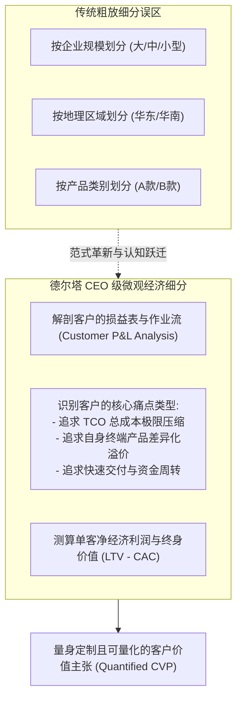

# Lec 02 首席视角下的客户细分与客户价值主张 (CEO-Level Customer Segmentation & CVP)

> MIT Sloan School of Management · 15.904 Strategy and the CEO · Prof. Arnoldo Hax

## TL;DR

- CEO 必须亲自挂帅重构客户细分，打破市场部基于人口统计学的肤浅划分。
- 德尔塔客户细分基石：基于客户底层经济模型（损益表与资产负债表）的价值驱动拆解。
- 客户价值主张（CVP）必须量化：明确为客户降低多少总拥有成本（TCO）或带来多少增量收益。
- 制定 DMK 战略客户分类梯队，确定重点倾斜资源的“一级战略伙伴”与坚决淘汰的“负利毒瘤客户”。

## 为什么传统客户细分会误导最高决策层？ / The Fatal Flaws of Traditional Segmentation

绝大多数企业的营销部门在向 CEO 汇报客户细分时，拿出来的通常是基于地理区域（华东、华北、海外）、企业规模（大型国企、中小民企）或产品采购型号的划分图表。

阿诺尔多·哈克斯教授指出，这种传统的细分方式在战略上是极度浅薄甚至危险的：
- **混淆了特征与动机**：两家规模完全相同的企业，一家可能极度看重采购单价的微小折扣，另一家可能宁可支付高溢价也要求 100% 的生产线无故障保障；
- **掩盖了真实盈利水平**：单纯按采购额划分的大客户，往往凭借巨大的采购量向企业索取极低价格并提出无数苛刻的非标定制要求，导致企业在这些“大客户”身上净亏损；
- **无法指导战略对齐**：粗放的人口统计划分无法告诉研发人员该开发什么能力，也无法告诉供应链该如何设计差异化交付网络。

CEO 必须要求团队下沉到客户的真实业务现场，像外科医生解剖病理一样，解构客户赚取利润与发生成本的微观机制。

## 客户经济模型解构与量化 CVP 设计 / Deconstructing Customer Economics

客户价值主张（Customer Value Proposition, CVP）绝不是写在画册上的“品质卓越、服务第一”等空洞口号。一个合格的 CVP 必须是一份严谨的**商业对赌与价值承诺书**。

### 1. 降低客户总拥有成本（Lowering Customer TCO）
总拥有成本不仅包括前端采购发票上的显性价格，更包括全生命周期的隐形开销：

$$
\text{TCO} = P_{\text{purchase}} + C_{\text{logistics}} + C_{\text{inventory}} + C_{\text{installation}} + C_{\text{downtime}} + C_{\text{maintenance}} + C_{\text{disposal}}
$$

企业即使在采购价格（$P_{\text{purchase}}$）上高出竞品 10%，但如果能通过卓越的可靠性将客户的产线停机损失（$C_{\text{downtime}}$）降低 50%、将备件库存成本（$C_{\text{inventory}}$）降低 30%，客户的整体综合成本反而大幅下降。这就是“全面客户解决方案”无坚不摧的定价杀手锏。

### 2. 提升客户业务收益（Enhancing Customer Top-line Revenue）
协助客户为其终端消费者提供更具吸引力的新功能、更短的上市交付周期，或帮助客户打入原本无法触达的新兴高端市场，让客户因为采购了你的方案而赚取更多超额收益。

::: definition 客户价值主张 (CVP)
客户价值主张是企业针对特定细分客群所做出的独特、量化且具备防御力的经济价值承诺。它明确界定了企业如何通过自身独特的能力束，在帮助客户降低总运营成本或显著增加业务收入的过程中，与客户达成共赢的价值分配契约。
:::

## DMK 企业的客户细分实战演练 / DMK Customer Segmentation Matrix

在 15.904 的第一次小组实战作业中，学员需要为 DMK 公司建立一套全新的客户分层经营矩阵：

| 客户梯队类别 | 客户核心特征与需求偏好 | DMK 定制的客户价值主张 (CVP) | 德尔塔定位与资源配置策略 |
| :--- | :--- | :--- | :--- |
| **第一梯队：战略共生合伙人 (Tier 1: Strategic Partners)** | 行业领军企业、注重长远创新、愿与 DMK 共享技术路线图与经营数据 | 提供联合研发（JDA）、专属驻场工程团队、全生命周期系统托管与效益分成 | **全面客户解决方案**：倾斜 60% 研发资源与顶尖人才，构筑深度流程绑定 |
| **第二梯队：成长型高价值客户 (Tier 2: Value Customers)** | 业务增长迅猛、技术储备较弱、对生产交付稳定性有极高要求 | 提供模块化一站式解决方案组合包、标准技术支持与阶梯返利 | **最佳产品向解决方案过渡**：配置标准化销售与服务支持，提高钱包份额 |
| **第三梯队：纯交易型大宗采购 (Tier 3: Transactional Buyers)** | 价格极度敏感、仅购买通用标准件、随时进行公开招标比价 | 提供极致性价比的标准现货产品、线上自主下单结算、严格现款现货 | **最佳产品 (低成本领先)**：严格控制服务与差旅开销，杜绝非标定制 |
| **第四梯队：负利毒瘤客户 (Tier 4: Capital Destroyers)** | 采购规模小、需求苛刻且多变、经常拖欠货款且占用大量售后工时 | 提高报价 30% 或推行最低起订量（MOQ）限制，倒逼其按标品采购 | **坚决淘汰或剥离**：若客户拒绝接受合理调价，毫不犹豫终止合作 |

## 我的理解与实践洞察 / Personal Insight

客户细分是检验企业战略克制力的试金石。

::: insight 战略的勇气在于敢于对不合格的客户说“不”
很多销售出身的管理者有一种心理误区：“只要是客户给的订单，不赚白不赚”。
**然而，商业世界最残酷的真相是：相当一部分客户不仅不赚钱，反而是在疯狂毁灭你的企业价值！**
那些天天为了几毛钱打压价格、却要求你派出顶级专家天天驻场服务的毒瘤客户，不仅占用了你宝贵的研发工程师精力，更破坏了你服务核心战略大客户的节奏。卓越的 CEO 必须拥有一双冷酷的经济学慧眼，敢于把破坏资本的客户清除出客户池，把最宝贵的资源毫无保留地浇灌在能够共生共赢的战略土壤上。
:::

## 思考题与实战研讨

1. 运用本讲的 TCO 公式，如果某大客户向 DMK 提出：“竞品报价比你们便宜 8%，如果你们不能降价匹配，下个月我们将把采购份额转移给竞品”，作为 DMK 的 CEO，你应指导大客户销售总监准备怎样一份量化商业提案予以有力还击？
2. 在 DMK 的客户细分中，如何界定“负利毒瘤客户”？请列出至少三项基于作业成本法（ABC）的量化财务判定红线。
