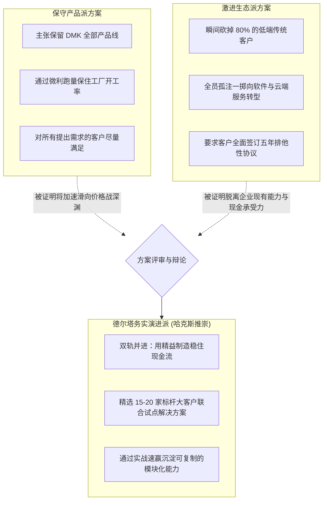
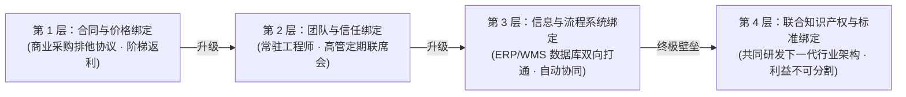

# Lec 03 客户细分与 CVP 实战复盘与跨界研讨 (Segmentation & CVP Review: The DMK Case)

> MIT Sloan School of Management · 15.904 Strategy and the CEO · Prof. Arnoldo Hax

## TL;DR

- 各高管小组针对 DMK 客户细分与 CVP 方案的实战答辩与唇枪舌剑。
- 哈克斯教授现场诊断：警惕“自欺欺人的伪定制”与“不切实际的全面讨好”。
- 客户转换壁垒的微观构筑：从合同约束走向软硬件底层技术嵌入。
- 复盘提炼：如何将静态的客户细分表格转化为指导销售团队日常打仗的实操作战手册。

## 小组答辩与方案碰撞：不同战略流派的交锋 / Group Presentations & Clash of Perspectives

在 15.904 的第三次课程中，来自不同背景的高管学员小组走上讲台，汇报各自为 DMK 公司量身定制的客户细分方案。作为一家面临转型的传统工业制造企业，DMK 的高管团队内部对于究竟应当坚守传统老阵地还是激进跨界展开了极其激烈的论战。

这种方案的碰撞不仅反映了各自对市场趋势判断的分歧，更深刻折射出不同管理哲学在面对生死存亡时的根本取舍。课堂现场爆发了三大截然不同战略流派的激烈交锋：

哈克斯教授逐一对各组方案进行了犀利而深刻的解剖。保守产品派看似稳妥，实则是在温水煮青蛙，随着竞品成本持续压低，DMK 迟早会被活活耗死；而激进生态派虽然口号响亮，却完全脱离了企业现有的组织能力存量与现金储备极限，极易导致资金链断裂。唯有德尔塔务实演进派，在守住基本盘现金流的同时，集中优势兵力在核心大客户身上取得突破，才是大企业转型的最优破局解法。

## 哈克斯教授的现场诊断与经典误区破除 / Deconstructing Common Strategic Blindspots

在听取完学员汇报后，哈克斯教授指出，几乎所有管理层在制定细分与价值主张时，都会掉入三大典型陷阱：

### 1. 陷阱一：自欺欺人的“伪定制（Fake Customization）”
很多小组在报告中声称“我们为每个客户量身定制方案”。
- **现实残酷性**：真正的定制需要极高昂的研发人力与现场支持开销。如果企业没有建立模块化的底层技术底座，盲目答应客户的每一个特殊需求，就会把企业拖入“项目制手工作坊”的泥潭；
- **德尔塔准则**：**大规模定制（Mass Customization）**的真谛在于“核心组件高度标准化，外围接口高度柔性化”。企业必须用 80% 的成熟预制模块，去拼装出满足客户 20% 个性化需求的整体方案。

### 2. 陷阱二：不切实际的“全能保姆幻想（Universal Savior Fallacy）”
某些小组试图设计一套兼顾低成本、高品质、极速交付和免费定制的“超级价值主张”。
- **现实残酷性**：战略的核心就是取舍（Trade-offs）。追求极致低价就必须牺牲定制灵活性；追求深度驻场就必须收取服务溢价；
- **德尔塔准则**：向客户坦诚你的边界。明确告诉客户你能在哪些方面创造惊人价值，同时坚决拒绝在非核心诉求上做无意义的资源浪费。

::: pitfall 承诺无法兑现的价值主张是商誉的自杀
在 B2B 商业世界中，客户对交付违约的惩罚是极其严厉的。如果销售团队为了拿到大单，向客户高管许诺了超出公司交付能力极限的 CVP，最终导致客户产线停工或项目延期，不仅该客户会永久流失，更会在整个行业生态圈中彻底摧毁企业的信誉口碑。
:::

## 客户绑定机制的深层锚定：从纸面契约到骨肉相连 / Deepening the Bonding Mechanics

在深入剖析 DMK 方案时，哈克斯教授引导学员思考：**当竞品在两年后终于研发出了类似的整体解决方案时，DMK 凭什么阻止客户移情别恋？**

答案在于将客户绑定推进到更高的物理与组织层级：

当 DMK 的软件系统与客户的生产制造执行系统（MES）完全对接、当客户的年轻工程师都是使用 DMK 的工具软件成长起来时，客户要替换掉 DMK，就必须对自身内部全套业务流程动大手术。这种结构性转换壁垒，才是最坚实的护城河。

## 将细分方案转化为日常作战手册 / From Segmentation Matrix to Sales Playbook

战略如果不能转化为前线销售代表能够听得懂、用得上的工具，战略细分就只是一堆废纸。

在复盘总结中，哈克斯教授要求管理层将 DMK 的新战略细分沉淀为三项具体的管理工具：
1. **大客户画像自检清单（Target Profiling Checklist）**：销售人员在拜访新客户时，通过 10 个关键提问，在 30 分钟内准确判定该客户属于哪个梯队；
2. **量化 TCO 测算模型计算器（TCO ROI Calculator）**：为销售团队配备简易的平板测算软件，现场输入客户的电费、停机工时、废品率，当场生成对比图表；
3. **差异化资源申请通行证（Resource Allocation Gate）**：只有第一梯队和第二梯队的战略客户，销售人员才有权向公司总部申请高级架构师随同出差与免费样机研发支持。

## 我的理解与实践洞察 / Personal Insight

战略评审不是为了选出最口若悬河的小组，而是为了逼近商业现实的本质。

::: insight 商业模式不是在真空中设计的，而是在利益博弈的摩擦中淬炼出来的
在课堂上，当两个小组就 DMK 究竟应该降价还是提价争得面红耳赤时，他们真切体会到了 CEO 每天面临的精神撕裂。
**战略决策从来不是在“正确”与“错误”之间做选择，而往往是在“这个代价我能否承受”与“那个风险我能否化解”之间做决断**。卓越的领导者从不在争论中寻求毫无原则的折中妥协，他们以深刻的客户经济洞察为手术刀，精准切除组织深处的幻想，带领团队直面最艰难但唯一正确的战略破局点。
:::

## 思考题与实战研讨

1. 在 DMK 客户细分研讨中，某小组主张：“对所有长期拖欠货款但采购量巨大的老客户，一律给予最优惠的定制解决方案以挽留他们”。运用本讲理论，驳斥该观点的荒谬性，并提出正确的处置对策。
2. 结合本讲介绍的“客户绑定四层递进模型”，选择一家你所熟悉的数字化企业（如 Salesforce、SAP 或阿里云），分析其是如何一步步将客户从初期的软件购买引导至终极的生态系统绑定的？
