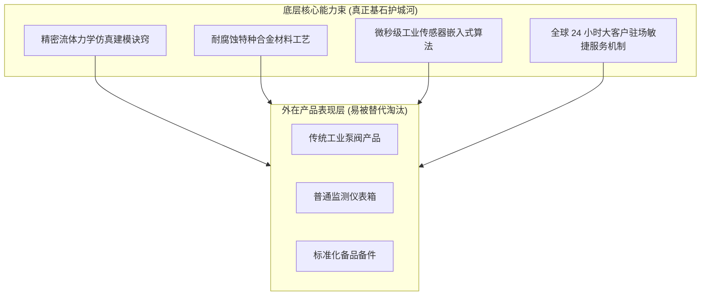
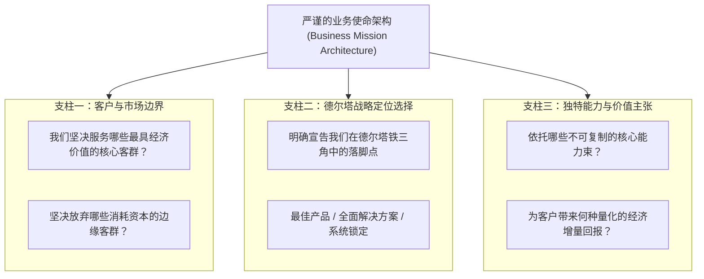

# Lec 04 作为能力束的企业：核心竞争力审计与使命界定 (The Firm as a Bundle of Competencies & Mission Architecture)

> MIT Sloan School of Management · 15.904 Strategy and the CEO · Prof. Arnoldo Hax

## TL;DR

- 企业本质上是独特知识、技术诀窍、管理流程与资产的“能力束（Bundle of Competencies）”。
- CEO 必须主持严谨的能力差距审计（Competency Gap Audit）：识别现有能力与未来战略诉求的断层。
- 业务使命（Business Mission）是企业战略的大宪章，必须清晰界定业务范围、定位与坚决不做什么。
- DMK 案例推演：从传统设备组装制造能力，向软硬件集成、远程运维与工业数据智能能力跨越。

## 能力束视角：穿透产品表象看组织本质 / The Firm as a Bundle of Competencies

很多企业的高管在向外界介绍自己的公司时，往往列举出一长串产品清单：“我们生产高压阀门、离心泵、工业仪表”。然而，阿诺尔多·哈克斯教授指出，这种将企业等同于“产品集合”的认知是极其肤浅的。

产品只是企业在特定历史时间点上的物理产出载体，随时会被更新的技术替代淘汰。**企业的真正内核，是一组深藏于组织内部、能够持续繁育出多样化产品与服务的“核心能力束（Bundle of Competencies）”**。

正如本田（Honda）的核心能力不是汽车或割草机，而是高效轻量级内燃机技术与底盘调校工艺；佳能（Canon）的核心能力不是照相机或打印机，而是精密光学透镜与微电子成像控制技术。只要底层能力束生生不息，企业就能像大树一样不断长出全新的繁茂枝叶。

## 核心竞争力审计三维矩阵 / The Competency Audit Framework

为了摸清企业内部的家底，CEO 必须带领执委会开展严肃的**能力差距审计（Competency Gap Audit）**：

### 1. 内部能力与资产盘点（Internal Competency Audit）
- **技术与专利资产**：企业掌握的核心专利、软件代码库与工艺秘密配方；
- **人力与默会知识**：领军科学家、顶级大客户架构师与特级技师团队；
- **基础设施与 IT 系统**：自研的自动化生产线、全球供应链协同系统与客户数据中台。

### 2. 外部借力与互补生态能力（External & Complementor Competency）
- 企业是否具备吸引外部顶尖科研机构、高校实验室、软件外包伙伴共同研发的能力？
- 在系统锁定维度，企业是否有能力制定友好的开放接口，撬动第三方互补品开发者的智力资源？

### 3. 能力健康度 VRIO 检验
对照价值性（Valuable）、稀缺性（Rare）、难以模仿性（Inimitable）与组织协同性（Organized），评估每一项能力是属于“竞争劣势”、“平庸对等”，还是具备“持续竞争优势”。

::: definition 核心能力束 (Bundle of Competencies)
核心能力束是指企业在长期经营实践中所沉淀的、由技术诀窍、组织惯例、专利资产与人力技能高度协同交织而成的独特能力组合。它能为企业在多条业务赛道中带来显著超越同行的效率溢价与客户价值创造潜能。
:::

## 业务使命架构：战略定位的大宪章 / Crafting the Business Mission

在完成能力审计后，CEO 的下一项重大决断是撰写企业的**业务使命声明（The Business Mission Statement）**。

哈克斯教授极度反感那些泛泛而谈的公关型使命。在德尔塔模型中，业务使命具有极高密度的战略信息含量。它不仅是对外宣示企业存在的合理性，更是对内统一数万名员工思考方式与资源配置方向的行动宪章。一个严谨的战略使命绝不能流于抽象的道德宣示，它必须如同精确的法律合同一样，界定企业与外部商业世界互动的核心契约。

哈克斯教授提炼出业务使命必须包含的三大神圣支柱，缺少任何一根支柱，使命都会失去战略引导力：

一个合格的业务使命，应当让全公司任何一名员工在面临重大业务取舍时，无需请示 CEO，即可清晰判断该业务是否符合公司的使命准则。这种高度的自治与对齐，正是卓越企业能够在风云变幻的市场中保持敏捷战略定力的根本源泉。

## DMK 企业能力重组推演 / DMK Competencies & Mission Assignment

在 15.904 的推演中，DMK 公司面临着传统能力的严重老化与新战略所需能力的巨大鸿沟：

| 能力维度 | DMK 现有存量能力（传统机械工业） | 新战略所需目标能力（智能全面解决方案） | CEO 的能力构建路径 (Build / Buy / Partner) |
| :--- | :--- | :--- | :--- |
| **研发与技术能力** | 纯硬件机械结构设计、传统模具开模技术 | 物联网传感器集成、远程预测性维护算法、云端工业数据分析中台 | **并购 + 外部引援 (Buy & Hire)**：果断收购一家初创工业 IoT 软件公司 |
| **交付与运营能力** | 标准流水线按批次生产、第三方物流分销 | 模块化柔性定制交付、常驻客户现场运维、备件极速响应网络 | **内部流程再造 (Build - BPR)**：组建大客户专属交付突击队，重塑服务流程 |
| **销售与市场能力** | 目录推销、比拼出货价格的传统推销员 | 能看懂客户财务报表、提供量身定制方案的行业架构师顾问 | **彻底淘汰与转型 (Retrain & Replace)**：重构薪酬激励，大批引入技术咨询顾问 |

通过这一份能力重组蓝图，DMK 的新任 CEO 明确了未来三年全公司的资本开支与并购方向，为战略从纸面走向现实奠定了坚实的资源地基。

## 我的理解与实践洞察 / Personal Insight

能力审计是治愈企业盲目自信最清醒的良药。

::: insight 企业的真正能力，往往远比 CEO 想象的要少得多
在风口期，很多企业把“时代的红利”和“市场的暴增”错当成了“自身的核心能力”。高管们误以为自己无所不能，盲目跨界进入全新赛道。
**然而，退潮之后，企业才会发现自己除了靠低价拼杀的蛮力之外，根本没有真正具备技术护城河的核心能力**。卓越的 CEO 敢于在狂热中给组织泼冷水，用无情的客观尺度审计每一项能力的真伪。宁可承认短板而痛下决心通过并购与合作补齐，也绝不带着虚假的能力幻觉盲目打一场毫无胜算的战略硬仗。
:::

## 思考题与实战研讨

1. 某传统燃油车核心零部件供应商在面临电动化转型时，宣布其业务使命是“成为全球领先的新能源智能移动出行科技巨头”。运用哈克斯教授的业务使命三大支柱，分析该使命陈述存在哪些空洞与缺陷？如何将其修改为严谨的战略契约？
2. 在 DMK 的案例中，从“传统机械制造能力”向“工业物联网与远程运维能力”跃迁，企业面临巨大的组织文化冲突。作为 CEO，你会选择在母体内部孵化新能力，还是设立完全隔离的独立事业部？说明你的权衡依据。
