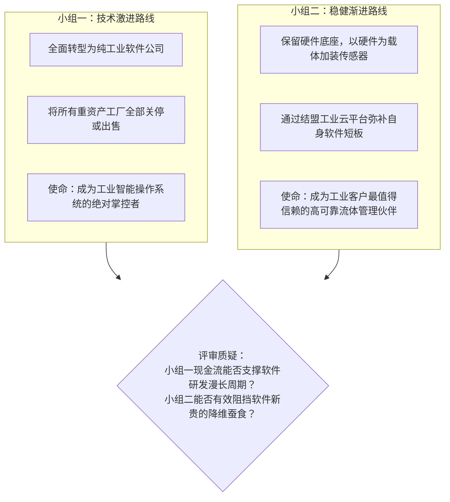
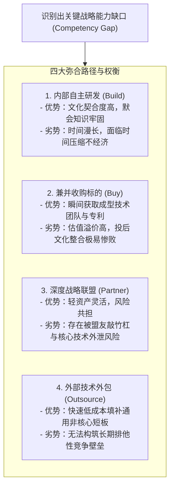

# Lec 05 组织能力审计与使命陈述深度实战 (Competency Audit & Mission Synthesis: Practical Workshop)

> MIT Sloan School of Management · 15.904 Strategy and the CEO · Prof. Arnoldo Hax

## TL;DR

- 各高管小组关于 DMK 组织能力审计与全新使命陈述的第二轮实战汇报。
- 哈克斯教授深度拆解：区分“门槛能力（Threshold）”与“致胜核心竞争力（Winning）”。
- 解决能力缺口的四大战略途径：自主内生培育、兼并收购、战略结盟与外部采购。
- 战略使命的落地测试：检验使命是否具有可操作的排他性、约束力与资源指引性。

## 实战研讨答辩：DMK 使命陈述方案交锋 / Group Workshop & Mission Presentations

在 15.904 的第五次课程中，学员们展示了经过深思熟虑后为 DMK 设计的全新使命陈述与能力缺口弥合方案。作为最高决策层，CEO 不仅需要提出理想化的宏伟蓝图，更需要面对真实的资源短缺与执行风险。

各小组在课堂上分别代表了不同的战略演进哲学，引发了关于企业转型节奏与风险承受力的深度大辩论。哈克斯教授让各小组互为攻防双方，针对方案的可行性与资本承受力展开激烈推敲：

通过激烈的辩论，学员们深刻体会到：**战略使命绝不是挑选听起来最性感的词汇，而是企业在自身客观能力约束下所能做出的最精妙的现实平衡**。盲目追逐时髦概念往往导致灾难性的翻车，唯有立足于自身独特的基因与资源禀赋，企业才能在长期的战略耐力赛中跑赢对手。

## 门槛能力 vs. 致胜核心竞争力的严苛区分 / Threshold vs. Winning Competencies

哈克斯教授在点评中提出了一个极其关键的认知分野：很多企业把“及格线能力”误当成了“竞争壁垒”。

| 能力分类 | 核心定义与标准 | 典型业务表现 | 战略价值与竞争后果 |
| :--- | :--- | :--- | :--- |
| **门槛能力 (Threshold Competencies)** | 进入该行业并维持日常运营所必需的最低基本功 | 具备基本的 ISO 质量认证、符合环保排放法规、正常的财务核算 | 拥有它只能让你拿到上场比赛的门票，绝无法带来任何超额利润；一旦缺失则立即被淘汰 |
| **致胜核心竞争力 (Winning Competencies)** | 能够为特定战略客群带来独特价值且对手无法轻易复制的独门绝技 | 颠覆性的算法架构、极深的大客户流程嵌入、独占性的互补品生态协议 | 能够直接拉开竞争差距，赋予企业强大的议价权与持续创造超额 EVA 的能力 |

在审计 DMK 时，哈克斯指出：“拥有现代化的流水线车间和合格的焊接工人，只是重工行业的门槛能力；但在 24 小时内为海上钻井平台量身定制出耐深海高压密封阀门并实现远程监控的能力，才是 DMK 能走向全面解决方案的致胜竞争力！”

::: definition 门槛能力与致胜竞争力定理
在成熟市场中，企业在门槛能力上的超额投入往往遭遇边际收益急剧递减。卓越的战略资源配置，必须将门槛能力的开销严格控制在行业平均基准线，而将 80% 的自由战略资本倾注于培育稀缺的致胜核心竞争力。
:::

## 弥合能力缺口的四大战略途径权衡 / Four Paths to Bridge Competency Gaps

当企业通过严谨的审计发现自身现有能力根本无法支撑全新使命时，最高管理层绝不能寄希望于奇迹的发生，而必须在弥合能力缺口的四大战略途径中做出理性的权衡与抉择。

每一种途径都对应着完全不同的资本消耗规模、时间沉淀要求、组织摩擦阻力以及对外部知识的控制力。CEO 必须像资本配置大师一样，评估不同路径下的投入产出比与战略风险溢价：

哈克斯教授强调，决策的核心依据在于**该项能力对战略定位的核心程度与市场紧迫性**。如果该能力属于战略命脉（如德尔塔解决方案的底层数据中台），且市场窗口期仅剩 12-18 个月，自主研发根本来不及，企业必须果断启动战略并购；如果属于通用支撑模块，则应坚决采用外部采购与外包。通过科学组合这四种手段，企业方能在最短时间内以最小的组织震荡补齐能力短板。

## 使命陈述的战略落地压力测试 / Stress-Testing the Mission Statement

在工作坊的尾声，哈克斯教授为高管团队制定了检验使命陈述有效性的“四项极限压力测试”：
1. **排他性检验（Exclusivity Test）**：把使命陈述中的公司名称替换为竞争对手的名字，这句话读起来是否依然毫无违和感？如果是，说明该使命是一句毫无价值的放之四海而皆准的套话；
2. **否定性检验（Negative Boundary Test）**：使命中是否明确指出了公司坚决不从事的领域？没有清晰边界的使命不是战略，而是贪婪的许愿清单；
3. **资本指引性检验（Resource Allocation Test）**：看到该使命陈述，CFO 是否能够清晰知道未来三年资本预算的 70% 应该投向哪里、应该从哪里削减？
4. **一线激励检验（Frontline Inspiration Test）**：一线销售和工程师能否在 30 秒内用自己的大白话向客户解释清楚这一使命带给客户的真正价值？

## 我的理解与实践洞察 / Personal Insight

使命陈述是凝聚组织军心最神圣的旗帜。

::: insight 战略使命不是写给外人看的公关文案，而是刻在骨子里的行动铁律
许多平庸企业的使命陈述读起来冠冕堂皇，但一到现实经营中，只要某个毫无关联的领域出现赚快钱的机会，管理层就会像苍蝇一样一拥而上，把神圣的使命抛到九霄云外。
**真正伟大的战略使命，是企业在诱惑面前的防腐剂**。它时刻提醒着全公司上下：我们是谁，我们要向何处去，我们坚决不为什么利益而出卖我们的灵魂。当全员上下都对这一崇高使命深信不疑并以此为荣时，组织所爆发出的协同作战效能将彻底击溃任何唯利是图的散兵游勇。
:::

## 思考题与实战研讨

1. 运用本讲的“四项极限压力测试”，对你所在企业（或你熟悉的一家上市企业）现有的愿景与使命陈述进行严格审计，指出其在排他性与资本指引性上的得分与改进方案。
2. 在 DMK 公司收购工业物联网初创企业的案例中，作为 CEO，你将采取哪些具体的管理机制，防止体量庞大、充斥着传统机械制造官僚文化的 DMK 母体，将这支被收购的年轻敏捷软件团队的创新活力彻底窒息？
