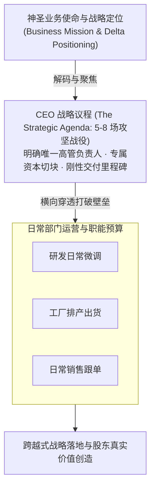

# Lec 06 企业使命构建与 CEO 战略议程制定 (The Mission of the Firm and Crafting the Strategic Agenda)

> MIT Sloan School of Management · 15.904 Strategy and the CEO · Prof. Arnoldo Hax

## TL;DR

- 战略议程（Strategic Agenda）是 CEO 领导企业实现战略跃迁最高阶、最重要的执行抓手。
- 严控战略战役数量：任何时期内，全公司级战略议程必须严格限制在 5 到 8 项。
- 战略议程三要素：行动导向的清晰定义、指定高管责任人（Owner）、严格里程碑与资源倾斜。
- DMK 案例推演：制定未来三年的 6 项核心战略战役，将抽象使命彻底转化为可落地的行动契约。

## 战略议程：连接宏观愿景与微观执行的枢纽 / The Essence of the Strategic Agenda

在企业管理实践中，最常出现的悲剧是“战略与执行的两张皮”：在公司高层的闭门会议上，大家讨论的是宏大的愿景、颠覆式创新和百亿蓝海；然而回到办公室，各部门主管依然在处理上一年度遗留的报销审批、客户投诉和日常流水线排班。

阿诺尔多·哈克斯教授在 15.902 和 15.904 中反复疾呼：**没有战略议程的战略规划，只是一场昂贵的心智自慰！**

战略议程（The Strategic Agenda）是 CEO 用来强行打破组织日常事务惯性、强行将稀缺资本与组织注意力拉回到战略主航道上的**最高指挥机制**：

战略议程不是日常运营工作的清单汇总，它是全公司为了实现向德尔塔新定位跃迁，在未来 12 到 36 个月内必须全力攻克的一组**非例行性、跨职能的重大攻坚战役集合**。

## 制定战略议程的四大铁律 / Four Golden Rules of Strategic Agenda

哈克斯教授为跨国企业 CEO 总结了制定战略议程不可逾越的四项基本准则：

### 1. 数量极致聚焦法则（The Rule of 5 to 8）
全公司级的战略议程绝对不能超过 8 项，最佳区间为 **5 到 8 项**。
- 如果 CEO 列出了 20 项重点工作，就等于没有任何重点；
- 过多的议程会瞬间稀释高管团队的心智带宽，导致各部门再次退缩回各自的舒适区。

### 2. 行动导向与动词打头法则（Action-Oriented Verbs）
议程名称坚决不能使用“关于供应链的思考”等模糊名词，必须使用极具冲击力的战役化语言：
- 例如：“建立全球前 20 大战略客户的远程预测性维护直连平台”；
- 例如：“在 18 个月内剥离并出售连续三年 ROIC 低于 6% 的传统铸件业务”。

### 3. 唯一定点责任人制度（Single Executive Ownership）
每一项战略议程必须指定一名且仅一名核心执委会高管（如执行副总裁或高级副总裁）担任战役总指挥（Owner）：
- 坚决杜绝“由研发部与市场部共同牵头”的模糊设定；
- 该高管拥有跨部门调配资源的专属授权，其个人年终绩效的 50% 以上直接与该战役的成败挂钩。

### 4. 专属战略资本切块（Strategic Capital Carve-out）
战略议程的资金绝不能混在各部门的日常运营预算中。CFO 必须建立“战略专项资本池”，独立立项、独立核算，确保战役资金不被传统老业务的日常开销所侵蚀。

::: theorem 战略议程第一定律
企业的战略重点并不取决于 CEO 在大会上强调了多少遍，而是取决于全公司最优秀的 20% 核心骨干每天将多少有效工时投入到了战略议程相关的任务之中。凡是没有高管亲自挂帅、没有专属预算切块的议程，统统属于伪战略。
:::

## DMK 战略议程实战设计方案 / DMK Strategic Agenda Formulation

在 15.904 的第六讲中，学员们代入 DMK 公司 CEO 的角色，为这家深陷泥潭的工业巨头量身定制了未来三年的 **6 项核心战略议程**：

| 战役序号 | 战略议程战役名称 (The Strategic Agenda) | 战役核心交付成果与里程碑 | 执委会责任人 (Owner) | 德尔塔战略映射 |
| :---: | :--- | :--- | :--- | :--- |
| **议程 1** | **攻克前 15 大客户一体化解决方案转型** | 与至少 12 家大客户签订长期流体管理服务协议，将客户产线非计划停机时间降低 40% | 全球销售与服务执行副总裁 | 全面客户解决方案 |
| **议程 2** | **构建工业 IoT 传感器与远程智能诊断中台** | 完成对初创软件公司的并购吸收，并在 1000 台存量大型设备上完成智能硬件改造与联网 | 首席技术官 (CTO) | 能力束构建与升级 |
| **议程 3** | **重构端到端敏捷供应链与备件极速交付网络** | 实施业务流程重塑（BPR），将核心战略客户的紧急备件响应交付周期由 72 小时压缩至 6 小时 | 首席运营官 (COO) | 运营卓越支持 |
| **议程 4** | **全面推进精益制造与存量传统工厂去大宗化** | 在所有标品生产线上推行自动化精益单元，消灭呆滞库存，三年内释放 1.5 亿美元流动资本 | 制造副总裁 | 最佳产品降本 |
| **议程 5** | **冷酷剥离非核心亏损传统铸件业务单元** | 在 12 个月内完成资产挂牌出售，收回资本用于偿还高息负债并充实数字业务研发池 | 首席财务官 (CFO) | 资本配置与纪律 |
| **议程 6** | **重塑德尔塔客户绑定导向的组织文化与激励** | 彻底改革销售提成制度，将单一硬件提成转变为客户长期 EVA 收益分成，推行 SECI 知识复盘 | 首席人力资源官 (CHRO) | 战略性 HRM 与文化 |

这份清晰、硬核、具备时间表的战略议程，瞬间让 DMK 迷雾重重的发展方向变得豁然开朗。

## 我的理解与实践洞察 / Personal Insight

战略议程是 CEO 对抗组织熵增的终极武器。

::: insight 管理者的平庸，始于被日常事务的琐碎彻底淹没
绝大多数高管并不是不聪明，但他们每天一睁开眼，就被数百封邮件、紧急会议和突发救火塞满了全部日程。一年下来精疲力竭，回头一看，公司依然在原来的泥潭里原地打转。
**卓越的 CEO 拥有一种神圣的冷酷**。他们敢于对 90% 的琐事冷眼旁观，将自己最充沛的时间和心力，像激光一样死死聚焦在战略议程上。当 CEO 每天都在追问这几场战略战役的进展，当所有的资源都在向这几场战役倾斜，整个组织的灵魂就会被彻底激活，奇迹就会在日复一日的战略聚焦中诞生。
:::

## 思考题与实战研讨

1. 某科技公司的 CEO 在战略规划报告中列出了 18 项重点工作，其中包括“更换总部大楼前台形象”、“更新内部报销系统”。运用哈克斯教授的战略议程四铁律，指导该 CEO 如何对这份清单进行严肃的战略清洗？
2. 在 DMK 的战略议程中，为什么“重塑销售激励机制”必须单独作为一项全公司级的战略战役由 CHRO 亲自挂帅推进？如果这一项议程流产，将对其他五项议程产生怎样的毁灭性连锁反应？
