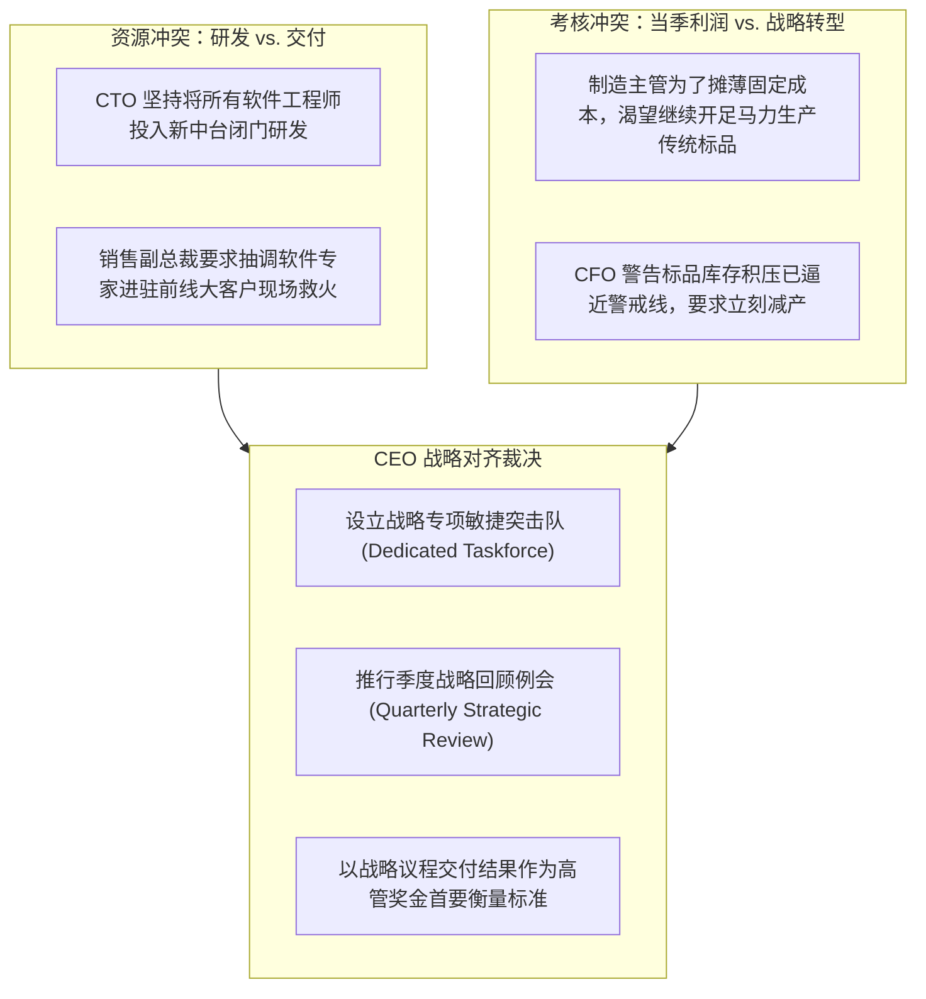
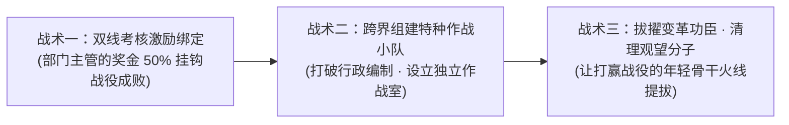

# Lec 07 战略议程执行规划与关键任务对齐 (Strategic Agenda Alignment and Execution Roadmap)

> MIT Sloan School of Management · 15.904 Strategy and the CEO · Prof. Arnoldo Hax

## TL;DR

- 各高管小组对 DMK 战略议程实施路线图的深度答辩与跨部门资源博弈推演。
- 解决战略战役之间的资源冲突：建立企业级战略项目管理办公室（PMO）协同机制。
- 应对中基层管理者的隐性抵触：打破部门地盘意识，将战役指标穿透至个人晋升通道。
- 战略执行动态校准机制：建立季度战略回顾（QSR）例会，拒绝形式主义汇报。

## 实战研讨答辩：DMK 战略议程实施路线图交锋 / Group Workshop & Agenda Presentations

在 15.904 的第七次课程中，各高管小组就 DMK 战略议程的落地执行时间表（Roadmap）进行了公开辩论。战略议程如果仅仅停留在口头共识上，每个人都会表示支持；但一旦涉及到具体季度的资源切块、关键技术专家的调配以及各部门预算的重新分配时，组织内部根深蒂固的利益藩篱就会瞬间爆发。

各小组在推演 DMK 路线图时，生动地复刻了跨国集团内部最真实的政治博弈与协同阵痛。现场集中暴露出两大最具代表性的部门利益冲突，倒逼 CEO 必须亲自出面进行战略调停与权威裁决：

哈克斯教授指出，这种冲突在真实企业中每天都在上演。CEO 的价值不是当一个和稀泥的老好人，而是依据德尔塔战略定位，做出毫不含糊的优先级裁决。如果为了照顾部门主管的情绪而在关键战役上搞折中平衡，其结果必然是战役资源被严重摊薄，导致所有战略议程全面延期溃败。

## 战略项目管理办公室（PMO）的设立与治理架构 / Strategic PMO Architecture

为了确保战略议程不被日常事务绞杀，哈克斯教授推崇建立直属于 CEO 的**战略项目管理办公室（Strategic PMO）**：

### 1. PMO 的核心职责
- **战略雷达监控**：每周跟踪各项议程的关键交付里程碑（Milestones），提前识别进度滞后与资源卡点；
- **跨部门摩擦仲裁准备**：为 CEO 梳理部门冲突背后的根因，提供客观的数据分析支持，杜绝各执一词的推诿；
- **战略沟通枢纽**：定期向全公司透明公布各项战略战役的最新战报，营造前线捷报频传的浓厚胜仗氛围。

### 2. 避免 PMO 沦为“官僚督查队”
::: pitfall PMO 异化为官僚考核枷锁的危险
如果 PMO 的人员只懂要求一线业务团队填写繁琐的周报和 PPT，而无法为战役解决任何实际的预算和跨部门协调难题，PMO 就会迅速沦为被全员唾弃的官僚机构。**卓越的 PMO 必须是“战役赋能者”而非“监工”**，其人员必须深入前线，亲自帮助各战役 Owner 清除组织阻碍。
:::

## 打破部门竖井与隐性抵触的破局战术 / Overcoming Silos & Inertia

战略议程往往要求跨部门协作，这直接动了传统部门管理者的“权力奶酪”。哈克斯教授传授了三条破局战术：

1. **利益再绑定**：宣布任何事业部副总裁的年终奖金，不仅看其本部门的财务指标，更看其为跨部门战略议程输送了多少精兵强将与实际支持；
2. **设立物理独立作战室（War Room）**：将来自研发、制造、销售、IT 的战役骨干抽调到同一个实体办公室集中办公，消除邮件往返的推诿延迟；
3. **人事任免的强力信号**：将那些在战略战役中立下赫赫战功的年轻骨干破格提拔为核心高管，同时坚决将消极怠工、各守地盘的资深管理者调离关键岗位。

## 季度战略回顾例会（QSR）：拒绝形式主义的闭环机制 / The Quarterly Strategic Review

战略管理最忌讳“一年制定一次，年底算一次总账”。哈克斯教授要求企业必须建立铁打的**季度战略回顾例会（Quarterly Strategic Review, QSR）**：

### QSR 例会的四项刚性规则
- **时间严格锁定**：每个季度末固定召开全天封闭会议，任何高管不得以客户拜访或出差为由请假；
- **只讲问题与求助**：会议坚决禁止展示歌功颂德的粉饰 PPT，每位议程 Owner 必须直奔主题：过去三个月承诺的里程碑是否达成？遇到什么跨部门卡点？需要 CEO 现场拍板调配什么资源？
- **红黄绿灯态势感知**：对所有战役进展实施交通灯预警机制。连续两个季度亮黄灯的议程，必须当场启动战役复盘与换人程序；
- **战略动态微调**：外部市场环境如果发生重大突变（如关键竞争对手推出颠覆性产品），CEO 有权在 QSR 例会上对个别战略议程进行果断的迭代微调。

## 我的理解与实践洞察 / Personal Insight

战略落地是一场与人性惰性博弈的持久战。

::: insight 组织执行力的根源，在于高管团队对承诺的敬畏心
很多企业的高管在开会时激情澎湃，把目标定得震天响；三个月后发现目标落空，又嘻嘻哈哈找出一堆客观理由蒙混过关。
**如果一个组织容忍“目标落空而无需承担任何后果”，那么这个组织的战略执行力就彻底死亡了**。
卓越的 CEO 必须在企业内部树立起“言必信、行必果”的军令状文化。每一项战略议程都是对股东、对全体员工立下的庄严契约。唯有建立起对交付节点的绝对敬畏，企业才能在漫长艰苦的战略转型长征中，一步一个脚印地杀出一条通往胜利的血路。
:::

## 思考题与实战研讨

1. 在 DMK 的战略执行规划中，如果研发副总裁与销售副总裁在“战役 1（大客户解决方案）与战役 2（通用物联网中台）的工程师分配”上发生不可调和的争执，作为 CEO，你将依据哪些客观标准做出最终裁决？
2. 结合本讲介绍的“季度战略回顾例会（QSR）”机制，设计一份针对特定战略议程的《单页纸季度战略汇报模板（One-Page QSR Dashboard）》，包含哪些最核心的量化监控要素？
