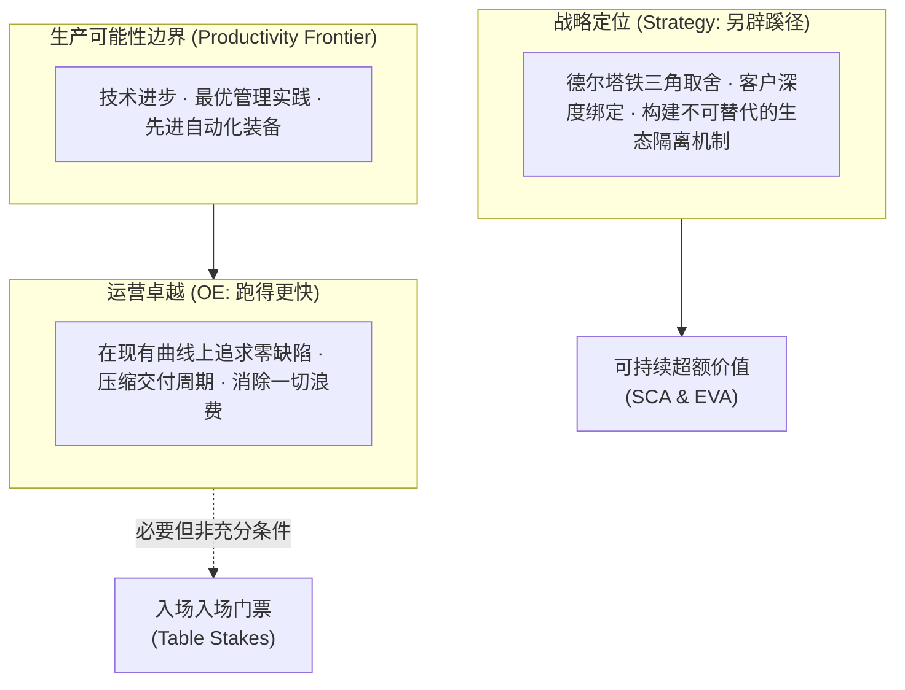

# Lec 08 运营卓越与流程执行力：CEO 的效率基石 (Operational Effectiveness: The Foundation of Execution)

> MIT Sloan School of Management · 15.904 Strategy and the CEO · Prof. Arnoldo Hax

## TL;DR

- 迈克尔·波特核心洞见重申：运营卓越（OE）不是战略，但缺乏运营卓越的企业根本没有资格谈战略。
- 运营卓越是将生产可能性边界（Productivity Frontier）推向极致，而战略是选择独特的价值定位。
- 德尔塔框架下的运营卓越：不仅追求工厂精益低成本，更追求端到端交付的敏捷性与定制精确度。
- CEO 的运营职责：消除部门之间的非增值摩擦，将精益六西格玛沉淀为全员的肌肉记忆与常态纪律。

## 运营卓越 vs. 战略定位：CEO 必须明辨的边界 / Operational Effectiveness vs. Strategy

在管理界，许多 CEO 常常将“运营改善”误当成“企业战略”。他们把全部精力扑在引进 ERP 系统、推行精益生产看板、压缩差旅成本和供应链压价上，一旦这些举措取得了阶段性降本成果，就宣称公司战略取得了重大成功。

阿诺尔多·哈克斯教授在 15.904 中重申了迈克尔·波特的经典告诫：**运营卓越（Operational Effectiveness, OE）与战略定位（Strategic Positioning）是两回事！运营卓越是战略落地的基石，但它绝不能替代战略本身**。

运营卓越指的是在执行相似的管理活动时，比竞争对手做得更出色、更少出错、耗时更短；而战略定位指的是执行与竞争对手截然不同的经营活动，或者以完全不同的方式执行活动，从而向客户交付独特的价值组合。

## 为什么单纯依赖运营卓越会导致企业集体沉沦？ / The Trap of Pure Operational Effectiveness

哈克斯教授指出，如果一个行业的全部企业都只抓运营卓越而缺乏战略差异化，整个行业必将陷入**“竞争性趋同（Competitive Convergence）”**的血腥泥潭：
1. **最佳实践的快速扩散**：麦肯锡、波士顿等咨询公司和设备供应商会把最新的精益工具迅速普及到所有竞品手中；
2. **生产可能性边界外移但利润归零**：全行业生产效率提升、产品良品率提高，但由于各家产品同质化，所有的效率红利最终全部通过价格战无偿转移给了终端客户与买方；
3. **陷入残酷的消耗战**：企业像在跑步机上狂奔的仓鼠，跑得越来越快，消耗的体力越来越大，却依然停留在原地。

::: definition 运营卓越与战略定位定理
运营卓越是企业生存的必要条件，战略定位是企业获取超额利润的充分条件。仅有战略而缺乏运营卓越，企业会死于执行瘫痪与高成本；仅有运营卓越而缺乏独特战略定位，企业会死于行业同质化价格战。
:::

## 德尔塔视角下的运营卓越升维 / Delta-Driven Operational Excellence

在德尔塔模型中，哈克斯教授重新定义了运营卓越的战略内涵。在不同的战略顶点，运营卓越的侧重点完全不同：

| 战略定位选项 | 传统运营指标（波特视角） | 德尔塔升维运营指标（哈克斯视角） | CEO 的流程干预抓手 |
| :--- | :--- | :--- | :--- |
| **最佳产品 (Best Product)** | 单件制造成本、流水线设备稼动率（OEE） | 供应链现金循环天数（CCC）、柔性排产换线损耗时长 | 推行极端精益制造与全面自动化，消灭冗余库存 |
| **全面客户解决方案 (Total Solutions)** | 订单交付按时率（OTD） | 客户紧急停机响应时长、非标定制方案首次交付通过率 | 实施端到端 BPR 流程重塑，建立前线客户敏捷小组 |
| **系统锁定 (System Lock-in)** | IT 架构服务器宕机率 | 开发者 API 接口调用延迟（Latency）、生态插件审核周期 | 优化开发者文档，打造极速自服务上架工具链 |

在“全面客户解决方案”维度，运营卓越不再是单纯地追求工厂出货成本低，而是**如何以工业化、模块化的极高效率，向成百上千家客户交付定制化的高难度解决方案**。

## CEO 如何夯实企业的流程执行底座？ / CEO's Levers for Flawless Execution

作为最高战略建筑师，CEO 应当通过三项关键举措，将运营卓越融入组织的神经末梢：
1. **制度化跨职能流程所有权**：指定副总裁级别的“端到端流程负责人（Process Owner）”，让其拥有超越各职能部门主管的权力，坚决消灭交接界面的扯皮；
2. **推行透明化的实时运营看板**：引入敏捷作战大屏，将一线订单从录入、排产、采购、制造到驻场安装的毫秒级进度向全公司公开，让任何瓶颈环节无所遁形；
3. **建立常态化持续改善（Kaizen）文化**：不仅奖励高管的宏观战略构想，更大力奖励一线产业工人和驻场工程师针对微小流程断点提出的千万条合理化改进提案。

## 我的理解与实践洞察 / Personal Insight

许多管理者习惯于在战略与运营之间制造虚假的对立。

::: insight 战略是灵魂，运营是肌肉
有些领导者自诩为“只抓战略方向的大思想家”，对企业日常交付的粗糙、客户发票的错误、备件迟到的混乱嗤之以鼻，认为这是下属执行力不行。
**殊不知，再伟大的战略构想，一旦掉进千疮百孔的运营泥坑中，都会被活活拖垮**。
当你的大客户因为一次关键备件迟到 48 小时而导致整座化工厂停产时，你向他宣讲再美好的“德尔塔全面解决方案”都只会招致无情的唾弃与解约。卓越的 CEO 能够随时在战略望远镜与运营显微镜之间自如切换，以钢铁般的纪律夯实运营底座，让战略的翅膀拥有最强健的肌肉支撑。
:::

## 思考题与实战研讨

1. 某跨国重工企业在过去三年中花费数亿美元引入了全套精益生产系统，生产成本下降了 12%，但其产品在市场上的平均售价却下跌了 15%，净利润率反而恶化。运用波特与哈克斯关于运营卓越的理论，诊断该企业战略失焦的深层根因。
2. 在全面客户解决方案的战略定位下，制造部门追求的“大批量流水线生产以压低单位成本”与前线大客户团队追求的“小批量高频次柔性定制交付”存在根本冲突。作为 CEO，你将建立怎样的运营协调机制化解这一矛盾？
