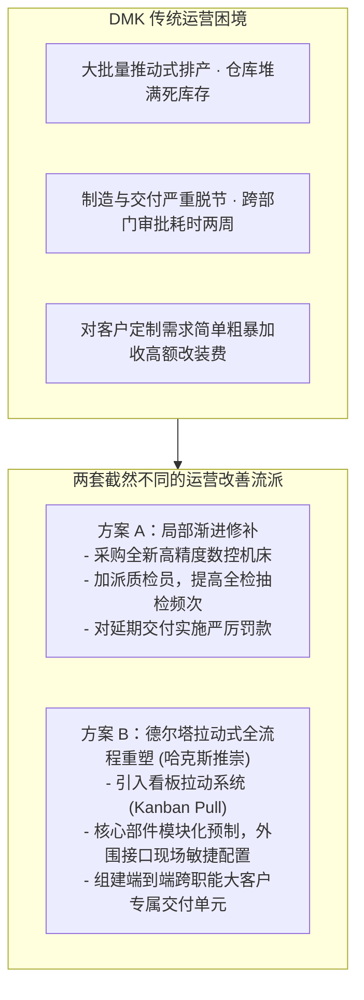

# Lec 09 运营卓越实战拆解与持续改善体系 (Operational Effectiveness Case Workshop & Lean Systems)

> MIT Sloan School of Management · 15.904 Strategy and the CEO · Prof. Arnoldo Hax

## TL;DR

- 各高管小组针对 DMK 生产交付、质量管理与供应链运营卓越方案的实战答辩。
- 解决标准化规模经济与个性化客户定制之间的“效率-柔性两难悖论”。
- 丰田生产方式（TPS）与精益六西格玛在传统工业转型中的微观落地抓手。
- 建立端到端客户交付敏捷突击队，将 DMK 的重大故障平均修复时间（MTTR）压缩 70%。

## 实战研讨答辩：DMK 运营卓越瓶颈与破局交锋 / Group Workshop & Operational Audit

在 15.904 的第九次课程中，各小组深入解剖了 DMK 公司长期存在的运营交付痼疾。作为一家历史悠久的重型机械制造企业，DMK 内部充斥着大量传统工业的粗放管理陋习：紧急订单频发、半成品库存爆满、客户定制件交付延期率高达 35%，售后服务工程师天天在前线大客户处“灭火道歉”。

各小组在讲台上汇报了针对 DMK 运营体系的再造方案，现场展现了极具冲击力的方案对比：



哈克斯教授一针见血地指出：方案 A 只是在病入膏肓的躯体上涂抹红药水，增加机器和罚款不仅无法解决延期，反而会进一步推高资本占用；唯有方案 B，从根本上改变了物料与信息的流动逻辑，才是真正具备战略级杀伤力的运营重塑。

## 破解“标准化规模经济 vs. 定制柔性”的两难悖论 / The Efficiency-Flexibility Paradox

在 DMK 案例推演中，管理层争论最激烈的问题是：**全面客户解决方案要求满足大客户的定制化诉求，但这难道不会彻底摧毁流水线制造的规模经济，导致成本急剧飙升吗？**

哈克斯教授带领学员运用**延迟制造策略（Postponement Strategy）**与**模块化架构设计（Modular Architecture）**化解了这一悖论：

```mermaid
flowchart LR
    Upstream["上游集中化大批量预制<br/>(Standardized Core Modules)<br/>- 标准精密阀体 · 基础电机底座 · 核心微处理器<br/>- 追求极致规模经济与零缺陷"]
    
    -->|推迟个性化决策点 (Decoupling Point)|
    
    Downstream["下游分布式敏捷配置交付<br/>(Customized Solution Packaging)<br/>- 专用传感器探头 · 软件协议驱动适配 · 现场管路接口<br/>- 追求极速响应与贴身绑定"]
```

### 延迟制造三大落地法宝
1. **建立通用底盘与标准化构件库**：将 DMK 旗下 500 多种非标零件归并整理为 40 种高可靠度的标准化通用模块；
2. **推迟定制差异化节点（Decoupling Point）**：在产品出厂前 80% 的工序中全部采用通用流水线标准作业，仅在最后 20% 的总装与现场集成阶段，根据特定大客户的工况需求进行软件烧录与接口选配；
3. **软硬件解耦与软件定义功能**：通过在硬件中预埋通用芯片，依靠远程下发不同的软件授权与固件算法，实现无需改变物理硬件即可秒级完成功能定制。

::: example 西麦斯（CEMEX）利用 GPS 调度化解定制混凝土配送危机
混凝土作为大宗建材，具有极其严苛的物理特性：在搅拌后 90 分钟内必须浇筑，否则就会凝固报废；而建筑工地的施工进度充满不可控的随机延误。西麦斯（CEMEX）通过在全墨西哥数千辆搅拌车上安装 GPS 卫星定位系统与实时车载通讯电脑，将分散的搅拌车组建成一个全网动态调度的“流动的混凝土流水线”。当某个工地突发延误时，调度中心瞬间将附近的搅拌车改派给另一家急需混凝土的工地，成功将准时交付承诺精确到 20 分钟以内，同时车队利用率提升 35%，创造了重工业运营卓越的教科书奇迹。
:::

## 精益六西格玛在 DMK 现场的微观落地 / Lean Six Sigma Implementation

为了将运营卓越推向极致，DMK 执委会制定了严谨的现场实施路线图：
- **消灭七大浪费（Muda Elimination）**：全面清理车间内部的过度搬运、等待工时、多余库存与不良品返工；
- **快速换模（SMED 技术）**：将重型机床的换线模具切换时间从原本的 4 小时大幅压缩至 18 分钟，使小批量多品种的柔性生产成为可能；
- **全员生产维护（TPM）**：将设备的日常点检与预防性维护职责还给一线机床操作工，彻底消灭因设备突发故障造成的停线停工。

## 我的理解与实践洞察 / Personal Insight

卓越的运营是一场充满禅意的组织修行。

::: insight 细节之处有神明，流程之中显威严
很多企业的高管喜欢在台上大谈元宇宙、大模型和宏伟愿景，但一走进他们的生产车间，满地油污、工具乱丢、工人无所事事、仓库账实不符。
**一个连车间工具都摆放不整齐的组织，绝不可能打赢任何严肃的战略攻坚战！**
丰田之所以能称霸全球汽车产业半个世纪，不是因为丰田拥有神机妙算的战略预言家，而是因为数万名丰田员工在过去几十年里的每一个清晨，都在一丝不苟地寻找并消灭流水线上的每一处浪费、拧紧每一颗螺母。这种深入骨髓的工匠敬畏与纪律性，构成了任何竞争对手用钱买不来、看得到却学不会的真正无敌的壁垒。
:::

## 思考题与实战研讨

1. 运用本讲的“延迟制造（Postponement）”原理，为一家生产工业机器人的企业设计一套方案，说明如何既能保证机器人本体的大规模廉价制造，又能满足汽车、电子、医药等不同行业客户对末端夹爪与控制软件的个性化定制诉求？
2. 在 DMK 推行“快速换模（SMED）”与“看板拉动系统”时，传统车间主任出于对“机床稼动率考核指标下降”的担忧而强烈抵触。作为 CEO，你应如何重构制造部门的考核指标体系以扫清这一变革阻力？
