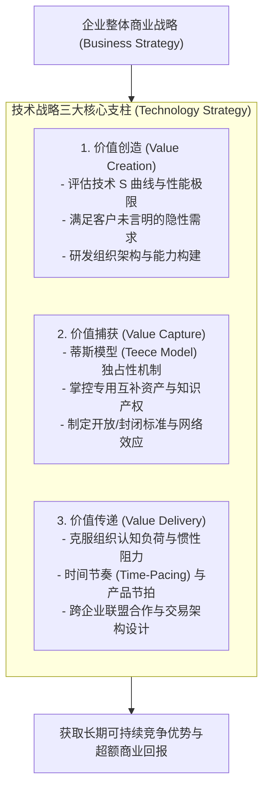
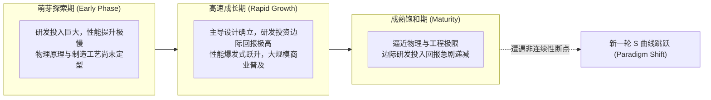

# Lec 01 技术战略全景：价值创造、捕获与传递 (Creating, Capturing, and Delivering Value with Technology Strategy)

> MIT Sloan School of Management · 15.912 Strategic Management of Innovation · Prof. Fiona Murray & Prof. Rebecca Henderson

## TL;DR

- 技术战略绝非单纯的 R&D 项目管理，而是决定在何种技术上投资、如何组织投资并应对竞争的商业总纲。
- 技术战略三维基石架构：价值创造（Value Creation）、价值捕获（Value Capture）与价值传递（Value Delivery）。
- 摩托罗拉（Motorola）铱星计划等经典惨败复盘：技术卓越不等于商业成功，技术战略必须与市场轨迹严密咬合。
- 技术 S 曲线（Technology S-Curve）揭示性能演进规律，帮助企业提前预警性能极限与范式跃迁拐点。

## 技术战略的本质：超越研发项目的商业总纲 / The Essence of Technology Strategy

在许多科技驱动型企业中，管理层常常将“技术战略（Technology Strategy）”狭隘地理解为研发部门的年度预算分配、专利申请指标或是产品研发项目进度表。

麻省理工学院斯隆管理学院著名教授菲奥娜·莫雷（Fiona Murray）与丽贝卡·亨德森（Rebecca Henderson）在 15.912 的开篇中明确纠正了这一重大偏见：**技术战略绝不是关于如何管理研发流程的微观技巧，它是企业整体商业战略（Business Strategy）中不可分割的核心引擎！**

技术战略回答的是企业在技术驱动的世界中生存与获胜的根本命题：

技术战略为企业提供了一套强大的分析工具箱：指导企业决定应该在哪些前沿技术上进行重金押注、如何设计跨组织合作与联盟架构，以及如何精准预判竞争对手、供应商和客户在技术突变面前的行为模式。

## 摩托罗拉经典教训：当卓越技术遭遇商业脱节 / The Motorola Lesson

在第一讲的实战案例研讨中，教授们带领学员深入剖析了摩托罗拉（Motorola）在无线通信演进历程中的技术战略成败：
- **曾经的辉煌**：摩托罗拉发明了全球第一款商用移动电话，并在模拟信号时代凭借顶尖的高频射频硬件工程能力统治全球蜂窝通信市场；
- **致命的盲区（铱星计划 Iridium 的陨落）**：摩托罗拉耗资数十亿美元发射了 66 颗低轨卫星，构建起能够覆盖全球任何荒漠与极地的卫星电话网络。从纯粹的技术工程角度看，铱星系统堪称人类航天与通信史上的奇迹；
- **商业现实的残酷耳光**：然而，地面蜂窝基站技术沿着陡峭的技术 S 曲线野蛮生长，以极低的资费和轻薄的手机迅速覆盖了 99% 的主流人口密集区。铱星笨重的终端设备和每分钟数美元的高昂资费，使其沦为了极少数极地科考队和远洋探险家的玩具，最终在商用不到一年内宣告破产重组。

::: pitfall 工程师的技术狂欢与商业真空
摩托罗拉的悲剧在于陷入了“技术至上主义（Technological Myopia）”。工程师们被攻克前所未有的工程难题所带来的崇高感所绑架，却完全忽视了**主流客户真实的使用场景、支付意愿以及地面蜂窝通信替代技术的演进速度**。没有经过商业价值闭环检验的技术奇迹，最终只能成为昂贵的技术遗迹。
:::

## 技术 S 曲线与性能演进轨迹 / The Technology S-Curve

技术的发展并非均速线性推进，而是遵循典型的逻辑斯蒂 **S 曲线（S-Curve）**：

$$
P(t) = \frac{K}{1 + e^{-r(t - t_0)}}
$$

其中 $K$ 为该技术范式所能达到的理论物理极限，$r$ 为研发投入转化为性能提升的学习速率：

卓越的技术战略家必须清醒地评估企业现有主打技术处于 S 曲线的哪一个区间。当技术逼近物理成熟极限时，继续砸入数十亿美元只能换取微弱的边际改良；此时企业必须果断将目光投向处于萌芽期的下一代全新技术范式。

## 我的理解与实践洞察 / Personal Insight

技术是商业力量的放大器，但方向比速度重要一万倍。

::: insight 技术战略的核心是“敬畏客户的常识”
许多技术出身的创业者喜欢沉迷于晦涩的数学公式或复杂的架构图，对商业营销和客户心理嗤之以鼻。
**然而，商业世界最神圣的法则，是客户永远只会为‘能帮他解决实际问题、提升生活品质或降低成本’的方案买单，没有任何客户会为技术本身的‘高难度’施舍一分钱**。
卓越的技术战略家不仅懂得如何研发顶尖技术，更懂得如何克制对技术的盲目自恋。他们用商业价值做尺子，用客户体验做天平，确保每一行代码、每一块芯片的诞生，都精准地落在大众市场最迫切的真实需求之上。
:::

## 思考题与实战研讨

1. 结合摩托罗拉铱星计划与马斯克的 SpaceX 星链（Starlink）计划，分析在相隔二十年的两次低轨卫星通信商业化探索中，技术 S 曲线、互补资产（可复用运载火箭）以及终端成本发生了哪些根本性变化？
2. 为什么许多在上一代技术 S 曲线上拥有绝对统治地位的行业领军企业，在面对下一代新技术跳跃时，往往会因为“资源依赖（Resource Dependence）”而丧失转型先机？
