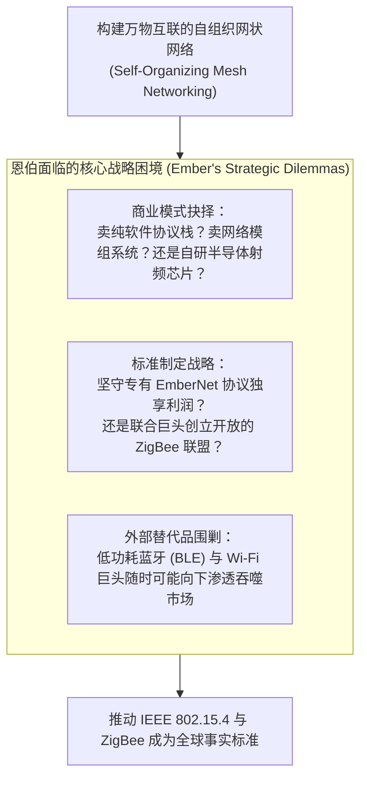
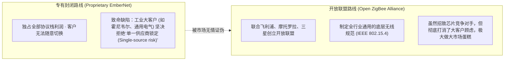

# Lec 10 恩伯公司（Ember）：物联网无线网络标准确立之战 (Ember: Developing the Next Ubiquitous Network Standard)'

> MIT Sloan School of Management · 15.912 Strategic Management of Innovation · Prof. Fiona Murray & Prof. Rebecca Henderson

## TL;DR

- 低功耗无线传感器网络（WSN）的商业化拓荒：麻省理工学院衍生企业恩伯（Ember）案例。
- 物联网连接协议之争：自研专有网状网络协议（EmberNet）vs. 推动开放国际标准（ZigBee 联盟）。
- 无晶圆厂半导体（Fabless）战略演进：从卖软件协议栈，到卖软硬件一体化射频 SoC 芯片方案。
- 面对蓝牙（Bluetooth）、Wi-Fi 与专有射频技术的四面楚歌，初创企业如何以联盟博弈构筑护城河。

## 物联网黎明前夜的通信混沌 / The Quest for Ubiquitous Low-Power Mesh

在 21 世纪初，随着微电子机械系统（MEMS）和传感器技术的进步，人类社会开始憧憬一个“万物互联”的世界：水表、电表、工厂机床、家庭温控器、路灯都能自主组网并实时通信。

然而在当时，现存的无线通信协议完全无法满足这一愿景：
- **Wi-Fi**：带宽极高，但功耗极其恐怖，电池供电仅能支撑几小时；
- **经典蓝牙（Bluetooth）**：功耗适中，但仅支持点对点或星型拓扑，无法实现长距离多跳（Multi-hop）中继；
- **工业有线总线**：铺设电缆成本极高，在老旧建筑和户外设施中根本无法实施。

麻省理工学院媒体实验室衍生出的初创企业 **恩伯公司（Ember Corporation）**，正是为了攻克这一产业空白而诞生。其核心技术是基于微功耗无线射频芯片的**自组织网状网络（Self-healing Mesh Networking）**技术：

作为一家资金有限的初创企业，Ember 必须在商业模式选择与国际标准博弈中走对每一步棋。

## 商业模式的惊险跃迁：从软件公司走向芯片设计 / Business Model Transformation

在企业初创期，Ember 的创始团队最初将自己定位为一家“软件网络协议开发商”：
- **初期挫折**：Ember 试图将自己开发的网状网络协议栈（EmberNet）授权给第三方射频芯片公司。然而当时的第三方通用无线芯片性能粗糙、无线通信底噪极大，客户在集成过程中故障频发，导致软件协议迟迟无法跑出优秀性能；
- **战略决断：走向无晶圆厂半导体（Fabless Semiconductor）**：Ember 管理层痛下决心，招募顶尖模拟与射频芯片工程师，决定自己动手研发软硬件一体化的 2.4GHz 射频微控制器 SoC 芯片（如 EM250）。

这一战略转型使得 Ember 能够实现“软件协议栈与芯片物理层的深度联合优化”，向工业和智能家居客户交付真正“开箱即用、低功耗、高稳定性”的交钥匙方案。

## 专有闭源 vs. 开放联盟：ZigBee 标准的世纪大博弈 / Proprietary vs. Open Standards

在确定了芯片战略后，Ember 面临着更加深远的战略抉择：**是保留自研的专有 EmberNet 协议独霸市场，还是发起成立全开放的 ZigBee 行业联盟？**

菲奥娜·莫雷教授引导学员使用蒂斯模型与网络效应理论，对两者的利弊进行了系统对比：

Ember 的管理层做出了极其明智的决断：**坚决拥抱开放标准！** Ember 成为 ZigBee 联盟的发起人和核心架构贡献者，推动 ZigBee 成为全球智能电网自动化（Smart Energy）与家庭自动化事实上的国际标准。

## 开放标准下的价值捕获：如何在竞争中守住胜果？ / Capturing Value in Open Standards

拥抱开放标准虽然做大了市场规模，但也立刻引来了飞思卡尔（Freescale）、德州仪器（TI）等半导体巨鳄的跟进竞争。Ember 凭什么在这场群雄逐鹿中保持领先？

Ember 构筑了三重差异化护城河：
1. **协议栈软件的极深积累（The Golden Stack）**：无线射频硬件可以抄袭，但在上千个节点复杂工况下保证网络自愈、防碰撞的协议栈固件代码，包含了数百万行经验调优，Ember 的软件协议栈被全行业公认为最稳定、丢包率最低的金标基准；
2. **率先打通关键生态客户**：深度绑定全球智能电表巨头（如 Itron、Landis+Gyr），在欧美数千万只智能电网远程抄表改造中锁定首发订单；
3. **最终的资本退出传奇**：2012 年，全球领先的高性能模拟与混合信号芯片巨头芯科科技（Silicon Labs）以 1.6 亿美元现金溢价全资收购 Ember，Ember 的技术构成了 Silicon Labs 日后统霸全球物联网无线芯片版图的核心支柱。

## 我的理解与实践洞察 / Personal Insight

标准的竞争，是商业博弈中最壮丽的合纵连横。

::: insight 想要统治规则，首先必须学会分享利益
很多创业者有一种近乎狭隘的垄断欲，总想着做一套完全封闭的私有协议，把客户像圈羊一样圈在自己的篱笆里。
**然而，在工业与基础设施领域，没有任何成熟的大客户愿意把自己的身家性命绑在一家随时可能破产的初创小公司身上！**
Ember 的睿智之处，在于它敢于把底层的通信标准贡献给全行业共享。通过联合行业巨头成立联盟，它赋予了整个市场强大的安全感与标准化信心。做开放生态的规则制定者，做最懂这套规则的顶尖交付者，通过卓越的软件固件和交付品质建立真正的客户粘性——这才是高科技企业在巨头林立的红海中脱颖而出的顶级生存哲学。
:::

## 思考题与实战研讨

1. 为什么工业巨头（如霍尼韦尔、施耐德电气）在采购关键无线通信模组时，宁可采购成本略高但符合开放国际标准的芯片，也坚决拒绝采用某家初创企业独家垄断且性能更优越的私有协议芯片？说明其背后的采购风险控制逻辑。
2. 比较 ZigBee、低功耗蓝牙（BLE Mesh）与 Thread 协议在当今智能家居生态（Matter 协议）中的演进格局，分析当年 Ember 推动的 IEEE 802.15.4 物理层标准为何能在二十年后依然发挥深远影响力？
