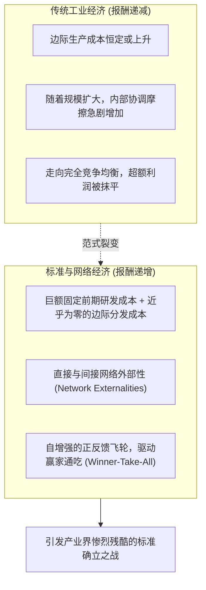

# Lec 11 开放标准、报酬递增与专有控制权 (Open Standards, Increasing Returns, and Proprietary Control)

> MIT Sloan School of Management · 15.912 Strategic Management of Innovation · Prof. Fiona Murray & Prof. Rebecca Henderson

## TL;DR

- 网络外部性（Network Externalities）打破传统新古典经济学规模报酬递减规律，驱动报酬递增。
- 标准之战（Standards Wars）：正反馈循环引发引爆点（Tipping Point），最终走向“赢家通吃（Winner-take-all）”。
- 开放（Open）与专有控制（Proprietary Control）的根本权衡：做大蛋糕的份额 vs. 独占小蛋糕的控制力。
- 掌控标准之战的七大关键资产：现有装机量（Installed Base）、互补品供给、信誉背书与先发优势。

## 报酬递增经济学与网络外部性 / The Economics of Increasing Returns

在传统的农业与传统工业经济中，生产遵循**边际报酬递减（Diminishing Returns）**定律：农田投入过多的化肥和劳动力，边际产出必然下降；工厂扩张到一定规模，管理复杂性和协调成本会导致边际成本上升。

然而，在以软件、通信标准和平台生态为主导的现代数字经济中，商业世界运转在完全不同的**规模报酬递增（Increasing Returns）**轨道上。布赖恩·阿瑟（W. Brian Arthur）与卡尔·夏皮罗（Carl Shapiro）开创的网络经济学理论，在 15.912 中被深入阐释：



### 两种网络外部性的微观机制
1. **直接网络效应（Direct Network Effects / 梅特卡夫定律）**：系统的价值随使用该系统的人数平方增长（例如：电话网络、微信、互联网协议）。网络中每增加一个新节点，不仅自身获益，更为网络中所有存量用户创造了连接价值；
2. **间接网络效应（Indirect Network Effects）**：用户越多，吸引的第三方互补开发者就越多，从而催生更丰富的软件、游戏和配件供给，进而吸引更多用户涌入（例如：Windows 操作系统、苹果 iOS、PlayStation 游戏机）。

## 临界质量与引爆点机制 / Critical Mass and the Tipping Point

标准之战最残酷的特征在于其强烈的**非线性引爆（Tipping）**特征。在市场早期，两个互相竞争的技术标准（如 VHS vs. Betamax 录像带、蓝光 Blu-ray vs. HD-DVD）可能势均力敌、平分秋色：

```mermaid
flowchart LR
    Struggle["早期双雄争霸 · 势均力敌<br/>(互相拉拢影院制片厂与硬件厂商)"]
    
    -->|一方率先跨越临界质量 (Critical Mass)| Tipping["市场引爆点 (Tipping Point)<br/>预期发生自增强转变"]
    
    Tipping --> Cascade["雪崩式马太效应 (Bandwagon Effect)<br/>所有盟友与用户集体倒戈叛逃"]
    
    Cascade --> Monopoly["胜者通吃 100% 市场 · 败者死无葬身之地"]
```

一旦某一方因为微小的早期先发优势或关键互补品联盟突破了**临界质量（Critical Mass）**，全市场的心理预期就会瞬间发生链式反应。消费者因为害怕购买淘汰产品而不再购买落后方，软件开发者连夜转投领先平台，落后方在短短数月内便会遭遇毁灭性的断崖式溃败。

## 开放 vs. 专有控制权的终极两难 / The Open vs. Proprietary Trade-off

技术企业在发起标准竞争时，面临着最艰难的战略哲学抉择：**我们究竟是应该完全开源开放，还是实施严格的专有知识产权锁定？**

| 战略维度 | 完全开放标准路线 (Open Strategy) | 专有封闭控制路线 (Proprietary Strategy) |
| :--- | :--- | :--- |
| **典型代表企业** | Linux 操作系统、谷歌 Android 平台、蓝牙联盟 | 苹果 iOS 系统、索尼早期 MemoryStick 记忆棒 |
| **战略核心诉求** | 最大化降低全行业的采纳摩擦，以最快速度做大生态蛋糕 | 绝对掌控技术演进方向，独占生态中所有的软硬件利润 |
| **对第三方的吸引力** | 极高：硬件厂商无需支付专利费，没有被单一供应商锁定的恐惧 | 较低：第三方必须支付高额授权费并接受严格甚至苛刻的审查 |
| **商业变现方式** | 难以在标准本身收费，必须通过互补服务、云平台或搜索广告变现 | 在单件硬件或每笔软件交易中直接抽取巨额高毛利抽成 |
| **核心潜在风险** | 生态严重碎片化（Fragmentation），无法保证统一的用户体验 | 极易在标准确立初期因为曲高和寡而被开放阵营彻底围剿淘汰 |

::: definition 开放与控制的权衡公理
企业的价值等于“全行业市场整体蛋糕的规模”乘以“企业所能捕获的份额比例”。**选择完全专有控制，你拥有了这块蛋糕的 100% 产权，但这块蛋糕可能永远只有硬币大小；选择完全开放，整个蛋糕被催化为摩天大楼，你哪怕只切取其中 5% 的服务溢价，其绝对收益也千百倍于孤芳自赏的小确幸。**
:::

## 赢得标准之战的七大关键战备资产 / Seven Key Assets in Standard Battles

夏皮罗与瓦里安（Shapiro & Varian）总结了打赢标准之战的七大王牌资产，亨德森教授要求学员逐一对照评估：
1. **掌控既有装机量（Installed Base）**：拥有庞大的存量用户，向后兼容（Backward Compatibility）能让老用户零成本平滑迁移；
2. **掌控知识产权与事实专利（IP Rights）**：在底层核心标准中筑牢不可规避的必要专利（SEP）；
3. **技术创新卓越度（Inherent Superiority）**：技术必须显著超越上一代，以抵消用户的转换摩擦；
4. **互补品生产能力与联盟阵营（Complementary Products）**：能否在产品上市首日就提供海量高质量应用与内容；
5. **制造与量产交付能力（Manufacturing Capabilities）**：能否在引爆点到来时以极低成本供应数千万台设备；
6. **全球分销网络与品牌号召力（Reputation & Brand）**：大企业的金字招牌能够极大稳定市场对该标准获胜的确定性预期；
7. **强大的财务与现金储备（Financial Strength）**：拥有承受数年价格战与生态补贴的雄厚资本耐力。

## 我的理解与实践洞察 / Personal Insight

标准之战是商业世界中最冷酷、最不可逆的高维战争。

::: insight 在网络效应的战场上，预期的管理重于技术的参数
在标准的生死决战中，很多科学家沉迷于证明自己的信号衰减比竞品低 3 个分贝、分辨率比竞品高 10%。
**然而，决定万亿市场胜负走向的，从来不是实验室里的参数，而是全市场数以亿计普通人心中的‘确定性预期’！**
只要你让开发者相信你会赢、让终端买家相信你的标准五年后绝不会过时、让设备商相信跟着你能赚大钱，这种‘预期’本身就会化作自我实现的惊人预言。标准之战打到最后，打的是领导者的政治结盟手腕、产业号召力与胸怀格局。谁能团结最广泛的同盟军，谁就是定义下一个时代的无冕之王。
:::

## 思考题与实战研讨

1. 索尼在 20 世纪 80 年代拥有画质更细腻、体积更小巧的 Betamax 录像带技术，为何最终被画质较差但时长更长、授权政策极其开放的 JVC 阵营（VHS 标准）彻底打得从地球上消失？
2. 谷歌在 2007 年以完全开源免费的形式发布 Android 操作系统，吸引了全球绝大多数手机厂商（三星、HTC、小米等）加盟。分析谷歌是如何在完全不靠 Android 系统授权收费的前提下，实现万亿美元商业价值捕获的？
