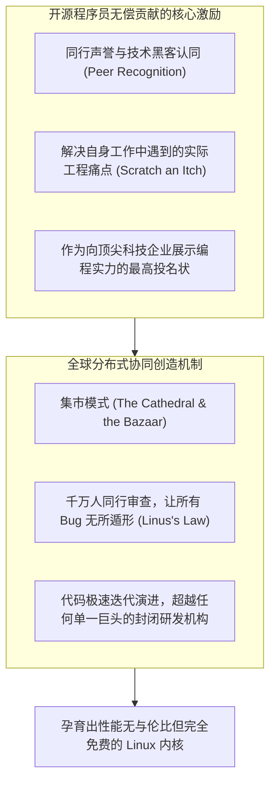

# Lec 12 红帽公司（Red Hat）与开源 Linux 商业革命 (Red Hat and the Linux Revolution)

> MIT Sloan School of Management · 15.912 Strategic Management of Innovation · Prof. Fiona Murray & Prof. Rebecca Henderson

## TL;DR

- 开源软件（OSS）经济学之谜：程序员为何无偿贡献代码？企业如何靠“免费公共品”赚取巨额利润？
- 红帽公司（Red Hat）商业模式演进：从 19.95 美元的廉价 CD 光盘销售，向企业级订阅年费（Subscription）模式蜕变。
- 企业级 Linux（RHEL）的核心价值：提供高确定性的硬件认证（ISV/IHV 矩阵）、长期安全补丁与法律合规免责保护。
- 开源商业生态治理：作为中立可信的桥梁，连接狂野分散的开源上游社区与对稳定性有苛刻要求的跨国财富 500 强企业。

## 开源经济学：挑战传统产权理论的商业奇迹 / The Economics of Open Source

在经典的自由市场经济学理论中，私有产权被视为一切商业价值创造的基石。如果一项资产对全世界完全公开、任何人都可以免费下载、随意修改甚至再分发，公地悲剧（Tragedy of the Commons）似乎是必然的归宿：没有任何人有动力投入真金白银进行维护，更不可能诞生估值数百亿美元的上市巨头。

然而，1991 年芬兰大学生林纳斯·托瓦兹（Linus Torvalds）发布的 **Linux 操作系统内核**，以及随之席卷全球的**开源软件（Open Source Software, OSS）运动**，彻底颠覆了传统管理学的认知。

在 15.912 的第十二讲中，莫雷教授与亨德森教授深入解构了开源生态独特的微观经济激励与价值创造逻辑：



然而，一个致命的商业鸿沟随之浮现：**既然全世界任何人都可以免费从互联网上下载完整的 Linux 代码，红帽公司（Red Hat）究竟凭什么能够向跨国企业客户每年收取数以十亿美元计的真金白银？**

## 红帽商业模式大演进：从卖光盘到卖“确定性” / Evolution of Red Hat's Business Model

红帽的创始人鲍勃·扬（Bob Young）与马修·什利克（Marc Ewing）经历了一场惊险绝伦的商业模式认知大跃迁：

```mermaid
flowchart LR
    Phase1["阶段一：廉价纸盒光盘模式 (1993-1998)<br/>- 把公开代码刻录进 CD，配一本说明书，售价 19.95 美元<br/>- 购买者多为极客学生 · 极度依赖零售货架 · 毫无技术壁垒"]
    
    -->|顿悟企业真实痛点：果断砍掉零售业务|
    
    Phase2["阶段二：企业级订阅服务模式 (RHEL 2002 至今)<br/>- 推出 Red Hat Enterprise Linux (RHEL)<br/>- 坚决停止免费版本更新，推行按服务器 CPU 每年付费的订阅制<br/>- 卖的不是代码，卖的是‘极致的系统稳定性与安全合规背书’！"]
```

### 财富 500 强企业到底在为什么买单？
哈克斯教授与亨德森教授共同指出，企业 CIO 和数据中心运维主管采购 RHEL，购买的绝非每一行开源代码本身，而是购买了以下三项极其昂贵且无法被免费代码替代的**专用互补资产**：
1. **硬件与独立软件开发商认证矩阵（IHV / ISV Ecosystem Certification）**：RHEL 确保在 IBM、惠普、戴尔的数千款服务器硬件，以及 Oracle 数据库、SAP 企业管理软件上经过了长达数万小时的极端压力测试。一旦系统崩溃，客户无需在软件与硬件厂商之间忍受互相踢皮球的噩梦；
2. **长达 7-10 年的长期技术支持（LTS Lifecycle Support）**：大银行和电信巨头的核心交易系统不能每三个月就跟随社区盲目升级。红帽承诺在未来十年内为特定旧版本提供毫秒级的安全漏洞补丁回填（Backporting）；
3. **法律侵权免责保护（Intellectual Property Indemnification）**：开源代码由全球成千上万名匿名极客共同编写，难免潜藏专利侵权与知识产权地雷。红帽为企业客户提供高达数百万美元的法律兜底保护，替企业承担一切版权诉讼风险。

::: definition 红帽法则 (The Red Hat Rule)
免费的往往是最昂贵的。当核心技术变成开源的免费公共品时，商业价值并没有消失，而是**从技术载体本身，不可逆转地转移到了降低该技术使用摩擦力、提供可靠性担保、合规认证与端到端系统集成的服务与互补资产之上**。
:::

## 上下游生态治理：中立桥梁的政治智慧 / Managing the Open Source Balancing Act

红帽成功的深层密码，在于其精妙绝伦的**“双重生态治理架构”**。在开源世界中，商业公司往往面临着巨大的两难困境：如果完全倒向商业利益并对代码进行闭源封装，就会被开源社区视为背叛理想的吸血鬼而遭遇集体抵制；但如果完全遵从开源社区随性而自由的发布节奏，又根本无法满足跨国企业对极度严苛的系统稳定性和长期技术支持的需求。

红帽通过构建双轨制的产品体系，成功地在狂野纯粹的黑客理想主义与保守严谨的企业现实主义之间搭建起了一座畅通无阻的桥梁。通过精细的生态分工，红帽既保留了开源创新的无尽活力，又确保了企业级交付的高确定性：

```mermaid
flowchart TD
    Upstream["狂野自由的开源上游社区 (Fedora Project)<br/>- 汇聚全球数十万名黑客开发者<br/>- 追求最激进的前沿技术实验 · 允许频繁崩溃 · 代码完全开放自由"]
    
    -->|红帽资深工程师深度介入核心维护并进行商业化清洗过滤|
    
    RedHatBridge["红帽公司：中立可信的战略过滤器 (The Commercial Sieve)<br/>- 投入数百名带薪顶级工程师向 Linux 社区回馈代码<br/>- 挑选经过实战检验的最成熟组件进行企业级硬化与长周期测试"]
    
    -->|输出高确定性的商业级交付物|
    
    Downstream["保守严谨的企业级付费客户 (RHEL Fortune 500)<br/>- 纽约证券交易所 · 全球跨国银行 · 国防电信系统<br/>- 追求 99.999% 高可用 · 坚决拒绝任何未经验证的代码扰动"]
```

红帽从不试图“私有化”或“封闭”Linux 代码。红帽把经过自身测试与修复的代码全部无私地回馈给开源上游社区，赢得了开源世界最崇高的道德权威与技术领袖地位；同时，红帽又把这种权威转化为对财富 500 强企业最具说服力的品牌商誉。企业客户深信，红帽不仅拥有全世界最懂 Linux 核心机制的顶尖技术专家，更拥有直接在上游社区推动代码演进的巨大话语权。

## 我的理解与实践洞察 / Personal Insight

红帽的商业史诗，彻底重塑了人类对“竞争与垄断”的理解。

::: insight 最伟大的商业护城河，不是垄断秘密，而是成为全行业最值得托付的守门人
在传统的商业认知中，每个人都把自己的技术当成最高机密深藏在保险柜里，生怕别人看走一行代码。
**红帽却反其道而行之：把所有的代码完全公开在阳光下，却让全世界最有钱的企业心甘情愿地每年向它上贡数亿美元的真金白银！**
2019 年，百年巨头 IBM 斥资 340 亿美元历史性天价全现金收购红帽，正是为了买下这把通往开源云原生世界的终极钥匙。红帽向全世界证明：在智力资产大爆炸的时代，真正的壁垒不再是独占知识，而是掌控复杂性。谁能把狂野混乱的世界打磨成安全可靠的生产力基石，谁就是数字文明中最不可动摇的黄金中枢。
:::

## 思考题与实战研讨

1. 很多传统软件巨头（如早期的微软）曾将开源 Linux 视作“吞噬知识产权的毒瘤癌症”，然而几十年后，微软却全面拥抱 Linux 并在 Azure 云平台上大力支持开源。运用本讲的开源经济学理论，剖析这一世纪大反转背后的底层商业逻辑。
2. 如果一家初创软件公司仅仅是将 GitHub 上的开源大模型或数据库代码打包下载，套上一个漂亮的图形化操作界面并在市场上推销，它能否复制红帽公司的订阅制奇迹？说明其在“互补资产与生态认证矩阵”上存在的致命短板。
