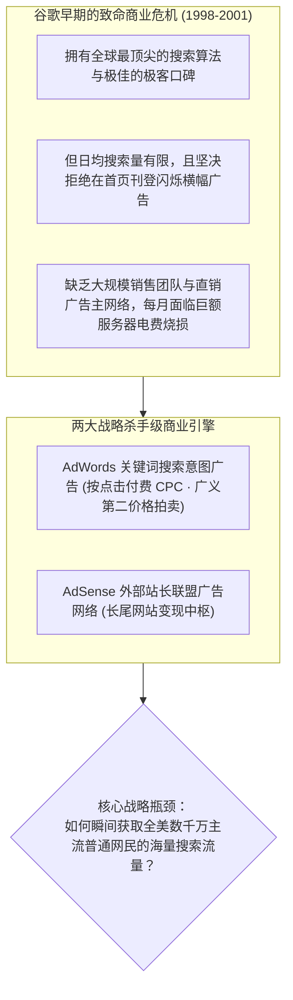
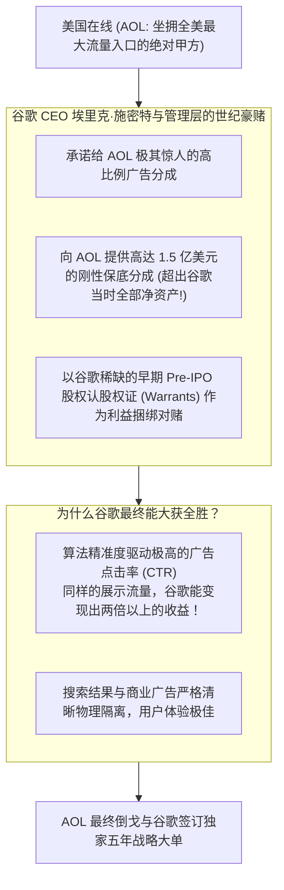

# Lec 13 谷歌与 AOL 战略联盟：搜索商业化与价值链跃迁 (Google and AOL: Search Monetization and Value Chain Evolution)

> MIT Sloan School of Management · 15.912 Strategic Management of Innovation · Prof. Fiona Murray & Prof. Rebecca Henderson

## TL;DR

- 早期互联网的流量与分销霸权：门户时代美国在线（AOL）的“围墙花园（Walled Garden）”。
- 谷歌（Google）从斯坦福学术算法向商业变现机器的惊险跨越：PageRank 与 AdWords/AdSense 广告竞价机制。
- 谷歌与 AOL 历史性战略联盟博弈：通过让渡高额保底分成拿下全美最大流量分销入口。
- 互联网价值链与权力格局的大洗牌：从“人工门户编辑索引”向“算法精准意图变现”的不可逆跃迁。

## 早期互联网的丛林与搜索的商业化荒原 / The Early Internet and Search Monetization

在 20 世纪 90 年代末至 21 世纪初，全球互联网被**门户时代（Portal Era）**所统治。当时如日中天的巨头是雅虎（Yahoo!）、美国在线（AOL）和微软 MSN：
- **主流商业逻辑**：巨头们投入巨资打造“围墙花园（Walled Garden）”，通过人工编辑成千上万个新闻、体育、财经频道，试图把用户死死圈在自己的门户网站内部，以此向可口可乐、通用汽车等大广告主兜售昂贵的静态横幅展示广告（Banner Ads）；
- **搜索引擎被视作边缘廉价工具**：在当时的门户高管看来，搜索只是一个微不足道的辅助功能，甚至是一个“危险的工具”，因为优秀的搜索会把用户快速导向外部网站，从而减少用户在门户内的停留时间！

斯坦福大学博士生拉里·佩奇（Larry Page）与谢尔盖·布林（Sergey Brin）创立的 **谷歌（Google）**，凭借革命性的 **PageRank 网页链接分析算法**，带来了前所未有的纯净、极速且精准的搜索体验。



谷歌空有一台世界上最高效的“印钞机原型”，却严重缺乏驱动这台机器运转的燃料——**海量的大众主流搜索请求流量**。

## 2002 年世纪世纪世纪大联盟博弈：谷歌对决 Overture 争夺 AOL / The High-Stakes AOL Deal

2002 年，全美最大的互联网服务提供商（ISP）兼门户霸主 **美国在线（AOL）** 决定为其数千万拨号上网用户重构搜索服务。全美所有的搜索技术服务商倾巢出动，展开了一场关乎整个互联网未来霸权的绝死较量：

### 两大核心竞争对手的底牌与较量

在决定全网流量分销归属的谈判桌前，Overture 与谷歌分别代表了两种完全不同的技术与商业流派。Overture 凭借先发优势已经与众多门户签订了长约，现金流极度充沛；而谷歌则坚信自己的算法相关性能够实现更高的商业变现效率。

对于当时的美国在线（AOL）而言，选择权完全掌握在自己手中。AOL 的高管团队深知，无论选择哪一家，都将直接决定自己未来数年数亿美元的净利润底线。因此，AOL 在谈判中表现出了极其苛刻的商业条件，要求竞标方不仅提供技术服务，更要承担巨大的财务保底对赌。

这是一场典型的以小博大、用尖端算法重塑商业契约的巅峰之战。双方在谈判桌上使出浑身解数，将各自的商业筹码推向了极致：



面对生死战役，谷歌管理层展现了惊人的战略决断魄力。谷歌确信自身的算法相关性能够将广告点击率提升数倍，从而用超额的真实广告流水填平保底缺口。更重要的是，通过让渡部分早期股权认股权证，谷歌成功将巨头 AOL 的利益与自身的长期估值紧密绑定在一起，彻底瓦解了对手的防御阵线。

## 价值链的不可逆转移：渠道宿主沦为寄生宿主 / The Evolution of the Value Chain

谷歌与 AOL 的战略结盟，成为了全球互联网商业史上最著名的**“特洛伊木马（Trojan Horse）”**：

```mermaid
flowchart LR
    subgraph Year2002["2002 年：AOL 是主宰，谷歌是下游供应商"]
        A1["AOL: 坐拥数千万用户与分销渠道 (霸道甲方)"]
        -->|外包边缘搜索功能| G1["Google: 默默打工的技术代工厂"]
    end

    -->|仅仅三年之后 (价值链发生颠覆性逆转)|

    subgraph Year2005["2005 年：谷歌成为帝国，AOL 沦为空壳宿主"]
        G2["Google: 掌控全网最高商业价值的用户意图数据中枢<br/>成为万亿广告现金牛，市值飙升超越时代华纳"]
        A2["AOL: 门户内容沦为冗余杂质，用户被全面教育‘跳过门户直接使用谷歌’<br/>核心资产迅速贬值，沦为被资本抛弃的废墟"]
    end
```

### 价值链权力逆转的深层动力学
- **用户心智习惯的彻底迁移**：全美网民通过 AOL 页面体验到了谷歌搜索的无上神威，大家逐渐意识到根本不需要在 AOL 的繁杂页面上翻找新闻，直接在谷歌输入框输入关键词即可直达目标；
- **双边网络效应与广告飞轮的彻底自增强**：AOL 导入的天量搜索数据，使得谷歌的算法模型能够进行更深度的机器学习训练与点击率预估；广告点击率越高，吸引的全球广告主就越多；广告主出价竞价越激烈，谷歌单次搜索变现金额（RPS）就越高，彻底将雅虎和微软踢出了搜索广告的竞争跑道。

## 我的理解与实践洞察 / Personal Insight

谷歌与 AOL 的博弈，是科技初创企业逆袭产业霸主的传世教科书。

::: insight 商业合作中最致命的盲区，是把‘当下的流量优势’误当成了‘长久的战略护城河’
在商业谈判中，许多掌握渠道的大块头企业总是摆出一副高高在上的甲方姿态，以为技术不过是随时可以替换的外包零件。
**然而，当这项新技术蕴含着全新的商业文明范式与更高的生产力时，渠道的霸权便会在不知不觉中被技术底层彻底掏空**。
AOL 自以为凭借流量渠道狠狠敲了谷歌一笔巨额保底竹杠，赚得盆满钵满；殊不知，它亲手把自己的数千万核心用户，用一根金丝带包装好，整整齐齐地送进了谷歌的生态腹地。科技战略家必须时刻警惕：在你看似占尽便宜的合作协议中，你究竟是在利用别人的工具，还是正在沦为别人颠覆你自身的特洛伊木马？
:::

## 思考题与实战研讨

1. 雅虎公司（Yahoo!）在 2000 年曾经长期采用谷歌作为其默认搜索引擎外包服务商，并在搜索框旁边标注“Powered by Google”。运用本讲的价值链演进理论，分析雅虎当年的这一战略决策是如何亲手培育了自己最致命的掘墓人？
2. 谷歌在夺取 AOL 流量时推行的“广义第二价格拍卖（GSP）”机制与“质量得分（Quality Score）”算法，为何能彻底击败传统按展示付费（CPM）的门户横幅广告，成为人类商业史上变现效率最高的盈利机器？
