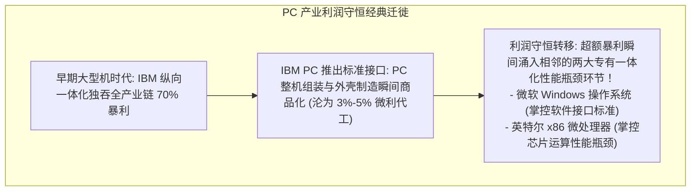
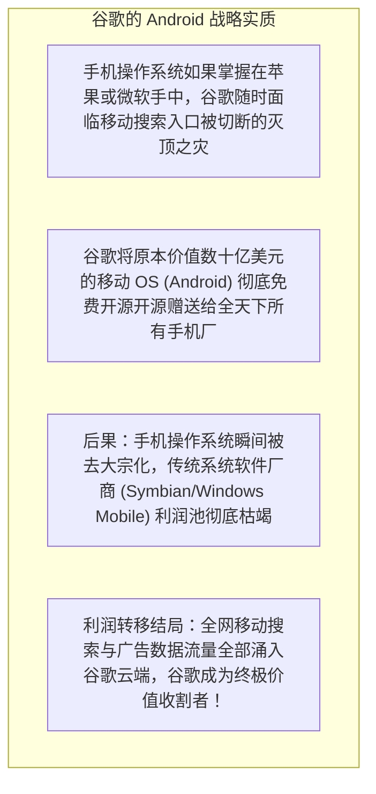

# Lec 14 横向与纵向战略：产业链演进与利润池转移 (Horizontal vs Vertical Strategies and Value Chain Evolution)

> MIT Sloan School of Management · 15.912 Strategic Management of Innovation · Prof. Fiona Murray & Prof. Rebecca Henderson

## TL;DR

- 产业链架构的双重形态：纵向一体化（Integrated / Proprietary）与横向高度分工（Modular / Disintegrated）。
- 克里斯坦森“诱人利润守恒定律（Law of Conservation of Attractive Profits）”的深层经济机理。
- 模块化带来的商品化陷阱：当一个环节被标准化解耦时，行业超额利润必然向相邻的专有一体化瓶颈环节转移。
- 科技巨头的产业链攻防：通过主动开源或补贴外部环节，摧毁对手利润池并巩固自身垄断中枢。

## 产业链演进的两大经典范式：纵向一体化 vs. 横向模块化 / The Architectural Oscillations

在科技产业的百年长河中，产业组织结构永远在**“合久必分、分久必合”**的钟摆运动中持续震荡。

在产业发展的早期阶段，由于底层零部件技术极不成熟、系统性能处于严重匮乏状态，企业必须采用专有紧耦合的纵向一体化模式，亲自研发并制造每一个核心构件，才能将系统性能逼近极限。然而，随着技术的逐步成熟与工业接口规范的确立，原本紧密咬合的系统开始发生模块化解耦，产业迅速走向全球专业化分工协作的横向格局。

亨德森教授与莫雷教授引导学员深入解构这两种截然不同的产业组织形态，及其在不同历史发展阶段下的优劣权衡：

```mermaid
flowchart TD
    subgraph VerticalParadigm["纵向一体化时代 (Vertical / Proprietary)"]
        V1["大型机时代的 IBM · 早期福特汽车 · 苹果软硬件闭环"]
        V2["专有闭源架构 · 所有零部件内部定制 · 接口高度紧耦合"]
        V3["优势：性能追求极致极致突破 · 彻底消灭系统协同摩擦"]
    end

    -->|技术成熟与接口标准化 (Modularization)|

    subgraph HorizontalParadigm["横向水平分工时代 (Horizontal / Disintegrated)"]
        H1["Wintel PC 时代 · 现代 Android 智能手机 · 汽车零部件 Tier 1/2 分工"]
        H2["标准接口解耦 · 模块化插拔拼装 · 全球分布式专业化生产"]
        H3["优势：极速降低成本 · 规模效应大爆发 · 推动产品大众化普及"]
    end
```

这种演变并不是随机发生的，它背后受到极其深邃的**技术成熟度与客户性能需求满意度**的底层物理定律支配。当技术性能不足以满足客户基本需求时，纵向一体化是唯一的救世主；而当技术性能发生供给过剩时，横向模块化分工便会如狂风暴雨般摧毁一切专有一体化的传统壁垒。

## 克莱顿·克里斯坦森：诱人利润守恒定律 / The Law of Conservation of Attractive Profits

很多企业管理层存在一个巨大的认知盲区，以为随着整个行业走向模块化分工，全产业链的毛利率都会随之下降，行业最终将变成人人无利可图的贫民窟。

哈佛商学院克莱顿·克里斯坦森（Clayton Christensen）提出了震撼世界的**“诱人利润守恒定律”**。丽贝卡·亨德森教授与菲奥娜·莫雷教授在 15.912 中，将其视为预判产业未来利润转移方向的最高罗盘：

::: definition 诱人利润守恒定律 (Law of Conservation of Attractive Profits)
在一个产业的价值链中，当某一核心环节的技术走向成熟、接口实现标准化并沦为低毛利的通用大宗商品（Commoditized）时，全行业原有的超额垄断利润绝不会凭空蒸发消失！**超额利润将必然向该环节相邻的、当前技术尚不成熟、无法被标准化替代、且对最终整体系统性能构成最严峻瓶颈的专有一体化环节发生大规模转移！**
:::



谁掌控了整个价值链中当前**“尚未被完全满足、技术最为复杂、且最不易被标准化的紧耦合瓶颈”**，谁就掌控了全行业绝大多数的现金奶牛！

## 战略降维打击：将对手的环节商品化 / Commoditizing Your Complementor

理解了产业链利润迁移的规律，顶尖科技巨头的竞争策略便上升到了“降维打击”的哲学高度。

在现代高科技战争中，最凶悍的打法从来不是在对手的主场跟他逐项比拼性能，而是**“通过扶持、开源或免费赠送对手的核心业务，使其彻底沦为无利可图的大宗商品，从而让利润完全涌入自己所掌控的专有瓶颈中”**：



### 巨头常用的商品化武器库
1. **开源颠覆术**：将竞争对手赖以生存的核心软件产品（如中间件、操作系统、数据库）作为开源基础工具免费发布，从根源上摧毁对手的收费商业模式；
2. **制定并捐赠开放标准**：推动行业将原本由某个巨头垄断的专有接口（如通信协议、充电标准）转变为免费的国际开放标准，瞬间瓦解对手的专有溢价；
3. **交叉补贴倾销**：在自身拥有高额暴利的业务支持下，以边际成本甚至亏本价格向市场倾销对手的主营硬件，将对手活活拖入失血消耗战。

## 我的理解与实践洞察 / Personal Insight

产业链的博弈，是商业棋盘上最深沉的阳谋。

::: insight 商业竞争的最高段位，是让竞争对手的武器变得一文不值
许多平庸的管理者在制定战略时，永远只盯着眼前的一亩三分地，整天想着怎么把自己的产品打磨得比对手便宜 5%。
**真正顶级的大战略家，思考的永远是整条产业链的引力重力场！**
他们懂得像克里斯坦森那样敏锐预判利润池将在何时发生大迁徙。当别人还在为硬件参数争得头破血流时，他们早已在下一个不可替代的软件中枢或数据瓶颈处布下天罗地网；当对手还在靠软件授权赚取微利时，他们用大开大合的开源战略瞬间把对手的摇钱树打成白菜价。看清产业链的终局，掌控不可替代的咽喉要道，你才能在产业变迁的惊涛骇浪中稳坐钓鱼台。
:::

## 思考题与实战研讨

1. 在当前新能源智能电动汽车产业中，随着电机、电控和电池包逐渐走向标准化模块化采购（如宁德时代提供标准电芯），运用克里斯坦森“诱人利润守恒定律”，分析未来汽车产业最诱人的超额利润池正在向哪一个环节发生不可逆的转移？
2. 微软公司现任 CEO 纳德拉选择全面拥抱开源软件，甚至将 Windows 的核心组件与开发工具全面跨平台免费提供给开发者，这是否违背了商业常理？结合本讲理论说明其背后的宏观算盘。
