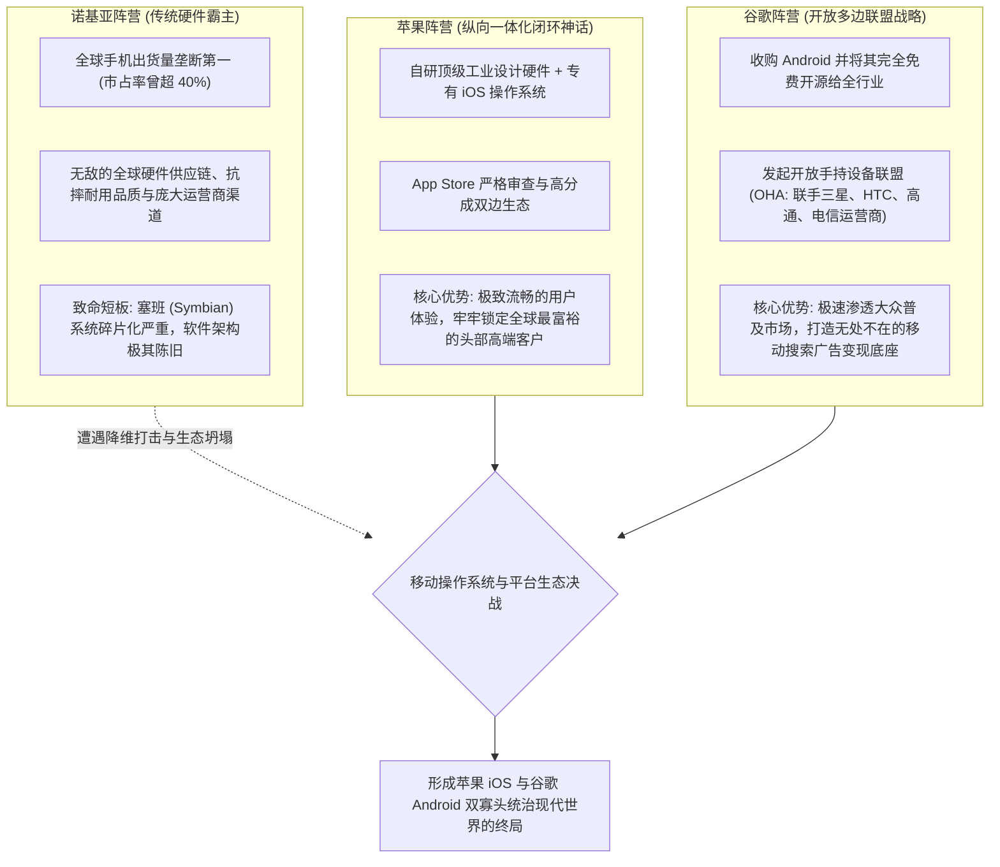

# Lec 15 移动终端三国杀：诺基亚、苹果与谷歌的战略决战 (Mobile Wars: Nokia, Apple, and Google)

> MIT Sloan School of Management · 15.912 Strategic Management of Innovation · Prof. Fiona Murray & Prof. Rebecca Henderson

## TL;DR

- 商业史上最宏伟的技术战略大决战：传统硬件王者诺基亚、纵向一体化苹果与开放开源巨头谷歌。
- 诺基亚的黄昏：死守塞班（Symbian）过时架构，深陷硬件供应链与运营商绑定的创新者窘境。
- 苹果 iPhone 的降维打击：将多点触控硬件、iOS 操作系统与 App Store 双边开发者生态融为一体。
- 谷歌 Android 的合纵连横：以开放源代码联盟（OHA）团结全天下硬件厂商与电信运营商，实现农村包围城市。

## 移动计算纪元的黎明与三大巨人的碰撞 / The Dawn of the Mobile Computing Era

在 2007 年至 2011 年的短短四年间，全球商业舞台上演了人类科技史上最波澜壮阔、也最具戏剧性的一场战略大厮杀——**全球智能手机三国决战（The Mobile Wars）**。

这场战争不仅涉及数万亿美元的终端市场规模，更决定了未来三十年人类数字生活基础设施的终极控制权。从芬兰埃斯波的诺基亚总部，到加州库比蒂诺的苹果园区，再到山景城的谷歌大楼，三大商业巨人分别调动了人类工业文明在硬件制造、工业设计、操作系统和互联网云计算领域的全部精锐力量。

在移动互联网爆发前夜，手机行业曾经被公认为是一个完全由电信运营商和传统硬件供应链主导的成熟市场。然而，触控交互革命、应用商店经济学与全天候移动在线的结合，彻底颠覆了既有的产业边界，迫使传统通信硬件王者、硅谷个人计算先驱与互联网搜索引擎霸主在一块小小的 3.5 英寸屏幕上展开殊死较量。

麻省理工学院 15.912 课程的第十五讲，将三大巨头置于同一战略显微镜下，深入解剖不同技术战略范式在面对代际跃迁时的生死对抗：

这场决战的结局举世震惊：曾经无可匹敌的诺基亚帝国在短短几年内分崩离析走向卖身，而苹果与谷歌则分别在高端利润与大众普及率两个维度上平分天下。通过深入推演三大巨头的战略轨迹，学员们得以看清平台生态战的核心本质。

## 诺基亚的溃败：硬件帝国为何死于软件生态盲区？ / Why the Titan Nokia Fell

在 iPhone 发布之初，诺基亚的高管们在公开场合充满了不屑：“iPhone 连基本的防摔测试都通不过，电池只能用半天，没有物理键盘，根本算不上合格的手机。”

菲奥娜·莫雷教授深入拆解了导致诺基亚迅速崩塌的四大组织与战略毒瘤：
1. **架构认知盲区**：诺基亚坚信自己是一家“硬件制造与供应链公司”，其核心能力是压低每部手机的塑料外壳和射频天线成本；而苹果与谷歌从第一天起就清楚地知道，**智能手机的本质是一台装在口袋里的通用计算机，竞争的胜负在操作系统和应用软件层决出！**
2. **塞班系统（Symbian）的技术债务山穷水尽**：塞班诞生于黑白屏九宫格时代，其底层代码充斥着数十万个补丁，无法支持流畅的多点触控和现代多任务处理。开发一个最简单的全触摸界面，在塞班上需要编写数千行复杂的底层 C++ 代码，导致第三方软件开发者苦不堪言；
3. **组织政治内耗与自满**：诺基亚内部按功能手机与智能手机划分事业部，各部门副总裁为了保住当季硬件出货量提成，疯狂阻挠对下一代纯触控系统（如 MeeGo）的集中投资；
4. **傲慢与运营商绑架**：诺基亚习惯于听从电信运营商的严苛定制要求（为运营商预装大量无用的垃圾定制软件），完全丧失了对终端消费者极致体验的同理心。

## 苹果 vs. 谷歌：两种截然不同商业哲学的终极对决 / Apple vs. Google: Divergent Ecosystem Philosophies

在这场史诗级对决中，苹果与谷歌展现了商业世界两套截然相反、却各自取得极高成就的顶层战略范式：

| 战略比较维度 | 苹果战略模式 (Apple's Playbook) | 谷歌战略模式 (Google's Playbook) |
| :--- | :--- | :--- |
| **德尔塔定位** | **系统锁定 + 专有高品质解决方案** | **系统锁定 + 开放平台网络效应** |
| **商业变现核心** | 单件硬件超额暴利（占据全行业 85%+ 的硬件利润）+ App Store 30% 抽成 | 硬件完全不赚钱，靠底层预装 Google 移动服务（GMS）攫取全球移动搜索与广告巨额流水 |
| **生态控制权** | **绝对中央集权（花园围墙 Walled Garden）**：严格的人工代码审查，所有接口专有闭源 | **高度分权与开放（Open Source Platform）**：代码开源，允许手机厂商深度自由魔改 UI |
| **目标客户群** | 全球具有极高支付意愿的高净值人群与高端专业用户 | 从百元机到旗舰机全覆盖的全球数十亿普罗大众 |
| **主要战略脆弱点** | 过于依赖单一硬件机型的持续惊艳；面临全球反垄断监管对“苹果税”的重锤敲打 | 硬件生态严重碎片化（Fragmentation），系统升级滞后，低端机型体验良莠不齐 |

::: example 埃里克·施密特与安迪·鲁宾的闪电反应
在 2007 年 1 月乔布斯发布 iPhone 的当天，时任 Android 负责人安迪·鲁宾（Andy Rubin）正在一辆开往拉斯维加斯参加 CES 的汽车上。鲁宾看完了乔布斯的演讲直播后，立即要求司机把车停在路边，并对身边的工程师说：“天哪，我们必须推迟发布原定带有全键盘的黑莓式 Android 原型机，我们要把整套操作系统推倒重来，全面转向多点触控！”正是这种面对颠覆性创新的极端清醒与自我革命的魄力，让谷歌在最短时间内调转船头，最终挽救了 Android 项目并成就了日后的霸业。
:::

## 我的理解与实践洞察 / Personal Insight

移动三国杀，是商业史上对“战略预判与生态思维”最壮丽的注解。

::: insight 商业竞争的终局，从来不是产品比产品，而是生态战生态
当诺基亚还在津津乐道自己的手机能挡子弹、能砸核桃时，它根本没有意识到自己的对手早已不是另一款手机，而是一个由成千上万名全球应用开发者、音乐人、设计师与互联网服务商共同编织的庞大生态网络！
**单打独斗的英雄，哪怕浑身是铁，也绝不可能战胜一整个高度进化的协同生态圈**。
苹果用极致的美学与严密的秩序建立了一座令人心驰神往的数字紫禁城，谷歌用海纳百川的胸怀与开源的力量建立起一座无边无际的全球数字集市。这两大巨头在战壕中教会了全世界：唯有将你的根系深扎进全球开发者的智慧土壤中，企业才能立于不败之地。
:::

## 思考题与实战研讨

1. 2011 年，前微软高管斯蒂芬·埃洛普（Stephen Elop）空降诺基亚担任 CEO，并发表了著名的《燃烧的平台（Burning Platform）》备忘录，随后决定放弃自研系统全面拥抱微软 Windows Phone。结合本讲理论，分析为什么这一决策最终成为了加速诺基亚帝国灭亡的催化剂？
2. 在当前全球人工智能（AI）大模型的竞争格局中，OpenAI（软硬件深度绑定的闭源路线）与 Meta Llama（免费开源大模型路线）的对峙，在多大程度上复刻了当年苹果 iOS 与谷歌 Android 的移动操作系统生态之战？
